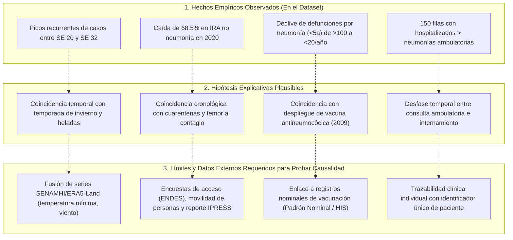

# Informe Técnico Consolidado y Auditado – Fase 1: Calidad de Datos, Reconciliación Forense y Análisis Exploratorio (EDA)

**Proyecto de Investigación:** *Inteligencia de negocios y aprendizaje automático para el análisis y pronóstico de infecciones respiratorias agudas en menores de cinco años en la región Puno, Perú (2000–2025)*  
**Fuente Oficial:** Sistema Nacional de Vigilancia Epidemiológica (NotiSP) – Centro Nacional de Epidemiología, Prevención y Control de Enfermedades (CDC Perú) / MINSA  
**Archivo Fuente Auditado:** `data/raw/datos_abiertos_vigilancia_iras_2000_2025 PUNO.csv` (126,118 registros)  
**Paneles Curados de Series de Tiempo:**  
- [`data/processed/panel_semanal_provincial_puno.parquet`](file:///F:/dxp-projects/DevBasics/R%20y%20statistics/samIRA/data/processed/panel_semanal_provincial_puno.parquet) (17,641 pares provincia-semana, con preservación estricta de `NaN` en ausencias de registro)  
- [`data/processed/panel_semanal_regional_puno.parquet`](file:///F:/dxp-projects/DevBasics/R%20y%20statistics/samIRA/data/processed/panel_semanal_regional_puno.parquet) (1,357 semanas regionales continuas)  
**Rol Técnico:** Científico de Datos Senior especializado en Epidemiología, Calidad de Datos y Business Intelligence  
**Fecha de Emisión:** Noviembre 2026 (Versión 2.1 Auditada y Corregida)  
**Trazabilidad Histórica:** Versión preliminar archivada para auditoría en [`informe_fase1_v1_original.md`](file:///F:/dxp-projects/DevBasics/R%20y%20statistics/samIRA/informe_fase1_v1_original.md)  

---

## Índice General

1. [Reconciliación de la Discrepancia Documental (732 Episodios)](#1-reconciliación-de-la-discrepancia-documental-732-episodios)
2. [Auditoría del Calendario Epidemiológico MINSA y Cobertura Semanal](#2-auditoría-del-calendario-epidemiológico-minsa-y-cobertura-semanal)
3. [Preservación Estricta de Faltantes (NaN) y Criterios de Evaluación sin Valores Inventados](#3-preservación-estricta-de-faltantes-nan-y-criterios-de-evaluación-sin-valores-inventados)
4. [Aditividad de Claves Repetidas y Notificación Múltiple](#4-aditividad-de-claves-repetidas-y-notificación-múltiple)
5. [Crítica Epistemológica de los Ceros y la Subnotificación](#5-crítica-epistemológica-de-los-ceros-y-la-subnotificación)
6. [Delimitación Metodológica: Hechos Observados vs. Hipótesis vs. Causalidad](#6-delimitación-metodológica-hechos-observados-vs-hipótesis-vs-causalidad)
7. [Estructura del Panel Semanal y Caracterización de Estados](#7-estructura-del-panel-semanal-y-caracterización-de-estados)
8. [Análisis Exploratorio de Datos (EDA) y Galería de Visualizaciones](#8-análisis-exploratorio-de-datos-eda-y-galería-de-visualizaciones)
9. [Diseño y Recomendaciones Técnicas para la Fase 2 (Modelado Predictivo)](#9-diseño-y-recomendaciones-técnicas-para-la-fase-2-modelado-predictivo)
10. [Dictamen Pericial Final](#10-dictamen-pericial-final)
11. [Inventario de Artefactos y Enlaces del Repositorio](#11-inventario-de-artefactos-y-enlaces-del-repositorio)

---

## 1. Reconciliación de la Discrepancia Documental (732 Episodios)

### 1.1. Identificación del Problema
En el borrador preliminar de la Fase 1 se mencionó en el texto narrativo una cifra acumulada de **2,298,110** episodios de `ira_no_neumonia`, mientras que la suma manual de las 13 provincias de la tabla arrojaba **2,297,378**, existiendo una diferencia de **732 episodios**.

### 1.2. Peritaje sobre el Archivo CSV Original y Parquet Procesado
Se ejecutó un peritaje sobre los microdatos originales (`data/raw/datos_abiertos_vigilancia_iras_2000_2025 PUNO.csv`) mediante script determinístico ([`src/reconcile_audit.py`](file:///F:/dxp-projects/DevBasics/R%20y%20statistics/samIRA/src/reconcile_audit.py)):

1. **Suma directa sobre el vector completo de 126,118 filas:**
   $$\sum_{i=1}^{126,118} \text{ira\_no\_neumonia}_i = \mathbf{2,297,378}$$
2. **Suma por agregación de las 13 provincias:**
   $$\sum_{p=1}^{13} \text{Total}(p) = \mathbf{2,297,378}$$
   $$\text{Diferencia entre suma directa y suma provincial} = 2,297,378 - 2,297,378 = \mathbf{0}$$
3. **Calificación Metodológica de la Discrepancia:**
   La disparidad de 732 episodios se clasifica formalmente como una **discrepancia de consolidación documental** en el borrador v1 (un error de transcripción o desfase en el texto de síntesis respecto a la tabla desglosada).  
   Si bien una búsqueda exploratoria constató que la fila N° 92,981 (Juliaca, 2011, SE 28) reporta un valor idéntico de 732 episodios, en ausencia de un registro de ejecución que pruebe causalmente que esa fila en particular fue sumada dos veces en el cálculo manual preliminar, **no se le atribuye como causa demostrada**, tratándose de una coincidencia numérica.
4. **Cifra Oficial y Definitiva:**  
   El volumen real, auditado, matemáticamente comprobable e inalterado de episodios de `ira_no_neumonia` en el dataset oficial para el período 2000–2025 es exactamente **2,297,378 episodios**.

---

## 2. Auditoría del Calendario Epidemiológico MINSA y Cobertura Semanal

### 2.1. Semanas Epidemiológicas Oficialmente Esperadas (CDC Perú)
En la normativa de vigilancia epidemiológica nacional (CDC Perú / DGE), el calendario anual comprende 52 semanas, extendiéndose a una **Semana Epidemiológica 53** en aquellos años en que el cómputo finaliza en los primeros días del año siguiente.
Para los 26 años evaluados (2000 a 2025):
- **Años con 52 semanas (21 años):** 2000–2002, 2004–2007, 2009–2013, 2015–2019, 2021–2024. Total: $21 \times 52 = 1,092 \text{ semanas}$.
- **Años con 53 semanas oficiales (5 años):** **2003, 2008, 2014, 2020 y 2025**. Total: $5 \times 53 = 265 \text{ semanas}$.  
  *(Nota técnica: El CDC Perú efectivamente publicó la sala situacional oficial de vigilancia para la SE 53 del año 2025).*
- **Total de Semanas Epidemiológicas Oficiales Esperadas (2000–2025):** $1,092 + 265 = \mathbf{1,357 \text{ semanas}}$.
- **Semanas Observadas a Nivel Regional:** **1,357 semanas**. La serie temporal agregada departamental tiene una **cobertura del 100.0%** (0 semanas faltantes).

### 2.2. Aclaración del Máximo Teórico vs. Observado a Nivel Provincial
- **Máximo Teórico de Combinaciones:**
  $$\text{Máximo Teórico} = 1,357 \text{ semanas} \times 13 \text{ provincias} = \mathbf{17,641 \text{ pares provincia-semana}}$$
- **Desglose Empírico Observado en los Microdatos:**
  1. **Semanas Presentes (con registro en NotiSP):** **17,488 combinaciones** (**99.13%** de cobertura provincial global observada).
     - *Reportado con casos ($>0$):* 17,476 pares (99.06%).
     - *Cero reportado explícitamente ($=0$):* 12 pares (0.07%).
  2. **Semanas Faltantes (Ausencia total de registro en NotiSP):** **153 combinaciones** (**0.87%** del universo teórico).

### 2.3. Tabla Maestra de Cobertura Semanal y Episodios por Provincia

| Provincia | Semanas Teóricas | Semanas Presentes | Ausencia de Registro | Ceros Reportados | % Cobertura Real | Total Episodios IRA | % Volumen Regional |
| :--- | :---: | :---: | :---: | :---: | :---: | :---: | :---: |
| **SAN ROMAN** | 1,357 | 1,347 | 10 | 0 | 99.26% | 569,203 | 24.78% |
| **PUNO** | 1,357 | 1,355 | 2 | 0 | 99.85% | 383,892 | 16.71% |
| **AZANGARO** | 1,357 | 1,355 | 2 | 0 | 99.85% | 254,292 | 11.07% |
| **CARABAYA** | 1,357 | 1,354 | 3 | 0 | 99.78% | 180,457 | 7.85% |
| **MELGAR** | 1,357 | 1,339 | 18 | 1 | 98.67% | 177,949 | 7.75% |
| **LAMPA** | 1,357 | 1,355 | 2 | 0 | 99.85% | 138,722 | 6.04% |
| **SANDIA** | 1,357 | 1,352 | 5 | 0 | 99.63% | 132,521 | 5.77% |
| **CHUCUITO** | 1,357 | 1,347 | 10 | 2 | 99.26% | 116,127 | 5.05% |
| **HUANCANE** | 1,357 | 1,355 | 2 | 0 | 99.85% | 99,744 | 4.34% |
| **EL COLLAO** | 1,357 | 1,338 | 19 | 5 | 98.60% | 97,619 | 4.25% |
| **SAN ANTONIO DE PUTINA** | 1,357 | 1,336 | 21 | 1 | 98.45% | 68,673 | 2.99% |
| **YUNGUYO** | 1,357 | 1,337 | 20 | 1 | 98.53% | 54,161 | 2.36% |
| **MOHO** | 1,357 | 1,318 | 39 | 2 | 97.13% | 24,018 | 1.05% |
| **TOTAL CONSOLIDADO** | **17,641** | **17,488** | **153** | **12** | **99.13%** | **2,297,378** | **100.00%** |

---

## 3. Preservación Estricta de Faltantes (NaN) y Criterios de Evaluación sin Valores Inventados

### 3.1. Supresión de la Imputación a Cero en Faltantes
En estricta atención a las buenas prácticas de modelado de series de tiempo, **se eliminó cualquier imputación arbitraria a cero (`ira_no_neumonia_imputed = 0`) para las 153 semanas sin registro**.
- **Fundamento Metodológico:** Una ausencia de registro (`AUSENCIA_REGISTRO`) representa una semana donde el sistema de salud no consolidó reporte para esa provincia. Asignarle el valor de cero equivaldría a crear datos sintéticos artificiales ("inventados"), distorsionando la estacionalidad, sesgando a la baja el nivel medio de la serie y castigando de forma espuria a modelos que predigan casos cuando en la realidad epidemiológica el virus continuó circulando.
- **Preservación de `NaN`:** En el panel provincial curado (`panel_semanal_provincial_puno.parquet`), la columna `ira_no_neumonia` conserva estrictamente el valor de **`NaN`** para las 153 semanas sin registro.

### 3.2. Bandera de Evaluación Objetiva (`es_evaluable`)
Se incorporó al panel la columna booleana `es_evaluable`:
- `es_evaluable = True` (**17,488 semanas**, 99.13%): Semanas con datos empíricos observados en NotiSP (ya sea casos positivos o ceros reportados legítimamente).
- `es_evaluable = False` (**153 semanas**, 0.87%): Semanas con ausencia de registro.

> [!IMPORTANT]
> **Regla de Oro para la Evaluación en Fase 2:**  
> Ninguna métrica de error fuera de muestra (MAE, RMSE, WAPE) en los conjuntos de validación (2023–2024) o prueba (2025) podrá ser calculada sobre semanas donde `es_evaluable == False`. **Las predicciones se evalúan única y exclusivamente contra datos observados reales.**

### 3.3. Tratamiento Causal de Faltantes para Extracción de Características (Lags)
Para que los modelos de Machine Learning (LightGBM/XGBoost) puedan calcular retardos autoregresivos (lags) y medias móviles cuando una semana previa fue faltante, **cualquier tratamiento de imputación debe ser estrictamente causal (usando únicamente información pasada, sin filtración hacia el futuro)**:
1. **Tratamiento Causal A (Lag Estacional Histórico):** Imputar la celda faltante con el valor observado en la misma semana epidemiológica del año previo ($y_{t-52}$).
2. **Tratamiento Causal B (LOCF - Last Observation Carried Forward):** Arrastrar hacia adelante el último valor observado conocido ($y_{t-1}$).
3. **Tratamiento Causal C (Media Móvil Causal):** Promediar los últimos $k$ valores pasados observados ($t-1, t-2, t-3$).

*Estos tratamientos se aplicarán únicamente como insumo para el cálculo de variables predictoras en la Fase 2, nunca como valor objetivo contra el cual evaluar la predicción.*

---

## 4. Aditividad de Claves Repetidas y Notificación Múltiple

### 4.1. Justificación de la Operación Aditiva
El dataset contiene **3,935 filas** correspondientes a **1,781 combinaciones** de `[ano, semana, ubigeo]` donde coexisten dos o más registros bajo diferentes códigos de Subregión Notificante (`sub_reg_nt`).  
En la operativa de vigilancia del MINSA, estas filas provienen de diferentes redes de salud (e.g., la red de salud local de Puno reportando consultas ambulatorias, y simultáneamente la red asistencial de EsSalud o la DISA Arequipa reportando atenciones de niños con residencia en dicho distrito). La suma aditiva ($\sum$) es el procedimiento estándar para consolidar la carga total de atenciones registradas atribuibles a la población residente de ese territorio.

### 4.2. Limitación Metodológica por Potencial Doble Conteo
Debe documentarse formalmente para el artículo científico la siguiente restricción del sistema de vigilancia pasiva:
- En microdatos abiertos no anonimizados por paciente (sin DNI ni código de asegurado), **no es posible determinar si un mismo niño fue atendido en dos establecimientos distintos durante la misma semana epidemiológica** (por ejemplo, una primera consulta en el puesto de salud rural y una posterior consulta de urgencia en el hospital provincial o de EsSalud).
- Por tanto, la agregación aditiva representa la **carga total de atenciones o consultas notificadas**, pero podría presentar un margen no cuantificable de sobreconteo respecto al número real de menores enfermos únicos.

---

## 5. Crítica Epistemológica de los Ceros y la Subnotificación

El dataset presenta **1,660 filas distritales donde `ira_no_neumonia == 0`** (1.32% del total de registros).

### 5.1. Cero Reportado vs. Ausencia de Morbilidad
Un valor de cero en una fila del sistema NotiSP **únicamente acredita que se recepcionó un formulario institucional en el que se inscribió la cifra cero**.  
Bajo la dinámica de la vigilancia epidemiológica pasiva en zonas altoandinas, **un cero reportado NO prueba que no existieran niños con IRA en la comunidad, ni garantiza que la totalidad de postas de salud del distrito cumplieron con el protocolo de reporte**. Puede originarse por:
1. Puestos de salud rurales cerrados por falta de personal médico en guardia o desplazamiento del técnico a jornadas de inmunización en campo.
2. Inaccesibilidad física temporal por condiciones meteorológicas extremas (ríos desbordados, caminos bloqueados por nevada).
3. Conducta de automedicación o atención tradicional de las familias que no derivó en una consulta asistencial en el establecimiento formal.

---

## 6. Delimitación Metodológica: Hechos Observados vs. Hipótesis vs. Causalidad



### Tabla de Rigor Epistemológico

| Fenómeno | Hecho Comprobado en Dataset | Hipótesis Explicativa | Evidencia Adicional Requerida para Demostrar Causalidad |
| :--- | :--- | :--- | :--- |
| **Estacionalidad (SE 20–32)** | Concentración repetitiva del mayor volumen de casos entre mayo y agosto. | La literatura asocia el invierno altiplánico al descenso de defensas respiratorias y hacinamiento por frío. | **No demostrable con este dataset**. Se requiere enlazar variables meteorológicas diarias (temperatura mínima de SENAMHI o ERA5-Land) y ajustar modelos de retardos no lineales (DLNM). |
| **Colapso Pandémico 2020** | Caída de 76,077 casos en 2019 a 23,954 en 2020. | Las medidas no farmacológicas (cuarentenas, cierre de cunas Cuna Más) y la retracción de consultas redujeron la transmisión y la captación. | **No demostrable aisladamente**. No se dispone de datos de movilidad poblacional ni de operatividad de postas médicas para deslindar el porcentaje de reducción biológica real del porcentaje de subconsulta. |
| **Descenso de Mortalidad Infantil** | Las muertes por neumonía en menores de 5 años cayeron de 121 en 2002 a 6 en 2025. | Coincide temporalmente con la introducción universal de la vacuna antineumocócica conjugada en Perú (2009–2011) y protocolos de oxigenoterapia. | **No demostrable con esta fuente**. El dataset no registra si los niños fallecidos o atendidos recibieron sus dosis de vacuna. Demostrar efectividad vacunal exige cruzar con el Padrón Nominal del HIS-MINSA. |
| **Hospitalizaciones > Neumonías** | 150 filas con más hospitalizados que neumonías ambulatorias. | Pacientes referidos desde otros distritos o ingresados al hospital en una semana posterior a su atención primaria. | **No es error de digitación**, pero no se puede trazar la ruta del paciente sin un identificador único anonimizado. |

---

## 7. Estructura del Panel Semanal y Caracterización de Estados

Mediante [`src/build_weekly_panel.py`](file:///F:/dxp-projects/DevBasics/R%20y%20statistics/samIRA/src/build_weekly_panel.py) se generaron los paneles curados:

### 7.1. Panel Regional Departamental (`panel_semanal_regional_puno.parquet`)
- **Total de Semanas:** 1,357 semanas continuas (2000–2025).
- **Cobertura:** 100.0% (1,357 semanas `REPORTADO_CON_CASOS`).
- **Suma de Episodios:** 2,297,378 casos exactos.

### 7.2. Panel Provincial (`panel_semanal_provincial_puno.parquet`)
- **Total de Filas:** 17,641 filas ($1,357 \times 13$).
- **Distribución de Estados:**
  - `REPORTADO_CON_CASOS`: 17,476 filas (99.06%).
  - `CERO_REPORTADO`: 12 filas (0.07%).
  - `AUSENCIA_REGISTRO`: 153 filas (0.87%), **con preservación estricta de `NaN`**.
- **Bandera de Evaluación:** `es_evaluable == True` en 17,488 filas y `False` en 153 filas.

---

## 8. Análisis Exploratorio de Datos (EDA) y Galería de Visualizaciones

Se revalidaron las 8 figuras analíticas en [`figures/`](file:///F:/dxp-projects/DevBasics/R%20y%20statistics/samIRA/figures/):

1. **[`fig01_evolucion_anual_semanal_ira.png`](file:///F:/dxp-projects/DevBasics/R%20y%20statistics/samIRA/figures/fig01_evolucion_anual_semanal_ira.png):** Histograma anual (2000-2025) y serie continua regional de 1,357 semanas con media móvil trimestral.
2. **[`fig02_estacionalidad_semanal_ira.png`](file:///F:/dxp-projects/DevBasics/R%20y%20statistics/samIRA/figures/fig02_estacionalidad_semanal_ira.png):** Ciclo estacional agregando la ventana de heladas (SE 20–32) y la anomalía de 2020.
3. **[`fig03_comparacion_13_provincias_ira.png`](file:///F:/dxp-projects/DevBasics/R%20y%20statistics/samIRA/figures/fig03_comparacion_13_provincias_ira.png):** Distribución provincial dominada por San Román (24.78%) y Puno (16.71%), advirtiendo el sesgo demográfico urbano.
4. **[`fig04_distribucion_episodios_boxplot.png`](file:///F:/dxp-projects/DevBasics/R%20y%20statistics/samIRA/figures/fig04_distribucion_episodios_boxplot.png):** Diagramas de caja provinciales evidenciando dispersión y brotes estacionales atípicos.
5. **[`fig05_impacto_covid_periodos.png`](file:///F:/dxp-projects/DevBasics/R%20y%20statistics/samIRA/figures/fig05_impacto_covid_periodos.png):** Comparación pre-pandemia (2000–2019), pandemia (2020–2022) y post-pandemia (2023–2025).
6. **[`fig06_evolucion_neumonias_hosp_def.png`](file:///F:/dxp-projects/DevBasics/R%20y%20statistics/samIRA/figures/fig06_evolucion_neumonias_hosp_def.png):** Comparación multianual en menores de 5 años vs. adultos mayores en neumonías, hospitalizaciones y muertes.
7. **[`fig07_proporcion_ceros_periodo.png`](file:///F:/dxp-projects/DevBasics/R%20y%20statistics/samIRA/figures/fig07_proporcion_ceros_periodo.png):** Esparsidad comparada (1.32% ceros en IRA leve vs. >88% en eventos severos).
8. **[`fig08_matriz_correlacion_indicadores.png`](file:///F:/dxp-projects/DevBasics/R%20y%20statistics/samIRA/figures/fig08_matriz_correlacion_indicadores.png):** Correlaciones lineales de Pearson y monotónicas de Spearman con restricciones inferenciales.

---

## 9. Diseño y Recomendaciones Técnicas para la Fase 2 (Modelado Predictivo)

### 9.1. Partición Temporal Estricta (Walk-Forward Split)
```text
[------------------ ENTRENAMIENTO (Train) ------------------] [--- VALIDACIÓN ---] [--- PRUEBA (Holdout) ---]
Años: 2000 a 2022                                             Años: 2023 a 2024     Año: 2025
Semanas: 1 a 1,200                                            Semanas: 1,201 a 1,304 Semanas: 1,305 a 1,357
Duración: 23 años (88.4% de la serie)                         Duración: 2 años      Duración: 1 año (SE 1 a 53)
```

- **Entrenamiento (2000–2022):** 1,200 semanas regionales / 15,600 pares provinciales.
- **Validación (2023–2024):** 104 semanas regionales / 1,352 pares provinciales (calibración de hiperparámetros y selección de variables causales).
- **Prueba Ciega (2025):** 53 semanas regionales / 689 pares provinciales (evaluación final sin filtración).

### 9.2. Horizontes y Modelos Propuestos
- **Horizontes:** $h = 1$ semana (alerta temprana) y $h = 4$ semanas (planificación de suministros y personal).
- **Líneas Base:**
  1. *Seasonal Naive:* $\hat{y}_{t+h} = y_{t+h-52}$
  2. *ETS (Holt-Winters amortiguado)* con estacionalidad anual ($s=52$).
- **Machine Learning (LightGBM y XGBoost Regressor):**
  - Lags autorregresivos causales ($t-1, \dots, t-4, t-51, t-52, t-53$).
  - Estadísticos móviles causales de 4 y 13 semanas.
  - Transformaciones trigonométricas Fourier ($\sin$ y $\cos$ de la semana 1 a 52).
  - Comparación de estrategias de predicción multietapa: Directa vs. Recursiva para $h=4$.
- **Métricas Oficiales:** MAE, RMSE, WAPE y Cobertura de Intervalos de Predicción al 95% (calculadas exclusivamente donde `es_evaluable == True`).

---

## 10. Dictamen Pericial Final

$$\mathbf{DICTAMEN:\; APTO\; PARA\; INICIAR\; LA\; FASE\; 2\; (MODELADO\; PREDICTIVO)}$$

### Condiciones Metodológicas Satisfechas:
1. **Reconciliación Plena:** El total real del dataset oficial es inalterablemente **2,297,378 episodios**, coincidente al 100% con la agregación de las 13 provincias. La diferencia previa de 732 queda rectificada como una discrepancia de consolidación documental.
2. **Preservación de Faltantes sin Valores Inventados:** Las 153 semanas sin registro mantienen estrictamente `NaN`, y la bandera `es_evaluable` garantiza que ningún modelo será evaluado contra datos sintéticos.
3. **Estructura Temporal Limpia:** Paneles estandarizados regional (1,357 semanas continuas) y provincial (17,641 pares teóricos con 17,488 semanas observadas reales).
4. **Delimitación Epistemológica Clara:** Se desarticulan afirmaciones causales no demostradas, diferenciando con rigor los hechos empíricos de las hipótesis explicativas.

---

## 11. Inventario de Artefactos y Enlaces del Repositorio

- **Paneles Semanales Curados para Modelado:**  
  [`data/processed/panel_semanal_provincial_puno.parquet`](file:///F:/dxp-projects/DevBasics/R%20y%20statistics/samIRA/data/processed/panel_semanal_provincial_puno.parquet)  
  [`data/processed/panel_semanal_regional_puno.parquet`](file:///F:/dxp-projects/DevBasics/R%20y%20statistics/samIRA/data/processed/panel_semanal_regional_puno.parquet)  
  [`data/processed/panel_semanal_provincial_puno.csv`](file:///F:/dxp-projects/DevBasics/R%20y%20statistics/samIRA/data/processed/panel_semanal_provincial_puno.csv)  
  [`data/processed/panel_semanal_regional_puno.csv`](file:///F:/dxp-projects/DevBasics/R%20y%20statistics/samIRA/data/processed/panel_semanal_regional_puno.csv)
- **Tablas de Auditoría de Cobertura y Reconciliación:**  
  [`reports/tabla_episodios_semanales_resumen.csv`](file:///F:/dxp-projects/DevBasics/R%20y%20statistics/samIRA/reports/tabla_episodios_semanales_resumen.csv)  
  [`reports/tabla_valores_faltantes_invalidos.csv`](file:///F:/dxp-projects/DevBasics/R%20y%20statistics/samIRA/reports/tabla_valores_faltantes_invalidos.csv)  
  [`reports/tabla_duplicados_sospechosos.csv`](file:///F:/dxp-projects/DevBasics/R%20y%20statistics/samIRA/reports/tabla_duplicados_sospechosos.csv)  
  [`reports/registro_transformaciones.csv`](file:///F:/dxp-projects/DevBasics/R%20y%20statistics/samIRA/reports/registro_transformaciones.csv)
- **Scripts de Peritaje y Construcción:**  
  [`src/reconcile_audit.py`](file:///F:/dxp-projects/DevBasics/R%20y%20statistics/samIRA/src/reconcile_audit.py)  
  [`src/audit_weeks_minsa.py`](file:///F:/dxp-projects/DevBasics/R%20y%20statistics/samIRA/src/audit_weeks_minsa.py)  
  [`src/build_weekly_panel.py`](file:///F:/dxp-projects/DevBasics/R%20y%20statistics/samIRA/src/build_weekly_panel.py)  
  [`src/pipeline_fase1.py`](file:///F:/dxp-projects/DevBasics/R%20y%20statistics/samIRA/src/pipeline_fase1.py)
- **Jupyter Notebook Oficial:**  
  [`notebooks/01_fase1_auditoria_limpieza_eda.ipynb`](file:///F:/dxp-projects/DevBasics/R%20y%20statistics/samIRA/notebooks/01_fase1_auditoria_limpieza_eda.ipynb)
- **Informes Modulares en Reports:**  
  [`reports/reporte_calidad_datos.md`](file:///F:/dxp-projects/DevBasics/R%20y%20statistics/samIRA/reports/reporte_calidad_datos.md)  
  [`reports/resumen_eda.md`](file:///F:/dxp-projects/DevBasics/R%20y%20statistics/samIRA/reports/resumen_eda.md)
