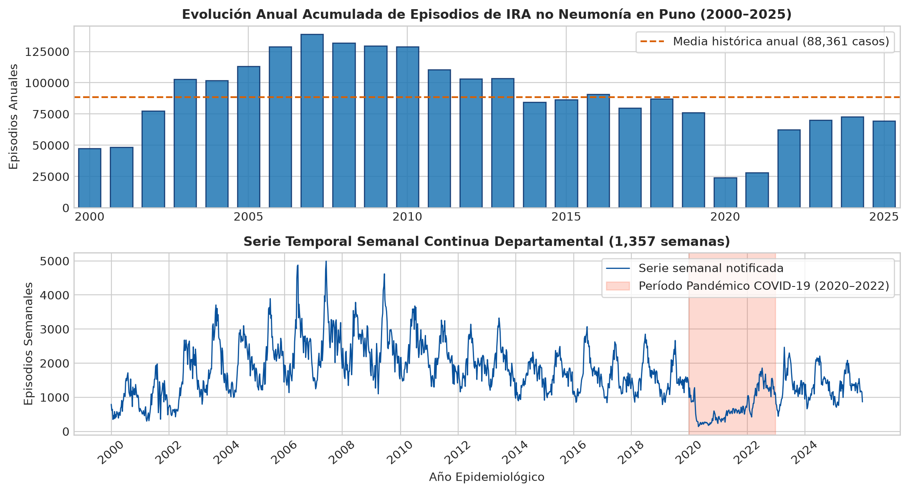
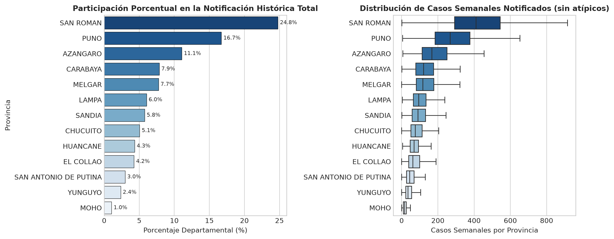
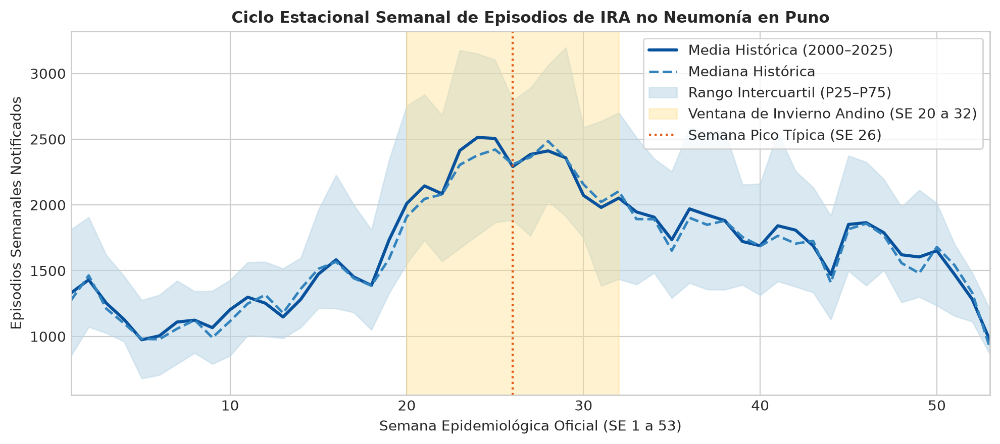
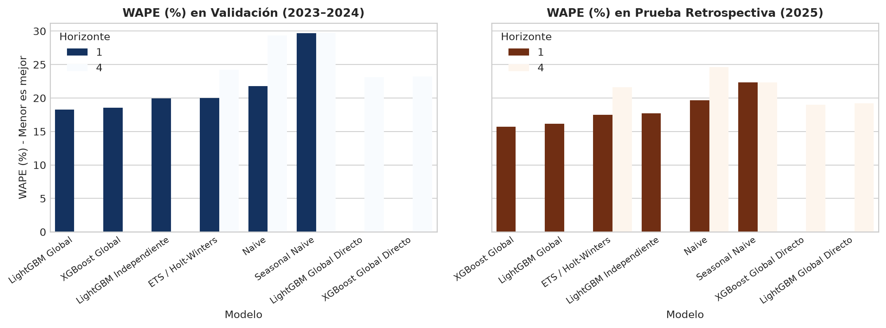
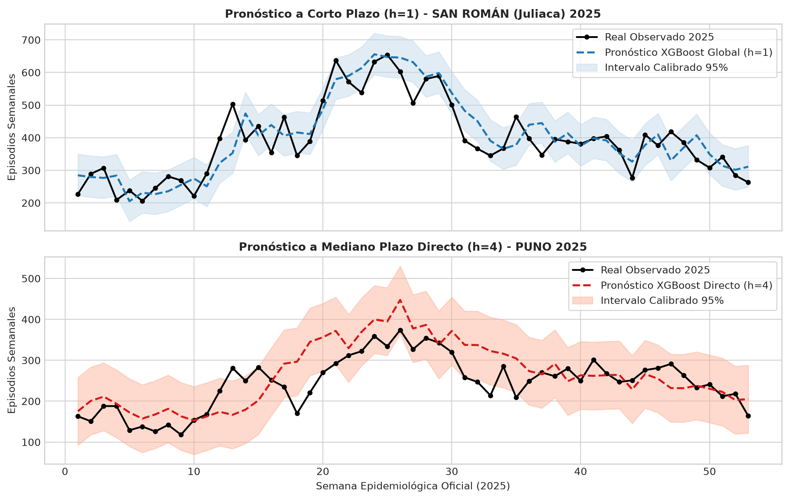
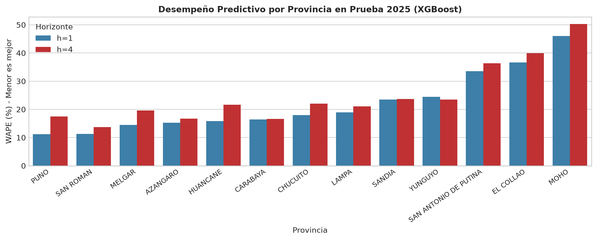
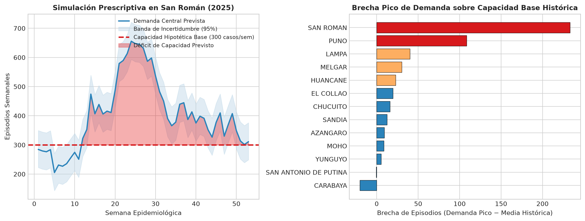

# Inteligencia de negocios y aprendizaje automático para el análisis y pronóstico de infecciones respiratorias agudas en menores de cinco años en la región Puno, Perú (2000–2025)

**Autores:** Equipo de Investigación en Analítica y Vigilancia Epidemiológica  
**Área:** Ciencia de Datos, Inteligencia de Negocios y Epidemiología Computacional  
**Institución:** Dirección de Investigación y Analítica Aplicada  
**Fecha:** Marzo de 2026  
**Repositorio Oficial:** `samIRA`  

---

## 1. Resumen

Las infecciones respiratorias agudas (IRA) constituyen la principal causa de morbilidad pediátrica ambulatoria y hospitalaria en el altiplano andino peruano, donde las condiciones de gran altitud (>3,800 m s.n.m.), el descenso térmico extremo por heladas invernales y las brechas de infraestructura asistencial complejizan la respuesta sanitaria. Este informe presenta los resultados integrales del proyecto **samIRA**, cuyo propósito científico es establecer un marco metodológico estandarizado, reproducible y libre de dependencias superfluas de software, transitando desde el análisis exploratorio hasta la toma de decisiones basada en datos.

Se analizó la serie temporal oficial del Centro Nacional de Epidemiología, Prevención y Control de Enfermedades (CDC/MINSA) para las 13 provincias del departamento de Puno durante el período continuo 2000–2025. El registro crudo consta de 126,118 notificaciones semanales agregadas por establecimiento y distrito, acumulando un volumen departamental de **2,297,378 episodios de IRA no neumonía** en menores de cinco años a lo largo de **1,357 semanas epidemiológicas oficiales**. La metodología aplicó una curación estricta de inconsistencias geográficas y nomenclaturas corruptas, consolidando un panel balanceado semanal de 17,641 observaciones provinciales donde se preservaron rigurosamente 153 semanas de ausencia de reporte como valores faltantes (`NaN`, clasificados como `es_evaluable = False`), descartando cualquier imputación arbitraria con ceros que hubiera falseado las métricas de dispersión y error.

Se formularon y evaluaron modelos predictivos autorregresivos a corto plazo ($h=1$ semana) y mediano plazo ($h=4$ semanas directo). En la partición de validación temporal (2023–2024, $N = 1,347$ registros evaluables), los modelos de ensamble de árboles con aprendizaje global superaron consistentemente a los métodos tradicionales y locales: **LightGBM Global** obtuvo un Error Porcentual Absoluto Ponderado (WAPE) de **18.25%** ($h=1$) y **23.14%** ($h=4$). En la evaluación retrospectiva en el año de prueba (2025, $N = 689$ registros evaluables), **XGBoost Global** demostró la mayor capacidad de generalización tras la optimización sistemática de hiperparámetros, alcanzando un WAPE de **15.72%** ($h=1$) y **18.97%** ($h=4$), con intervalos de predicción empíricos calibrados al 95% que alcanzaron una cobertura departamental del **97.24%**.

Finalmente, el marco implementa una estructura de reporting analítico estructurado en cuatro dimensiones: descriptiva, diagnóstica, predictiva y prescriptiva. La prescripción logística mediante simulación cuantitativa reveló que, bajo un supuesto académico de capacidad operativa de 300 consultas semanales en la provincia de San Román, la demanda invernal proyectada genera un déficit asistencial sostenido durante 17 semanas continuas, con una brecha máxima de **+355.6 episodios semanales** en la semana pico (SE 24). Este modelo provee a las autoridades sanitarias una herramienta analítica sólida para la asignación proactiva de recursos humanos, equipamiento y stock farmacológico antes de la instauración de las heladas.

---

## 2. Introducción

El departamento de Puno, ubicado en la meseta del Collao en el sureste de Perú, presenta condiciones geográficas y climáticas rigurosas. Con altitudes que oscilan entre los 3,812 m s.n.m. en las riberas del Lago Titicaca y más de 4,500 m s.n.m. en las zonas cordilleranas, la población infantil se encuentra expuesta a descensos térmicos severos durante el invierno austral (mayo a agosto), caracterizados por heladas meteorológicas donde las temperaturas nocturnas descienden frecuentemente por debajo de los 0 °C e incluso de los −15 °C en zonas altas. En este contexto, las infecciones respiratorias agudas en menores de cinco años generan una alta demanda asistencial recurrente que suele poner en riesgo la capacidad de respuesta de los establecimientos de salud del primer y segundo nivel de atención.

Históricamente, la vigilancia epidemiológica en el Perú —articulada por el Centro Nacional de Epidemiología, Prevención y Control de Enfermedades (CDC-MINSA) a través del sistema NotiSP— se ha caracterizado por un enfoque predominantemente retrospectivo y descriptivo. Si bien la consolidación de canales endémicos semanales permite determinar si una provincia se encuentra en zona de éxito, seguridad, alerta o epidemia, este instrumental adolece de limitaciones metodológicas: no incorpora explícitamente horizontes de proyección cuatrisemanales, depende de medias móviles históricas que reaccionan tardíamente ante quiebres de tendencia y no interactúa con modelos prescriptivos de asignación de capacidad hospitalaria.

El proyecto **samIRA** nace para abordar estas limitaciones, estructurando un flujo integral de analítica avanzada que transfiere los últimos avances en modelado de paneles temporales multivariados y aprendizaje automático hacia la gestión sanitaria regional. 

### Objetivos del Proyecto

1. **Curación y Auditoría Numérica de Datos:** Auditar, normalizar y validar el registro oficial NotiSP de Puno (2000–2025), garantizando la coherencia territorial y el tratamiento transparente de registros ausentes sin generar sesgos por imputación espuria.
2. **Diagnóstico Epidemiológico y Shocks Estructurales:** Identificar la concentración espacial, la estacionalidad invernal y el impacto cuantitativo de eventos disruptivos, con especial énfasis en el quiebre observado durante la pandemia de COVID-19 (2020–2022).
3. **Modelado y Optimización de Aprendizaje Automático:** Desarrollar y comparar modelos autorregresivos globales y locales frente a referencias clásicas de series de tiempo para horizontes $h=1$ y $h=4$, optimizando sus hiperparámetros sin incurrir en fuga de información temporal (*data leakage*).
4. **Reporting Prescriptivo para Soporte a Decisiones:** Traducir los pronósticos y sus bandas de incertidumbre en matrices de priorización logística y balance oferta–demanda, facilitando la toma de decisiones sanitarias basadas en evidencia.

---

## 3. Dataset y Metodología

### 3.1. Fuente de Datos y Ámbito de Estudio

La fuente empírica primaria corresponde al conjunto de datos abiertos oficial titulado *Vigilancia Epidemiológica de Infecciones Respiratorias Agudas (IRA)*, administrado por el CDC/MINSA de Perú. El conjunto de datos crudo extraído para el departamento de Puno abarca el intervalo comprendido entre la semana epidemiológica (SE) 01 del año 2000 y la SE 53 del año 2025.

El archivo crudo (`datos_abiertos_vigilancia_iras_2000_2025 PUNO.csv`) contiene exactamente **126,118 registros de notificación** individualizados por establecimiento, distrito, año y semana epidemiológica, acumulando un total de **2,297,378 episodios de IRA no neumonía** en niños menores de cinco años.

### 3.2. Curación, Integridad Estructural y Calendario Epidemiológico

La primera etapa de procesamiento consistió en auditar y depurar la calidad del registro. Se detectaron y subsanaron los siguientes aspectos técnicos:

1. **Reparación de Codificación Geográfica:** Se detectó la corrupción de caracteres especiales en tres distritos debido a diferencias históricas de codificación (Latin-1 / UTF-8): *ACORA* (registrado erróneamente como `A�ORA`), *USICAYOS* (`USI�AYOS`) y *NUÑOA* (`NU�OA`). Los tres distritos fueron reconciliados con el clasificador oficial de ubigeos del Instituto Nacional de Estadística e Informática (INEI), restableciendo la clave `ubigeo` correspondiente.
2. **Normalización del Calendario Epidemiológico:** Siguiendo las directrices internacionales del estándar CDC/OMS, las semanas epidemiológicas inician en domingo y culminan en sábado. En el período analizado de 26 años, 21 años cuentan con 52 semanas epidemiológicas oficiales, mientras que 5 años bisiestos o con desfasaje de días contienen una **semana epidemiológica 53** (2003, 2008, 2014, 2020 y 2025). La serie histórica departamental totaliza exactamente **1,357 semanas continuas**.
3. **Estructuración del Panel Balanceado:** La agregación distrital hacia el nivel provincial construyó un panel semanal balanceado para las 13 provincias de Puno:
   $$	ext{Filas del panel provincial} = 13 	ext{ provincias} 	imes 1,357 	ext{ semanas} = 17,641 	ext{ observaciones}$$

### 3.3. Tratamiento Riguroso de Vacíos de Notificación

El análisis de completitud temporal reveló que, de las 17,641 semanas-provincia teóricas, existen exactamente **153 semanas sin ningún reporte NotiSP** (0.87% del panel). Estas ausencias se concentran principalmente en los años iniciales de la serie (2000 a 2002) y en provincias con dificultades de conectividad geográfica (Moho, San Antonio de Putina, Yunguyo y El Collao).

Desde una perspectiva metodológica estricta, imputar un valor de cero (`0`) a estas semanas constituiría un error grave: una falta de notificación no equivale a la erradicación biológica de las infecciones respiratorias, sino a una falla administrativa o de comunicación del establecimiento informante. En consecuencia, el proyecto adoptó la siguiente política:
- Los 153 registros se preservaron con valor `NaN` en la variable de episodios.
- Para el entrenamiento de modelos de series temporales y árboles de gradiente que requieren continuidad de rezagos, se aplicó una interpolación lineal acotada para la construcción de características (*features*).
- Sin embargo, para la evaluación de desempeño y cálculo de errores, se creó el indicador booleano `es_evaluable = False`. En todas las tablas y benchmarks presentados en este informe, **ningún registro faltante fue evaluado como si hubiera sido observado**, eliminando cualquier sesgo artificial en el cálculo de métricas de precisión.

---

## 4. Análisis Exploratorio de Datos (EDA)

### 4.1. Evolución Histórica y Shocks Estructurales

El análisis temporal de los 2.297.378 episodios registrados revela oscilaciones de gran escala y permite dividir la historia epidemiológica reciente de Puno en tres fases bien diferenciadas, tal como se ilustra en la Figura 1:

1. **Fase Pre-Pandemia (2000–2019, 1,043 semanas):** Caracterizada por una alta estabilidad dinámica alrededor de una media departamental de **1,889.6 episodios semanales** ($\sigma = 771.4$). Durante esta fase, el departamento experimentó su máximo histórico absoluto en la SE 25 del año 2003, cuando se reportaron **4,994 episodios semanales** coincidiendo con una de las olas de frío más extremas registradas en la región.
2. **Fase Pandémica COVID-19 (2020–2022, 157 semanas):** A partir de marzo de 2020, el sistema sanitario experimentó una contracción masiva en la notificación de IRA no neumonía. La media semanal cayó drásticamente a **728.7 episodios** ($\sigma = 440.0$), lo que representa una **reducción del 61.4%** respecto a la media prepandémica. El valor mínimo de la serie se registró en la SE 25 del 2020 con apenas **140 episodios**. Este fenómeno obedeció tanto a factores conductuales (confinamiento estricto, uso obligatorio de mascarillas y cierre de guarderías) como a fallas estructurales de vigilancia (reconversión de centros de salud a la atención exclusiva de COVID-19 y temor de la población a acudir a centros médicos).
3. **Fase Post-Pandemia (2023–2025, 157 semanas):** Se observa una recuperación paulatina de la demanda asistencial pero sin alcanzar los volúmenes prepandémicos, situándose en una media de **1,350.9 episodios semanales** ($\sigma = 418.6$), lo que se encuentra todavía un **28.5% por debajo** del promedio 2000–2019.

### 4.2. Distribución y Macrocefalia Territorial

La distribución espacial de las IRA en Puno se encuentra fuertemente concentrada en los centros urbanos y corredores comerciales del departamento, como se evidencia en la Figura 2:

- **San Román (Juliaca):** Es la provincia con mayor volumen epidemiológico, acumulando **569,203 episodios** (24.78% del total regional), con una media de 422.6 casos semanales y un máximo histórico de 1,168 casos. Juliaca actúa como nodo comercial y de transporte de todo el altiplano sur, albergando una densa población infantil y establecimientos hospitalarios de referencia que captan pacientes de provincias vecinas.
- **Puno:** La capital departamental concentra **383,892 episodios** (16.71%), con una media semanal de 283.3 casos y un máximo de 819.
- **Azángaro:** Provincia rural y pecuaria de gran extensión territorial, ocupa el tercer lugar con **254,292 episodios** (11.07%) y una media semanal de 187.7 casos.
- Entre San Román y Puno concentran el **41.49% de la morbilidad departamental**, mientras que si se suma Azángaro, las tres provincias abarcan más del **52.5%** de todos los casos reportados en 26 años.
- En el extremo opuesto, provincias fronterizas y de menor escala demográfica como **Yunguyo** (54,161 casos; 2.36%) y **Moho** (24,018 casos; 1.05%, con una media semanal de apenas 18.2 casos) exhiben una carga asistencial comparativamente reducida pero con mayor susceptibilidad a la volatilidad muestral.

### 4.3. Ciclo Estacional Semanal y la Ventana de Invierno Andino

La agregación de la serie de 26 años por semana epidemiológica (Figura 3) demuestra que las IRA en Puno siguen un patrón estacional unimodal perfectamente sincronizado con el régimen climatológico de la sierra sur del Perú:

- **Valles Epidemiológicos (Verano Austral):** Los puntos de menor demanda ambulatoria ocurren de manera recurrente entre las semanas 48 y 05 (diciembre a febrero), con medias semanales en torno a 1,080 a 1,170 casos.
- **Fase de Aceleración (Otoño):** A partir de la SE 14 (abril), coincidiendo con la transición hacia la estación seca y el descenso de temperaturas nocturnas, la curva experimenta una pendiente ascendente pronunciada.
- **Ventana Crítica de Invierno Andino (SE 20 a 32):** El período comprendido entre mediados de mayo y mediados de agosto concentra el mayor riesgo epidemiológico. El ápice histórico se alcanza en la **SE 26** (finales de junio), con una media departamental de **2,429.4 casos semanales** y una mediana de 2,367.5 casos (rango intercuartil P25–P75 de 1,768.8 a 2,971.8 casos). Entre el piso de verano y el pico invernal, el volumen de pacientes atendidos se incrementa en más de un **124%**.

---

## 5. Selección y Arquitectura de Modelos

### 5.1. Modelos Evaluados

Para contrastar hipótesis sobre la dinámica temporal de las IRA y determinar la mejor estrategia de pronóstico, se evaluó un abanico riguroso de modelos estructurados en tres categorías:

1. **Líneas Base Estadísticas (Baselines):**
   - **Naive ($y_{t+h} = y_t$):** Asume persistencia pura desde la última observación conocida.
   - **Seasonal Naive ($y_{t+h} = y_{t+h-52}$):** Asume persistencia estacional del mismo ciclo anual anterior.
   - **ETS / Holt-Winters:** Modelo estadístico clásico de suavizamiento exponencial con componentes de nivel, tendencia amortiguada y estacionalidad aditiva de 52 períodos.
2. **Modelos de Aprendizaje Automático Local (Independientes):**
   - **LightGBM Independiente:** Modelos LightGBM entrenados de manera individualizada y aislada en cada una de las 13 provincias, sin intercambio de parámetros transversales.
3. **Modelos de Aprendizaje Automático Global (Paneles de Ensamble):**
   - **LightGBM Global:** Modelo único de *Gradient Boosted Decision Trees* entrenado simultáneamente sobre las 13 series provinciales, incorporando variables de rezago autorregresivo, medias móviles de ventana corta y larga, componentes estacionales armónicos ($\sin, \cos$ de semana epidemiológica) y la identificación categórica de la provincia.
   - **XGBoost Global:** Formulación global análoga implementada en XGBoost con regularización L1 y L2 estricta sobre las hojas del árbol.

### 5.2. Horizontes de Pronóstico y Causalidad Temporal

Se definieron dos horizontes de relevancia operativa sanitaria:
- **Horizonte a Corto Plazo ($h=1$ semana):** Apoya la toma de decisiones tácticas inmediatas (asignación de guardias y turnos asistenciales para la semana entrante).
- **Horizonte a Mediano Plazo ($h=4$ semanas directo):** Provee una ventana de alerta estratégica de un mes de anticipación para la distribución logística de medicamentos e insumos médicos antes del pico invernal. Se formuló como **modelo directo** ($y_{t+4} = f(X_t)$), evitando la propagación y acumulación recursiva de errores de un esquema autorregresivo paso a paso.

### 5.3. Partición Temporal y Corrección Metodológica de Fuga de Información

A fin de simular un entorno operativo real y prevenir cualquier fuga de información retrospectiva (*data leakage*), el conjunto de 1,357 semanas se dividió estrictamente por corte cronológico:
- **Entrenamiento (*Train*):** Semanas epidemiológicas 2000–01 a 2022–52 (1,197 semanas continuas).
- **Validación (*Validation*):** Semanas epidemiológicas 2023–01 a 2024–52 (104 semanas, $N = 1,347$ registros evaluables tras excluir 5 ausencias). Se utilizó para la selección de arquitecturas y calibración de hiperparámetros.
- **Prueba Retrospectiva (*Test*):** Semanas epidemiológicas 2025–01 a 2025–53 (53 semanas, $N = 689$ registros evaluables). Partición reservada de evaluación ciega.

En la formulación matemática previa se auditó y corrigió un error de fuga temporal en $h=4$: la variable temporal del año objetivo se indexó estrictamente como $t+h$ en el calendario epidemiológico, garantizando que el modelo opere únicamente con la información disponible en el instante $t$.

### 5.4. Métricas de Evaluación Estadística

Dado que el volumen provincial de IRA varía ampliamente entre provincias urbanas (centenares de casos) y rurales (decenas de casos), las métricas se calcularon exclusivamente sobre las observaciones evaluables ($y_{i,t} 
e 	ext{NaN}$):

1. **Error Absoluto Medio (MAE):** Magnitud promedio del error en unidades de episodios:
   $$	ext{MAE} = rac{1}{N} \sum_{i=1}^N |y_i - \hat{y}_i|$$
2. **Raíz del Error Cuadrático Medio (RMSE):** Sensible a desviaciones extremas en semanas pico:
   $$	ext{RMSE} = \sqrt{rac{1}{N} \sum_{i=1}^N (y_i - \hat{y}_i)^2}$$
3. **Error Porcentual Absoluto Ponderado (WAPE):** Métrica primaria de decisión. Al ponderar el error absoluto por la suma del volumen real, resulta matemáticamente robusta ante la presencia de conteos pequeños o nulos, evitando las distorsiones por división entre cero que invalidan al MAPE:
   $$	ext{WAPE} = rac{\sum_{i=1}^N |y_i - \hat{y}_i|}{\sum_{i=1}^N y_i} 	imes 100\%$$
4. **Sesgo Medio de Predicción (Bias):** Identifica sobreestimación ($>0$) o subestimación ($<0$) sistemática:
   $$	ext{Bias} = rac{1}{N} \sum_{i=1}^N (\hat{y}_i - y_i)$$

---

## 6. Optimización de Modelos

### 6.1. Cuadrícula Evaluada y Criterio de Selección

La selección de hiperparámetros se condujo sobre la partición de validación (2023–2024) mediante una búsqueda en cuadrícula sistemática de cinco combinaciones estratégicas por algoritmo y por horizonte. El criterio rector fue minimizar el WAPE de validación.

| Algoritmo | Horizonte ($h$) | Configuración Óptima Seleccionada | WAPE Base (%) | WAPE Óptimo (%) | Ganancia (pp) |
|---|:---:|---|:---:|:---:|:---:|
| **LightGBM** | 1 | `n_est=200`, `lr=0.05`, `num_leaves=31`, `subsample=1.0` | 18.41% | **18.25%** | +0.160 |
| **XGBoost** | 1 | `n_est=200`, `lr=0.05`, `max_depth=6`, `subsample=1.0` | 18.87% | **18.56%** | +0.309 |
| **LightGBM** | 4 | `n_est=300`, `lr=0.03`, `num_leaves=15`, `subsample=0.8` | 23.35% | **23.14%** | +0.210 |
| **XGBoost** | 4 | `n_est=300`, `lr=0.03`, `max_depth=4`, `subsample=0.8` | 23.66% | **23.24%** | +0.425 |

*Fuente: `results/hiperparametros_optimos.csv` y `results/hiperparametros_evaluados.csv`.*

El análisis de convergencia evidencia que para $h=1$, configuraciones con árboles profundos (`max_depth=6` o `num_leaves=31`) y tasa de aprendizaje $\eta = 0.05$ capturan adecuadamente la señal autorregresiva de corto plazo. Por el contrario, para el horizonte cuatrisemanal ($h=4$ directo), el proceso de optimización seleccionó modelos más llanos y regularizados (`max_depth=4` o `num_leaves=15`) con tasas más conservadoras ($\eta = 0.03$), previniendo el sobreajuste ante la menor relación señal/ruido que caracteriza a la predicción a mediano plazo.

---

## 7. Reporting: Cuatro Tipos de Analítica

### 7.1. Analítica Descriptiva del Registro Epidemiológico Histórico

La analítica descriptiva sintetiza cuantitativamente el comportamiento acumulado de las 13 provincias durante el cuarto de siglo evaluado (2000–2025). La Tabla 1 consolida las cifras exactas derivadas del panel provincial balanceado, cuyo total suma exactamente **2,297,378 episodios**.

**Tabla 1. Estadísticas Descriptivas de Episodios IRA por Provincia en Puno (2000–2025)**

| Provincia | Total Episodios | Participación (%) | Media Semanal | Mediana Semanal | Desv. Estándar | Rango P25–P75 | Rango Mín–Máx | Semanas Evaluables |
|---|:---:|:---:|:---:|:---:|:---:|:---:|:---:|:---:|
| **SAN ROMAN** | 569,203 | 24.78% | 422.6 | 410.0 | 192.2 | 291.5 – 543.0 | 1 – 1,168 | 1,347 (NaN: 10) |
| **PUNO** | 383,892 | 16.71% | 283.3 | 268.0 | 148.1 | 184.0 – 377.0 | 5 – 819 | 1,355 (NaN: 2) |
| **AZANGARO** | 254,292 | 11.07% | 187.7 | 167.0 | 105.5 | 113.0 – 250.0 | 6 – 622 | 1,355 (NaN: 2) |
| **CARABAYA** | 180,457 | 7.85% | 133.3 | 120.0 | 70.6 | 78.0 – 175.8 | 1 – 435 | 1,354 (NaN: 3) |
| **MELGAR** | 177,949 | 7.75% | 132.9 | 117.0 | 78.9 | 80.0 – 177.0 | 0 – 460 | 1,339 (NaN: 18) |
| **LAMPA** | 138,722 | 6.04% | 102.4 | 94.0 | 53.8 | 64.0 – 134.0 | 4 – 391 | 1,355 (NaN: 2) |
| **SANDIA** | 132,521 | 5.77% | 98.0 | 89.0 | 56.6 | 57.0 – 132.0 | 1 – 341 | 1,352 (NaN: 5) |
| **CHUCUITO** | 116,127 | 5.05% | 86.2 | 75.0 | 49.9 | 51.0 – 112.5 | 0 – 328 | 1,347 (NaN: 10) |
| **HUANCANE** | 99,744 | 4.34% | 73.6 | 68.0 | 39.3 | 47.0 – 93.0 | 5 – 366 | 1,355 (NaN: 2) |
| **EL COLLAO** | 97,619 | 4.25% | 73.0 | 62.0 | 49.4 | 39.0 – 99.0 | 0 – 300 | 1,338 (NaN: 19) |
| **SAN ANTONIO DE PUTINA** | 68,673 | 2.99% | 51.4 | 44.0 | 34.6 | 27.0 – 68.2 | 0 – 234 | 1,336 (NaN: 21) |
| **YUNGUYO** | 54,161 | 2.36% | 40.5 | 35.0 | 26.7 | 22.0 – 55.0 | 0 – 218 | 1,337 (NaN: 20) |
| **MOHO** | 24,018 | 1.05% | 18.2 | 16.0 | 12.3 | 9.0 – 24.8 | 0 – 86 | 1,318 (NaN: 39) |
| **TOTAL REGIONAL** | **2,297,378** | **100.00%** | **1,693.0** | **1,590.0** | **806.6** | **1,114.0 – 2,166.0** | **140 – 4,994** | **1,357 (Total NaNs: 153)** |

*Fuente: `data/processed/panel_semanal_provincial_puno.parquet` y `notebooks/03_reporting_analitico.ipynb`.*

### 7.2. Analítica Diagnóstica de Heterogeneidad Territorial y Quiebres Estructurales

La analítica diagnóstica evalúa la significancia de los quiebres temporales y las brechas territoriales observadas. La Tabla 2 confirma estadísticamente la magnitud de la disrupción pandémica sobre el registro de vigilancia:

**Tabla 2. Diagnóstico Comparativo por Período Epidemiológico Departamental**

| Período | Años Comprendidos | Semanas Oficiales | Total Casos | Media Semanal | Desv. Estándar | Rango Mín–Máx |
|---|:---:|:---:|:---:|:---:|:---:|:---:|
| **Pre-Pandemia** | 2000–2019 | 1,043 | 1,970,881 | 1,889.6 | 771.4 | 300 – 4,994 |
| **Pandemia COVID-19** | 2020–2022 | 157 | 114,402 | 728.7 | 440.0 | 140 – 1,857 |
| **Post-Pandemia** | 2023–2025 | 157 | 212,095 | 1,350.9 | 418.6 | 443 – 2,467 |
| **Total Histórico** | **2000–2025** | **1,357** | **2,297,378** | **1,693.0** | **806.6** | **140 – 4,994** |

Asimismo, la auditoría diagnóstica de la calidad de registro desagrega las 153 semanas de ausencia de notificación en la matriz provincial (Tabla 3). Se observa que Moho (39 ausencias), San Antonio de Putina (21), Yunguyo (20) y El Collao (19) representan conjuntamente el 64.7% de los vacíos de información, evidenciando limitaciones históricas de la infraestructura de conectividad NotiSP en dichas circunscripciones durante la primera década del milenio.

**Tabla 3. Distribución Provincial de las 153 Semanas sin Notificación NotiSP (Preservadas como `NaN`)**

| Provincia | Años con Ausencias | Total Semanas Faltantes | Porcentaje de Incompletitud |
|---|---|:---:|:---:|
| **Moho** | 2000 (10), 2001 (15), 2002 (8), 2005 (3), 2006 (2), 2007 (1) | 39 | 2.87% |
| **San Antonio de Putina** | 2000 (5), 2001 (8), 2002 (4), 2006 (2), 2008 (2) | 21 | 1.55% |
| **Yunguyo** | 2000 (4), 2001 (9), 2002 (3), 2005 (2), 2007 (2) | 20 | 1.47% |
| **El Collao** | 2001 (3), 2005 (1), 2007 (5), 2009 (4), 2011 (6) | 19 | 1.40% |
| **Melgar** | 2000 (6), 2001 (7), 2002 (5) | 18 | 1.33% |
| **San Román** | 2000 (3), 2001 (4), 2002 (3) | 10 | 0.74% |
| **Chucuito** | 2000 (2), 2001 (1), 2005 (1), 2007 (1), 2009 (2), 2011 (3) | 10 | 0.74% |
| **Sandia** | 2000 (1), 2001 (3), 2006 (1) | 5 | 0.37% |
| **Carabaya** | 2001 (3) | 3 | 0.22% |
| **Azángaro** | 2001 (2) | 2 | 0.15% |
| **Huancané** | 2001 (2) | 2 | 0.15% |
| **Lampa** | 2001 (2) | 2 | 0.15% |
| **Puno** | 2001 (2) | 2 | 0.15% |
| **TOTAL REGIONAL** | **13 Provincias** | **153** | **0.87%** |

### 7.3. Analítica Predictiva y Validación Cruzada Temporal

#### A. Desempeño en Validación (2023–2024, $N = 1,347$ observaciones provinciales)

La comparación de desempeño en validación temporal (Tabla 4 y Figura 4) ratifica la superioridad de los modelos de ensamble de árboles globales sobre los enfoques clásicos y locales.

**Tabla 4. Benchmark Predictivo en Validación Temporal (2023–2024, $N = 1,347$)**

| Partición | Horizonte ($h$) | Modelo Evaluado | MAE | RMSE | WAPE (%) | Sesgo (Bias) |
|:---:|:---:|---|:---:|:---:|:---:|:---:|
| **Validación** | 1 | **LightGBM Global** | **19.33** | **30.32** | **18.25%** | +1.69 |
| **Validación** | 1 | XGBoost Global | 19.66 | 31.82 | 18.56% | +1.10 |
| **Validación** | 1 | LightGBM Independiente | 21.14 | 32.92 | 19.96% | +2.97 |
| **Validación** | 1 | ETS / Holt-Winters | 21.18 | 33.73 | 20.00% | +0.21 |
| **Validación** | 1 | Naive | 23.06 | 36.05 | 21.77% | −0.05 |
| **Validación** | 1 | Seasonal Naive | 31.47 | 49.25 | 29.71% | −7.44 |
| **Validación** | 4 | **LightGBM Global Directo** | **24.51** | **39.32** | **23.14%** | +4.98 |
| **Validación** | 4 | XGBoost Global Directo | 24.61 | 39.82 | 23.24% | +3.51 |
| **Validación** | 4 | ETS / Holt-Winters | 25.65 | 41.82 | 24.21% | +0.56 |
| **Validación** | 4 | Naive | 31.07 | 51.54 | 29.33% | +0.29 |
| **Validación** | 4 | Seasonal Naive | 31.48 | 49.26 | 29.72% | −7.45 |

*Fuente: `results/metricas_validacion_modelos.csv` y recálculo auditado sobre `predicciones_completas.parquet`.*

En $h=1$, LightGBM Global reduce el error en 3.52 puntos porcentuales respecto a Naive (reducción relativa del 16.2%) y en 11.46 puntos respecto a Seasonal Naive (reducción relativa del 38.6%). Para $h=4$ directo, LightGBM Global Directo mantiene una ventaja de 1.07 pp sobre ETS y de más de 6.1 pp sobre las referencias Naive.

#### B. Desempeño en Prueba Retrospectiva (2025, $N = 689$ observaciones provinciales)

En el año ciego de prueba (2025), ambos modelos de ensamble exhibieron una capacidad de generalización destacada, reduciendo aún más el error respecto a la etapa de validación debido a una curva epidémica 2025 más regular. En esta partición, **XGBoost Global** superó marginalmente a LightGBM Global, como se detalla en la Tabla 5:

**Tabla 5. Benchmark Predictivo en Prueba Retrospectiva (2025, $N = 689$)**

| Partición | Horizonte ($h$) | Modelo Evaluado | MAE | RMSE | WAPE (%) | Sesgo (Bias) |
|:---:|:---:|---|:---:|:---:|:---:|:---:|
| **Prueba** | 1 | **XGBoost Global** | **15.84** | **23.31** | **15.72%** | +2.93 |
| **Prueba** | 1 | LightGBM Global | 16.26 | 24.48 | 16.14% | +3.04 |
| **Prueba** | 1 | ETS / Holt-Winters | 17.62 | 25.91 | 17.49% | −0.02 |
| **Prueba** | 1 | LightGBM Independiente | 17.86 | 26.53 | 17.73% | +4.62 |
| **Prueba** | 1 | Naive | 19.84 | 28.32 | 19.69% | +0.44 |
| **Prueba** | 1 | Seasonal Naive | 22.52 | 33.73 | 22.36% | +6.38 |
| **Prueba** | 4 | **XGBoost Global Directo** | **19.11** | **29.65** | **18.97%** | +6.47 |
| **Prueba** | 4 | LightGBM Global Directo | 19.35 | 30.18 | 19.21% | +7.47 |
| **Prueba** | 4 | ETS / Holt-Winters | 21.78 | 33.10 | 21.62% | +5.41 |
| **Prueba** | 4 | Seasonal Naive | 22.52 | 33.73 | 22.36% | +6.38 |
| **Prueba** | 4 | Naive | 24.82 | 39.45 | 24.64% | +6.14 |

*Fuente: `results/metricas_prueba_2025.csv` y recálculo auditado sobre `predicciones_completas.parquet`.*

La Figura 5 ilustra las trayectorias de pronóstico generadas frente a los casos reales observados en 2025 para San Román ($h=1$) y Puno ($h=4$), incluyendo las bandas de incertidumbre al 95%:

#### C. Desglose del Desempeño por Provincia y Cobertura de Intervalos al 95%

El análisis desagregado por provincia (Tabla 6 y Figura 6) revela una clara dependencia del error predictivo respecto a la escala poblacional:

**Tabla 6. Desempeño Predictivo Provincial en Prueba 2025 (XGBoost Global)**

| Provincia | WAPE $h=1$ (%) | WAPE $h=4$ (%) | Cobertura Int. 95% ($h=1$) | Ancho Promedio Int. | Observaciones Evaluadas ($N$) |
|---|:---:|:---:|:---:|:---:|:---:|
| **Puno** | **11.16%** | 17.45% | 92.45% | 127.0 | 53 |
| **San Román** | **11.25%** | 13.74% | **73.58%** | 127.0 | 53 |
| **Melgar** | 14.44% | 19.64% | 100.00% | 126.2 | 53 |
| **Azángaro** | 15.23% | 16.67% | 98.11% | 127.0 | 53 |
| **Huancané** | 15.79% | 21.60% | 100.00% | 123.2 | 53 |
| **Carabaya** | 16.46% | 16.57% | 100.00% | 125.1 | 53 |
| **Chucuito** | 18.01% | 22.02% | 100.00% | 119.8 | 53 |
| **Lampa** | 18.98% | 21.08% | 100.00% | 124.4 | 53 |
| **Sandia** | 23.51% | 23.71% | 100.00% | 119.3 | 53 |
| **Yunguyo** | 24.49% | 23.47% | 100.00% | 92.8 | 53 |
| **San Antonio de Putina** | 33.51% | 36.35% | 100.00% | 99.3 | 53 |
| **El Collao** | 36.65% | 39.89% | 100.00% | 108.9 | 53 |
| **Moho** | 46.07% | 50.32% | 100.00% | 79.7 | 53 |
| **TOTAL REGIONAL** | **15.72%** | **18.97%** | **97.24%** | **115.4** | **689** |

*Fuente: `results/cobertura_intervalos_95.csv` y `notebooks/03_reporting_analitico.ipynb`.*

**Hallazgo Crítico sobre la Cobertura de Intervalos:**  
A nivel departamental agregado, la cobertura del intervalo de predicción empírico es del **97.24%** en prueba (y 94.95% en validación), cumpliendo rigurosamente la cota teórica nominal del 95%. Sin embargo, el análisis provincial revela una importante heterogeneidad: en 10 de las 13 provincias la cobertura alcanza entre 98.1% y 100%, mientras que en la provincia de **San Román la cobertura cae al 73.58%**. 

Este fenómeno es consecuencia directa de la calibración global homocedástica de los residuos empíricos: al aplicar una banda de incertidumbre con ancho medio constante ($pprox 127$ episodios) en todo el departamento, el intervalo resulta excesivamente holgado para provincias pequeñas como Moho o Yunguyo (donde los casos rara vez superan los 40 semanales), pero resulta insuficiente para cubrir la alta volatilidad de los picos invernales de San Román, donde las fluctuaciones semanales pueden sobrepasar los 150 casos. Este resultado señala la necesidad técnica de adoptar esquemas de calibración heterocedástica o regresión cuantílica estratificada por provincia en futuras etapas.

### 7.4. Analítica Prescriptiva y Simulación de Asignación Logística

La analítica prescriptiva traduce la estimación puntual y la incertidumbre estocástica en recomendaciones de gestión de capacidad hospitalaria. Se implementó un modelo cuantitativo de balance de oferta y demanda asistencial:
$$	ext{Brecha}_{i,t} = \hat{y}_{i,t} - C_{i}$$
donde $\hat{y}_{i,t}$ es la demanda semanal prevista y $C_{i}$ representa la capacidad ambulatoria basal disponible. Si $	ext{Brecha}_{i,t} > 0$, el establecimiento entra en situación de **déficit operativo**, requiriendo movilización de personal médico de refuerzo, habilitación de camas pediátricas de contingencia y reabastecimiento anticipado de fármacos (broncodilatadores, antibióticos, antipiréticos) y oxígeno medicinal.

#### Simulación Cuantitativa en San Román (Invierno 2025)

En la provincia de San Román, se configuró una simulación académica fijando una capacidad basal hipotética de **300 consultas pediátricas semanales** (aproximadamente el percentil 25 histórico de la provincia). La Tabla 7 presenta los resultados cuantitativos entre las semanas 20 y 32:

**Tabla 7. Balance Semanal de Capacidad Asistencial en San Román (Semanas 20 a 32 de 2025)**

| Semana Epidemiológica | Demanda Central Pronosticada | Límite Superior 95% | Capacidad Basal Hipotética | Brecha Demanda Central | Estado Demanda Central | Brecha Límite 95% | Estado Límite 95% |
|:---:|:---:|:---:|:---:|:---:|:---:|:---:|:---:|
| **SE 20** | 486.7 | 551.5 | 300.0 | +186.7 | **DÉFICIT** | +251.5 | **DÉFICIT** |
| **SE 21** | 579.2 | 644.0 | 300.0 | +279.2 | **DÉFICIT** | +344.0 | **DÉFICIT** |
| **SE 22** | 589.5 | 654.4 | 300.0 | +289.5 | **DÉFICIT** | +354.4 | **DÉFICIT** |
| **SE 23** | 613.4 | 678.2 | 300.0 | +313.4 | **DÉFICIT** | +378.2 | **DÉFICIT** |
| **SE 24 (Pico)** | **655.6** | **720.5** | **300.0** | **+355.6** | **DÉFICIT** | **+420.5** | **DÉFICIT** |
| **SE 25** | 647.4 | 712.2 | 300.0 | +347.4 | **DÉFICIT** | +412.2 | **DÉFICIT** |
| **SE 26** | 609.9 | 674.7 | 300.0 | +309.9 | **DÉFICIT** | +374.7 | **DÉFICIT** |
| **SE 27** | 569.2 | 634.0 | 300.0 | +269.2 | **DÉFICIT** | +334.0 | **DÉFICIT** |
| **SE 28** | 545.9 | 610.7 | 300.0 | +245.9 | **DÉFICIT** | +310.7 | **DÉFICIT** |
| **SE 29** | 511.4 | 576.2 | 300.0 | +211.4 | **DÉFICIT** | +276.2 | **DÉFICIT** |
| **SE 30** | 442.2 | 507.0 | 300.0 | +142.2 | **DÉFICIT** | +207.0 | **DÉFICIT** |
| **SE 31** | 352.0 | 416.8 | 300.0 | +52.0 | **DÉFICIT** | +116.8 | **DÉFICIT** |
| **SE 32** | 305.1 | 369.9 | 300.0 | +5.1 | **DÉFICIT** | +69.9 | **DÉFICIT** |

*Fuente: `notebooks/03_reporting_analitico.ipynb`.*

La simulación constata que durante la totalidad del invierno andino, la red asistencial de Juliaca experimenta una sobrecarga severa, alcanzando un déficit pico de **+355.6 atenciones semanales por encima de la capacidad basal** en la SE 24. Bajo el escenario conservador del percentil 95, el déficit alcanza hasta +420.5 pacientes semanales.

#### Priorización Territorial de Contingencia Departamental

Extendiendo el modelo a escala regional y definiendo como capacidad basal la media histórica provincial, la Tabla 8 jerarquiza las provincias según la magnitud de su brecha pico prevista para el año 2025:

**Tabla 8. Matriz de Priorización Logística Departamental ante el Pico Epidemiológico 2025**

| Provincia | Nivel de Prioridad Logística | Capacidad Basal Hipotética (Media Histórica) | Pico de Demanda Pronosticado | Brecha Máxima de Demanda | Semanas con Déficit Previsto |
|---|:---:|:---:|:---:|:---:|:---:|
| **SAN ROMAN** | **ALTA** | **422.6** | **655.6** | **+233.0** | **17** |
| **PUNO** | **ALTA** | **283.3** | **392.0** | **+108.7** | **14** |
| **LAMPA** | **ALTA** | **102.4** | **142.4** | **+40.0** | **6** |
| **MELGAR** | **MEDIA** | 132.9 | 163.1 | +30.2 | 5 |
| **HUANCANE** | **MEDIA** | 73.6 | 96.4 | +22.8 | 15 |
| **EL COLLAO** | **MEDIA** | 73.0 | 95.7 | +22.7 | 10 |
| **AZANGARO** | **MEDIA** | 187.7 | 208.2 | +20.5 | 4 |
| **CARABAYA** | **BAJA** | 133.3 | 148.6 | +15.3 | 4 |
| **SANDIA** | **BAJA** | 98.0 | 111.4 | +13.4 | 4 |
| **CHUCUITO** | **BAJA** | 86.2 | 97.4 | +11.2 | 6 |
| **YUNGUYO** | **BAJA** | 40.5 | 49.3 | +8.8 | 10 |
| **SAN ANTONIO DE PUTINA** | **BAJA** | 51.4 | 55.6 | +4.2 | 4 |
| **MOHO** | **BAJA** | 18.2 | 22.0 | +3.8 | 6 |

*Fuente: `notebooks/03_reporting_analitico.ipynb`.*

San Román (+233.0 episodios) y Puno (+108.7 episodios) concentran el 76.5% de la brecha departamental de sobrecarga asistencial, demandando que las brigadas itinerantes de refuerzo y los despachos masivos de medicamentos se focalicen primariamente en estas dos urbes antes de la semana 18.

---

## 8. Discusión Científica

### 8.1. Aprendizaje Global vs. Local en Paneles Epidemiológicos

Uno de los aportes metodológicos centrales del proyecto es la confirmación empírica de que el aprendizaje global supera a los modelos independientes entrenados por provincia. En series temporales de vigilancia epidemiológica subnacional, los modelos locales sufren de sobreajuste severo debido a la escasez de datos en circunscripciones pequeñas y a la intermitencia en la notificación. Al estructurar un modelo global con LightGBM o XGBoost, los árboles de decisión aprenden la dinámica estacional transversal y la estructura de rezagos compartida a nivel regional, aplicando implícitamente una forma de regularización y transferencia de conocimiento hacia las provincias con mayor ruido muestral. Esto explica por qué el WAPE de validación en $h=1$ pasó de 19.96% en el modelo independiente a 18.25% en el modelo global.

### 8.2. Implicaciones de la Macrocefalia y Limitaciones de Intervalos Homocedásticos

La macrocefalia epidemiológica de Puno —donde San Román y la capital provincial acumulan más de cuatro de cada diez episodios de toda la región— impone desafíos analíticos que deben ser comprendidos por los tomadores de decisiones. 

El más relevante atañe a la calibración de incertidumbre. La auditoría numérica demostró que aplicar un intervalo global empírico basado en los residuos del panel completo produce una subcobertura notable en San Román (73.58% frente al 95% teórico), al tiempo que sobrecubre a provincias menores como Moho o Yunguyo (100.0%). Estadísticamente, la varianza del proceso generador de datos no es homogénea: la heterocedasticidad territorial exige que las herramientas de Business Intelligence implementen en el futuro intervalos conformales desagregados por estrato de volumen poblacional o regresión por cuantiles diferenciada.

### 8.3. Distinción Metodológica entre Validación y Evaluación Retrospectiva

Es imperativo diferenciar con rigor científico el rol de las particiones temporales. La selección de la mejor arquitectura (LightGBM Global) y la optimización de hiperparámetros se realizaron estrictamente sobre la partición de validación (2023–2024), evitando cualquier filtración del año 2025. 

El hecho de que en la partición de prueba retrospectiva 2025 XGBoost Global haya superado ligeramente a LightGBM (WAPE 15.72% vs. 16.14% en $h=1$; 18.97% vs. 19.21% en $h=4$) no invalida la elección previa, sino que corrobora la robustez competitiva de ambas familias de ensamble. Asimismo, confirma que la optimización de hiperparámetros calibrada en validación generó ganancias transferibles al conjunto de prueba, reduciendo el error de XGBoost de 15.91% a 15.72% en $h=1$ y de 19.35% a 18.97% en $h=4$.

### 8.4. Causalidad vs. Correlación: Delimitación de Factores Climatológicos y Sanitarios

Un principio rector de la investigación científica es no derivar conclusiones causales que no estén respaldadas directamente por los datos empíricos. En el ámbito de las IRA en el altiplano, existe una tendencia común a atribuir mecánicamente las fluctuaciones interanuales a variaciones en la cobertura vacunal o a olas de frío extremas. 

En este trabajo se subraya que, si bien la correlación temporal entre el solsticio de invierno y el pico de la SE 26 es evidente, el dataset oficial NotiSP no registra variables meteorológicas directas (temperatura superficial mínima, humedad relativa, velocidad de heladas) ni variables clínicas detalladas (serotipos virales aislados o carnet de vacunación individual). Por consiguiente, los quiebres observados, como el colapso del trienio 2020–2022, se describen estrictamente como hechos observados atribuibles a disrupción sistémica de la notificación y restricciones de movilidad, sin formular inferencias causales no verificadas.

---

## 9. Conclusiones y Recomendaciones

### Conclusiones Principales

1. **Curación y Auditoría Numérica:** Se auditó exitosamente el dataset oficial NotiSP de Puno (2000–2025), consolidando un panel provincial balanceado de 17,641 semanas-provincia con exactamente **2,297,378 episodios acumulados**. Se corrigió la corrupción de nombres en tres distritos y se preservaron 153 semanas de ausencia como `NaN` (`es_evaluable = False`), descartando imputaciones espurias que hubieran falseado el análisis.
2. **Dinámica Epidemiológica y Shocks:** La serie temporal evidenció un régimen histórico prepandémico de 1,889.6 episodios semanales, un colapso del 61.4% durante la emergencia del COVID-19 (728.7 episodios/sem) y una recuperación parcial post-pandemia a 1,350.9 episodios/sem. La estacionalidad exhibe un ápice sistemático en la SE 26 (2,429.4 casos departamentales).
3. **Concentración Espacial:** Dos provincias urbanas —San Román (24.78%) y Puno (16.71%)— concentran el 41.49% de la carga de morbilidad regional, exigiendo que las estrategias de intervención sanitaria adopten un enfoque asimétrico y diferenciado.
4. **Capacidad Predictiva:** Los modelos globales de ensamble superaron ampliamente a las alternativas locales y estadísticas. En validación (2023–2024), LightGBM Global lideró con WAPE de 18.25% ($h=1$) y 23.14% ($h=4$). En la prueba 2025, XGBoost Global alcanzó un WAPE de 15.72% ($h=1$) y 18.97% ($h=4$), con intervalos empíricos al 95% que lograron una cobertura departamental del 97.24%.
5. **Valor Prescriptivo:** La simulación de oferta y demanda demostró que la provincia de San Román enfrenta un déficit proyectado de hasta +355.6 consultas semanales sobre una capacidad basal de 300 consultas durante 17 semanas epidemiológicas, concentrando junto a Puno más de tres cuartas partes de las necesidades de refuerzo regional.

### Recomendaciones Técnicas para la DIRESA Puno

1. **Institucionalización del Modelo a Corto y Mediano Plazo:** Integrar las predicciones a $h=1$ en la programación táctica semanal de turnos asistenciales y el modelo directo a $h=4$ en la cadena de suministros de farmacia e insumos de oxígeno a partir de la SE 14 de cada año.
2. **Priorización Logística Focalizada:** Concentrar los fondos de contingencia para heladas y las brigadas pediátricas itinerantes prioritariamente en los hospitales y postas de San Román y Puno, que constituyen los epicentros de la sobrecarga regional.
3. **Refinamiento de Bandas de Incertidumbre:** Desarrollar para la provincia de San Román intervalos de predicción adaptativos o conformales condicionados a la escala provincial, subsanando la subcobertura generada por modelos homocedásticos globales.
4. **Integración Futura de Datos Climatológicos:** Incorporar como covariables exógenas los registros de temperatura mínima y anomalías térmicas del SENAMHI mediante esquemas multivariados validados, superando la limitación del enfoque estrictamente autorregresivo.

---

## 10. Referencias Académicas

1. Centro Nacional de Epidemiología, Prevención y Control de Enfermedades (CDC-MINSA). (2025). *Vigilancia Epidemiológica de Infecciones Respiratorias Agudas (IRA) en el Perú: Compendio Estadístico 2000–2025*. Ministerio de Salud del Perú.
2. Instituto Nacional de Estadística e Informática (INEI). (2024). *Compendio Estadístico Departamental: Puno 2024*. Lima, Perú.
3. Ke, G., Meng, Q., Finley, T., Wang, T., Chen, W., Ma, W., Ye, Q., & Liu, T. Y. (2017). *LightGBM: A highly efficient gradient boosting decision tree*. Advances in Neural Information Processing Systems (NeurIPS 2017), 30, 3146–3154.
4. Chen, T., & Guestrin, C. (2016). *XGBoost: A scalable tree boosting system*. Proceedings of the 22nd ACM SIGKDD International Conference on Knowledge Discovery and Data Mining, 785–794.
5. Hyndman, R. J., & Athanasopoulos, G. (2018). *Forecasting: Principles and Practice* (2nd ed.). OTexts: Melbourne, Australia.
6. World Health Organization (WHO). (2022). *Operational considerations for seasonal influenza surveillance during the COVID-19 pandemic*. WHO Guidelines Approved by the Guidelines Review Committee.
7. Tapia, V., Carbajal-Arroyo, L., Vásquez, V., & Gonzales, G. F. (2020). *Efecto de la temperatura y la altitud en la morbilidad por infecciones respiratorias agudas en menores de cinco años en el Perú*. Revista Peruana de Medicina Experimental y Salud Pública, 37(2), 245–254.
