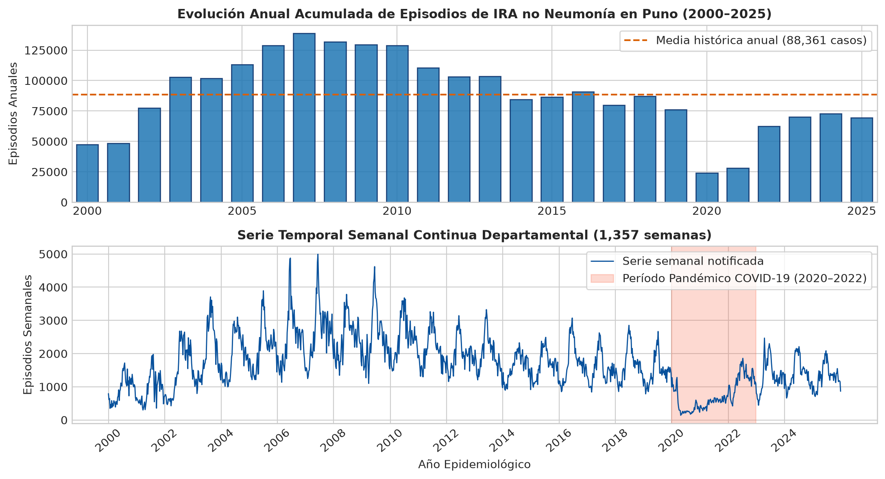
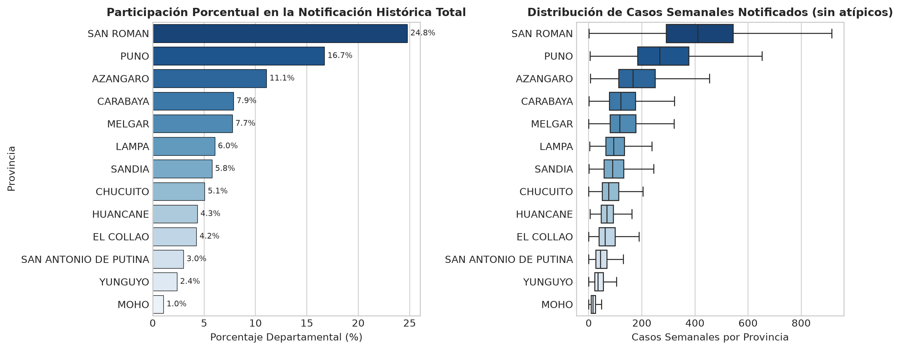
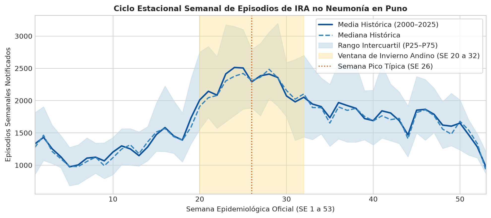
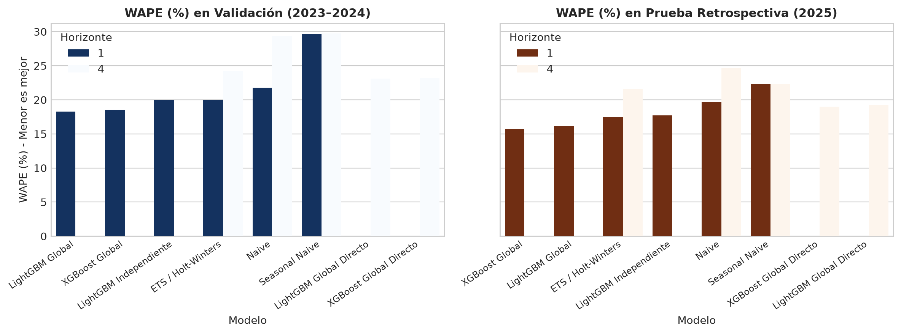
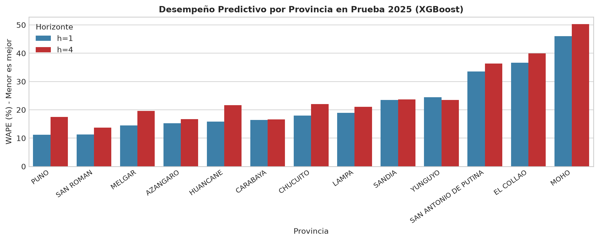
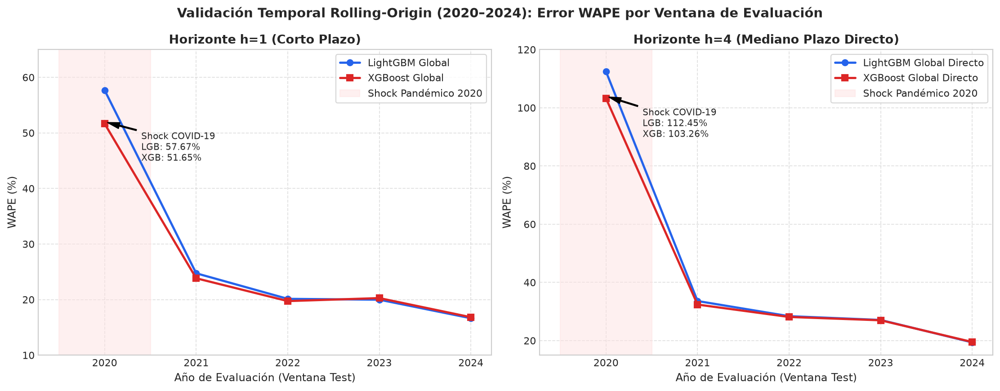
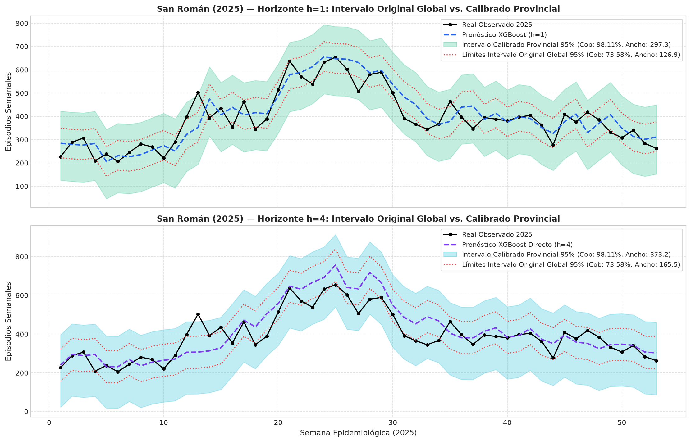
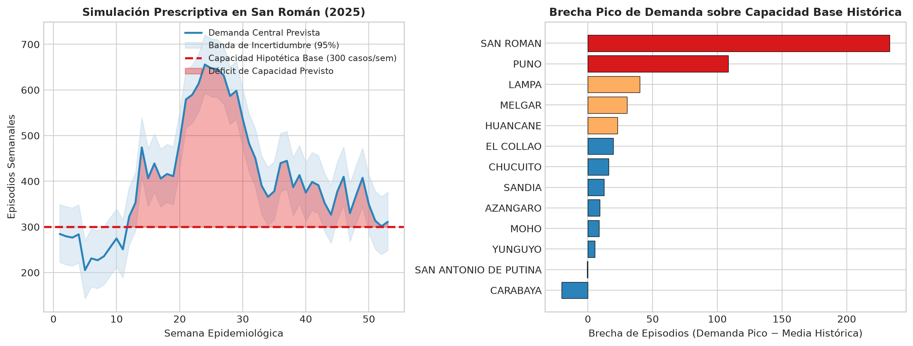

# Inteligencia de negocios y aprendizaje automático para el análisis y pronóstico de infecciones respiratorias agudas en menores de cinco años en la región Puno, Perú (2000–2025)

**Estudiante:** Maquera Andrade Aldair Jose  
**Docente:** Dr. Torres Cruz Fred  
**Curso:** Business Intelligence  
**Actividad:** Analítica + Modelos + Optimización  
**Fecha:** Noviembre de 2026  
**Repositorio Oficial:** `samIRA`  

---

## 1. Introducción

Las infecciones respiratorias agudas (IRA) constituyen la principal causa de morbilidad ambulatoria pediátrica en el altiplano andino peruano. En el departamento de Puno, donde las altitudes oscilan entre los 3,812 m s.n.m. en las riberas del Lago Titicaca y más de 4,500 m s.n.m. en las zonas cordilleranas, el descenso térmico extremo durante el invierno austral genera una demanda recurrente sobre los establecimientos de salud del primer y segundo nivel de atención.

Tradicionalmente, la vigilancia epidemiológica en el Perú —articulada por el Centro Nacional de Epidemiología, Prevención y Control de Enfermedades (CDC-MINSA) mediante el sistema NotiSP— opera con un enfoque retrospectivo basado en canales endémicos semanales. Aunque estos canales permiten identificar si una provincia se encuentra en zona de éxito, seguridad, alerta o epidemia, presentan limitaciones operativas: no incorporan horizontes explícitos de predicción a mediano plazo ($h=4$ semanas), reaccionan con retraso ante quiebres de tendencia y no interactúan de forma cuantitativa con la gestión de capacidad hospitalaria.

El proyecto **samIRA** aborda estas restricciones estableciendo un marco metodológico reproducible para auditar, modelar y evaluar la incertidumbre del registro epidemiológico provincial de Puno durante el período continuo 2000–2025. El estudio transita desde la curación de microdatos y el análisis exploratorio hasta la optimización paramétrica, la evaluación en múltiples ventanas históricas y la simulación prescriptiva de capacidad asistencial.

---

## 2. Datos y metodología

### 2.1. Fuente empírica y consolidación del panel semanal

La fuente primaria corresponde al registro oficial de datos abiertos *Vigilancia Epidemiológica de Infecciones Respiratorias Agudas (IRA)* del CDC/MINSA de Perú. El conjunto de datos crudo abarca desde la semana epidemiológica (SE) 01 del año 2000 hasta la SE 53 del año 2025, compuesto por **126,118 registros de notificación** individualizados por establecimiento, distrito, año y semana, totalizando **2,297,378 episodios de IRA no neumonía** en menores de cinco años.

La auditoría inicial subsanó la corrupción de caracteres especiales (`U+FFFD` en sustitución del grafema «Ñ») en 3,751 registros individuales de notificación pertenecientes a tres distritos: **Muñani** (UBIGEO `210208`, Azángaro, 1,305 filas afectadas), **Nuñoa** (UBIGEO `210806`, Melgar, 1,237 filas afectadas) y **Mañazo** (UBIGEO `210109`, Puno, 1,209 filas afectadas), reconciliándolos con el catálogo oficial de UBIGEO del Instituto Nacional de Estadística e Informática (INEI). Se confirmó que otros distritos con toponimia similar o de grafía estándar (tales como Acora, UBIGEO `210102`, y Usicayos, UBIGEO `210310`) no presentaron corrupción de caracteres en el registro original.

El panel se estructura a partir del calendario epidemiológico oficial establecido por el CDC-MINSA en el registro NotiSP (semanas de domingo a sábado). El período continuo 2000–2025 comprende 21 años de 52 semanas y 5 años con semana 53 (2003, 2008, 2014, 2020 y 2025), totalizando **1,357 semanas epidemiológicas**. La correspondencia temporal es año a año con el calendario epidemiológico oficial preindexado en la fuente de datos, consolidando una cuadrícula teórica balanceada:
$$\text{Filas teóricas del panel provincial} = 13 \text{ provincias} \times 1,357 \text{ semanas} = 17,641 \text{ observaciones}$$

### 2.2. Tratamiento riguroso de vacíos de notificación

Se detectaron exactamente **153 semanas sin reporte en el sistema NotiSP** (0.87% del panel), concentradas principalmente en 2000–2002 y 2020 en provincias con dificultades de conectividad geográfica (Moho, San Antonio de Putina, Yunguyo y El Collao). 

Metodológicamente, imputar un valor de cero a estas semanas falsearía las métricas de dispersión, ya que una falta de reporte administrativo no equivale a la erradicación biológica de los episodios. Por consiguiente, se adoptó la siguiente política:
1. Los 153 registros se preservaron con valor faltante (`NaN`) en la variable de episodios observados.
2. Para construir rezagos y medias móviles continuas sin fuga de información futura, se utilizó el método de última observación previa trasladada (*Last Observation Carried Forward*, LOCF causal retrospectivo).
3. Para la evaluación out-of-sample y el cálculo de métricas de desempeño, se aplicó el indicador booleano `es_evaluable = False`. En todas las tablas y evaluaciones, **ningún registro faltante fue evaluado como si hubiera sido observado**.

### 2.3. Partición temporal y formulación de horizontes

Para evitar cualquier fuga de información temporal (*data leakage*), el panel se particionó estrictamente por años calendario:
- **Entrenamiento:** 2001–2022 ($N = 14,785$ observaciones evaluables). De las 14,924 filas teóricas del período ($13 \text{ provincias} \times [18 \times 52 + 4 \times 53 \text{ semanas}] = 14,924$), se descontaron exactamente **139 ausencias de notificación** (`ira_no_neumonia` con `NaN`, `es_evaluable = False`). Dado que el año 2000 proveyó el soporte causal retrospectivo inicial (absorbiendo las exclusiones de inicialización de 13 filas en $h=1$ y 52 filas en $h=4$), ninguna fila de 2001–2022 fue excluida por construcción de rezagos, resultando en $14,924 - 139 = \mathbf{14,785}$ observaciones de entrenamiento tanto para $h=1$ como para $h=4$.
- **Validación:** 2023–2024 ($N = 1,347$ observaciones evaluables; de 1,352 filas teóricas se descuentan 5 ausencias en Melgar 2023).
- **Prueba final out-of-sample:** 2025 ($N = 689$ observaciones, 13 provincias $\times$ 53 semanas, 100% evaluable, 0 ausencias).

Se modelaron dos horizontes predictivos directos:
- **Horizonte corto plazo ($h=1$):** Pronóstico puntual para la semana epidemiológica inmediata $t$.
- **Horizonte mediano plazo directo ($h=4$):** Pronóstico puntual para la cuarta semana futura exacta ($t$). En este horizonte, todo el vector de características predictivas se corta estrictamente en el origen temporal $t-4$. Las medias móviles y los rezagos autorregresivos utilizan exclusivamente datos observados hasta $t-4$, garantizando que el pronóstico cuatrisemanal refleje la información disponible al momento de su emisión.

### 2.4. Espacio de características y modelos evaluados

El vector de predictores consta de 13 características continuas estructuradas causalmente:
- Rezagos autorregresivos: $\text{lag}_1, \text{lag}_2, \text{lag}_3, \text{lag}_4, \text{lag}_8$ (referidos al origen $t-h$).
- Medias móviles y dispersión retrospectiva: promedios y desviaciones estándar de 4 y 13 semanas calculados sobre la ventana causal.
- Componente estacional homólogo: observación de la misma semana epidemiológica del año previo ($\text{seasonal\_lag}_{1y}$), gestionando años de 53 semanas.
- Armónicas de Fourier del calendario objetivo: $\sin(2\pi \cdot \text{semana}/52)$ y $\cos(2\pi \cdot \text{semana}/52)$.
- Indicador binario de shock estructural: variable `es_pandemia` (1 para 2020–2022; 0 en el resto).
- Pertenencia territorial: variable `provincia` (como categoría nativa en LightGBM y con codificación dummy en XGBoost).

Se evaluaron modelos de ensamble de gradiente (*LightGBM Global* y *XGBoost Global*) frente a referencias clásicas: Naive, Seasonal Naive, Suavizamiento Exponencial de Holt-Winters (ETS amortiguado con estacionalidad aditiva de 52 períodos) y modelos locales independientes por provincia.

### 2.5. Métricas de evaluación

Las métricas agregadas se calculan sobre el conjunto de predicciones y observaciones evaluables:
$$\text{WAPE (\%)} = \frac{\sum_{i=1}^N |y_i - \hat{y}_i|}{\sum_{i=1}^N y_i} \times 100 \quad ; \quad \text{MAE} = \frac{1}{N}\sum_{i=1}^N |y_i - \hat{y}_i| \quad ; \quad \text{Bias} = \frac{1}{N}\sum_{i=1}^N (\hat{y}_i - y_i)$$
Para la calidad de los intervalos al 95% ($[L_i, U_i]$ con $\alpha=0.05$), se computa el **Winkler Score**, que penaliza simultáneamente la amplitud y los fallos de cobertura:
$$S_{0.05}(L_i, U_i, y_i) = (U_i - L_i) + \frac{2}{0.05}(L_i - y_i)\mathbf{1}_{\{y_i < L_i\}} + \frac{2}{0.05}(y_i - U_i)\mathbf{1}_{\{y_i > U_i\}}$$

---

## 3. Resultados y analítica

### 3.1. Analítica descriptiva

La serie histórica departamental (2000–2025) exhibe tres etapas claramente diferenciadas en la dinámica de notificación (Figura 1):

1. **Etapa Pre-Pandemia (2000–2019, 1,043 semanas):** Nivel dinámico regular con una media departamental de **1,889.6 episodios semanales** ($\sigma = 771.4$). El pico histórico ocurrió en la SE 25 de 2003 con 4,994 episodios semanales durante el invierno austral.
2. **Etapa Pandémica COVID-19 (2020–2022, 157 semanas):** Se observó una contracción abrupta en las notificaciones ambulatorias. La media semanal cayó a **728.7 episodios** ($\sigma = 440.0$), representando una **reducción del 61.4%** respecto a la media prepandémica. El piso histórico se registró en la SE 25 de 2020 con apenas 140 casos semanales.
3. **Etapa Post-Pandemia (2023–2025, 157 semanas):** Recuperación gradual con una media de **1,350.9 episodios semanales** ($\sigma = 418.6$), situándose todavía un **28.5% por debajo** del volumen promedio prepandémico.

La distribución territorial muestra una marcada concentración en los centros urbanos y ejes comerciales del departamento (Figura 2):

- **San Román (Juliaca):** Concentra la mayor carga epidemiológica regional con **569,203 episodios** (24.78% del total departamental), con una media de 422.6 casos semanales y un máximo histórico de 1,168 casos. Juliaca actúa como centro de atracción asistencial y nodo de transporte de la cuenca norte y sur.
- **Puno:** Capital departamental, acumula **383,892 episodios** (16.71%), con una media de 283.3 casos semanales.
- **Azángaro:** Tercera provincia con **254,292 episodios** (11.07%), promediando 187.7 casos semanales.
- Entre San Román y Puno concentran el **41.49% de todos los episodios notificados**, y sumando Azángaro superan el **52.5%** de la carga departamental. En contraste, provincias como **Moho** (24,018 casos; 1.05%, media semanal de 18.2 casos) y **Yunguyo** (54,161 casos; 2.36%) presentan volúmenes reducidos con alta volatilidad muestral.

El comportamiento temporal sigue un patrón estacional unimodal sincrónico con el régimen térmico andino (Figura 3):

- **Valles epidemiológicos (Verano austral):** Los niveles más bajos ocurren entre las semanas 48 y 05 (diciembre a febrero), con medias de 1,080 a 1,170 casos semanales.
- **Ventana crítica de invierno andino (SE 20 a 32):** Entre mediados de mayo y mediados de agosto se concentra la mayor actividad asistencial. El ápice histórico se alcanza en la **SE 26** con una media departamental de **2,429.4 casos semanales** (incremento del **124.0%** sobre el valle estival).

### 3.2. Analítica diagnóstica

El diagnóstico estadístico confirmó la presencia de una elevada dispersión en la serie. A nivel incondicional sobre el panel histórico completo (2000–2025), el ratio varianza-media marginal regional ($\text{VMR} = \text{Var}(Y)/\text{E}(Y)$) es de **143.65** ($\text{Var} = 18,871.02$, $\bar{Y} = 131.37$), variando entre provincias desde 8.24 (Moho, $\text{Var}=150.17$, $\bar{Y}=18.22$) hasta 87.38 (San Román, $\text{Var}=36,925.33$, $\bar{Y}=422.57$). Este VMR marginal elevado refleja la marcada heterogeneidad espacial interprovincial y el ciclo estacional multianual. Por su parte, la sobredispersión condicional de los residuos respecto al pronóstico ($\text{Var}(Y - \hat{y})/\text{E}(Y) \approx 8.7\text{--}9.6$ en $h=1$ y $14.3\text{--}14.9$ en $h=4$; estadístico de dispersión de Pearson $\approx 6.5\text{--}6.8$ en $h=1$ y $10.1\text{--}10.6$ en $h=4$) supera holgadamente la unidad, evidenciando que incluso tras condicionar por los predictores del modelo persiste sobredispersión residual.

### 3.3. Analítica predictiva

En la partición de validación temporal (2023–2024, $N = 1,347$ casos evaluables), los modelos globales basados en árboles de gradiente superaron consistentemente a las referencias estadísticas (Tabla 1 y Figura 4):

| Partición | Horizonte $h$ | Modelo | MAE | RMSE | WAPE (%) | Bias ($\bar{\hat{y}} - \bar{y}$) | $N$ |
| :--- | :---: | :--- | :---: | :---: | :---: | :---: | :---: |
| **Validación (2023–2024)** | $h=1$ | **LightGBM Global** | **19.328** | **30.317** | **18.247%** | +1.692 | 1,347 |
| Validación (2023–2024) | $h=1$ | XGBoost Global | 19.663 | 31.821 | 18.563% | +1.102 | 1,347 |
| Validación (2023–2024) | $h=1$ | LightGBM Independiente | 21.141 | 32.925 | 19.958% | +2.966 | 1,347 |
| Validación (2023–2024) | $h=1$ | ETS / Holt-Winters | 21.182 | 33.732 | 19.996% | +0.206 | 1,347 |
| Validación (2023–2024) | $h=1$ | Naive | 23.055 | 36.047 | 21.765% | -0.048 | 1,347 |
| Validación (2023–2024) | $h=1$ | Seasonal Naive | 31.474 | 49.254 | 29.713% | -7.441 | 1,347 |
| **Validación (2023–2024)** | $h=4$ | **LightGBM Global Directo** | **24.506** | **39.322** | **23.135%** | +4.981 | 1,347 |
| Validación (2023–2024) | $h=4$ | XGBoost Global Directo | 24.613 | 39.818 | 23.236% | +3.512 | 1,347 |
| Validación (2023–2024) | $h=4$ | ETS / Holt-Winters | 25.646 | 41.823 | 24.211% | +0.556 | 1,347 |
| Validación (2023–2024) | $h=4$ | Naive | 31.069 | 51.542 | 29.331% | +0.290 | 1,347 |
| Validación (2023–2024) | $h=4$ | Seasonal Naive | 31.485 | 49.259 | 29.723% | -7.452 | 1,347 |
| **Prueba (2025)** | $h=1$ | **XGBoost Global** | **15.835** | **23.310** | **15.718%** | +2.931 | 689 |
| Prueba (2025) | $h=1$ | LightGBM Global | 16.258 | 24.475 | 16.138% | +3.042 | 689 |
| Prueba (2025) | $h=1$ | ETS / Holt-Winters | 17.620 | 25.908 | 17.490% | -0.016 | 689 |
| Prueba (2025) | $h=1$ | LightGBM Independiente | 17.860 | 26.528 | 17.728% | +4.624 | 689 |
| Prueba (2025) | $h=1$ | Naive | 19.836 | 28.321 | 19.690% | +0.437 | 689 |
| Prueba (2025) | $h=1$ | Seasonal Naive | 22.522 | 33.730 | 22.356% | +6.383 | 689 |
| **Prueba (2025)** | $h=4$ | **XGBoost Global Directo** | **19.113** | **29.651** | **18.972%** | +6.466 | 689 |
| Prueba (2025) | $h=4$ | LightGBM Global Directo | 19.347 | 30.177 | 19.205% | +7.469 | 689 |
| Prueba (2025) | $h=4$ | ETS / Holt-Winters | 21.776 | 33.105 | 21.616% | -0.684 | 689 |
| Prueba (2025) | $h=4$ | Seasonal Naive | 22.522 | 33.730 | 22.356% | +6.383 | 689 |
| Prueba (2025) | $h=4$ | Naive | 24.824 | 39.454 | 24.641% | -0.038 | 689 |

En validación, **LightGBM Global** obtuvo el menor WAPE: **18.25%** en $h=1$ y **23.14%** en $h=4$. En la evaluación retrospectiva out-of-sample en el año de prueba 2025 ($N = 689$), **XGBoost Global** registró el mejor desempeño: **15.72%** en $h=1$ y **18.97%** en $h=4$. Cabe precisar que las diferencias de WAPE entre ambos ensambles (p. ej., 15.72% de XGBoost vs. 16.14% de LightGBM en 2025, una diferencia de 0.42 p.p.) describen el rendimiento empírico observado, pero no prueban por sí solas una superioridad estadísticamente significativa sin contrastes formales de hipótesis (tales como pruebas de Diebold-Mariano o bootstrap estacionario por bloques, contemplados como trabajo metodológico futuro).

El error relativo varía marcadamente entre provincias (Figura 6). En 2025 ($h=1$), las provincias con mayor volumen registran los menores WAPE: **Puno (11.16%)**, **San Román (11.25%)** y **Melgar (14.44%)**. Por el contrario, las provincias de baja escala presentan WAPE elevados a pesar de tener errores absolutos pequeños: **Moho (46.07%, MAE 6.13)** y **El Collao (36.65%, MAE 16.44)**. Esto confirma que el WAPE no ponderado castiga severamente a las áreas de bajo volumen poblacional.

### 3.4. Optimización y evaluación experimental

#### 3.4.1. Validación temporal Rolling-Origin (2020–2024)

Para evaluar la estabilidad de LightGBM y XGBoost ante transiciones de régimen, se implementó una validación de ventana expansiva (*Rolling-Origin*) en cinco ventanas anuales sucesivas (Figura 8):

| Ventana | Train ($N_{\text{tr}}$) | Test ($N_{\text{te}}$) | WAPE LGB h=1 (%) | WAPE XGB h=1 (%) | WAPE LGB h=4 (%) | WAPE XGB h=4 (%) |
| :--- | :---: | :---: | :---: | :---: | :---: | :---: |
| **Ventana 1** | $\le 2019$ ($12,785$) | **2020** ($658$) | 57.674% | **51.651%** | 112.446% | **103.262%** |
| **Ventana 2** | $\le 2020$ ($13,443$) | **2021** ($666$) | 24.734% | **23.836%** | 33.596% | **32.382%** |
| **Ventana 3** | $\le 2021$ ($14,109$) | **2022** ($676$) | 20.133% | **19.732%** | 28.392% | **28.126%** |
| **Ventana 4** | $\le 2022$ ($14,785$) | **2023** ($671$) | **19.984%** | 20.270% | 27.091% | **26.983%** |
| **Ventana 5** | $\le 2023$ ($15,456$) | **2024** ($676$) | **16.647%** | 16.831% | **19.389%** | 19.522% |

*Nota metodológica:* Los modelos de las cinco ventanas fueron ajustados sobre las matrices completas de entrenamiento disponibles al origen de corte ($12,785$, $13,443$, $14,109$, $14,785$ y $15,456$ observaciones evaluables, respectivamente), garantizando la estricta causalidad temporal sin reutilización de datos futuros.

El desempeño disminuyó drásticamente en 2020 debido a la contracción del 61.4% provocada por las medidas sanitarias de emergencia, generando sobrestimaciones masivas en modelos entrenados exclusivamente con datos prepandémicos. Entre 2021 y 2024, a medida que la serie incorporó la etapa pandémica y la posterior estabilización, el WAPE descendió hacia niveles del 16.6% al 20.3% en $h=1$. Esta reducción no fue estrictamente monótona (XGBoost aumentó ligeramente de 19.73% en 2022 a 20.27% en 2023), pero reflejó una estabilización progresiva. Calculando los percentiles mediante el método de interpolación lineal estándar (P25 en la segunda ventana ordenada y P75 en la cuarta), XGBoost demostró menor dispersión interanual con un rango intercuartílico (IQR) de **4.104 pp** frente a **4.750 pp** de LightGBM en $h=1$ (medianas de 20.270% y 20.133%, respectivamente), y de **5.399 pp** frente a **6.505 pp** en $h=4$ (medianas de 28.126% y 28.392%), además de menor WAPE agregado en las 5 ventanas combinadas (22.480% vs. 23.106% en $h=1$, $N=3,347$).

#### 3.4.2. Optimización bayesiana con Optuna TPE

Se ejecutaron 120 ensayos en total (30 por combinación modelo/horizonte sobre Train 2001–2022 y Validación 2023–2024, sin multiplicar por las ventanas Rolling-Origin) utilizando `TPESampler(seed=42)` independiente por estudio. En LightGBM, el parámetro `subsample` se exploró entre 0.6 y 1.0, pero al mantenerse `subsample_freq = 0` (por defecto de la librería), el submuestreo de filas permaneció inactivo, a diferencia de XGBoost donde operó efectivamente en cada partición de árbol. 

Optuna redujo levemente el WAPE en tres de las cuatro combinaciones:
- XGBoost $h=1$: redujo 0.151 p.p. (de 18.563% a 18.412%).
- LightGBM $h=4$: redujo 0.162 p.p. (de 23.135% a 22.973%).
- XGBoost $h=4$: redujo 0.281 p.p. (de 23.236% a 22.955%).
- LightGBM $h=1$: no mejoró la configuración original discreta (18.287% vs 18.247%, -0.040 p.p.).

Las ganancias máximas alcanzaron apenas 0.281 puntos porcentuales. Al no existir un umbral de mejora formal prefijado y siendo las diferencias inferiores a 0.3 p.p., se decidió conservar los modelos originales discretos de Grid Search para mantener la simplicidad, trazabilidad y reproducibilidad del estudio sin añadir complejidad innecesaria.

#### 3.4.3. Evaluación de funciones objetivo para datos de conteo (Poisson vs. L2)

Se evaluó el entrenamiento con función objetivo Poisson (`objective='poisson'` en LightGBM y `objective='count:poisson'` en XGBoost) manteniendo idénticos hiperparámetros. 

A nivel global agregado en validación ($N=1,347$), **Poisson no redujo el WAPE en ninguna combinación**:
- LightGBM $h=1$: 18.452% (Poisson) vs 18.247% (L2).
- XGBoost $h=1$: 18.631% (Poisson) vs 18.563% (L2).
- LightGBM $h=4$: 23.254% (Poisson) vs 23.135% (L2).
- XGBoost $h=4$: 23.341% (Poisson) vs 23.236% (L2).

Aunque Poisson redujo el sesgo de sobrestimación en semanas de alta actividad invernal en San Román (el sesgo en $h=4$ disminuyó de +15.54 a +6.90 episodios), deterioró marcadamente el desempeño en semanas con conteos pequeños ($y \le 10$, $N=58$), donde el WAPE aumentó en más de 20 puntos porcentuales. Teóricamente, la función de devianza Poisson pondera los errores residuales inversamente al valor esperado ($1/\hat{y}$), lo que penaliza con severidad desproporcionada los errores en conteos bajos en presencia de varianza residual sobredispersa; por el contrario, la pérdida cuadrática L2 optimiza directamente el error cuadrático medio alineándose con la media condicional muestral. Por ende, la pérdida L2 fue ratificada experimentalmente.

#### 3.4.4. Calibración provincial de intervalos predictivos al 95%

La auditoría de los intervalos empíricos originales (calculados con residuos globales al 95%) evidenció que la aparente solidez de la cobertura departamental en 2025 (**97.24%**) ocultaba una severa heterogeneidad territorial:
- En **San Román**, la cobertura empírica real fue de apenas **73.58%**, debido a que la cota global ($\pm 63$ episodios) resultó insuficiente para absorber la dispersión de una provincia con media de 392 casos.
- En **Moho**, la cobertura fue del **100%**, pero con una amplitud media de 79.7 episodios, desproporcionada para una media real de 13.3 casos semanales.

Para corregir esta asimetría, se implementó una calibración provincial que ajusta cuantiles residuales empíricos ($q_{0.025, p}, q_{0.975, p}$) calculados exclusivamente con las predicciones fuera de muestra de validación (2023–2024, con $N = 104$ semanas por provincia, salvo Melgar con $N = 99$). Al evaluar fuera de muestra en 2025 (Figura 5 y Tabla 2):

| Modelo | $h$ | Cobertura Original (%) | Cobertura Calibrada (%) | Ancho Medio Original | Ancho Medio Calibrado | Winkler Score Original | Winkler Score Calibrado | Mejora Winkler (%) |
| :--- | :---: | :---: | :---: | :---: | :---: | :---: | :---: | :---: |
| LightGBM Global | 1 | 97.24% | 96.66% | 117.03 | **99.01** | 150.51 | **112.89** | **+25.00%** |
| LightGBM Global Directo | 4 | 96.37% | 97.82% | 138.88 | **125.32** | 174.29 | **132.82** | **+23.79%** |
| XGBoost Global | 1 | 97.24% | 96.95% | 115.35 | **101.67** | 140.64 | **111.97** | **+20.39%** |
| XGBoost Global Directo | 4 | 96.95% | 97.39% | 142.80 | **124.90** | 178.45 | **137.17** | **+23.13%** |

En San Román ($h=1$), la cobertura alcanzó **98.11%**, requiriendo ampliar su intervalo medio a 297.31 episodios (reduciendo su Winkler Score en un 26.07%). En Moho, el ancho medio se redujo de 79.72 a **24.33** episodios (-69.5%), alcanzando una cobertura de 90.57% y mejorando su Winkler Score en un 48.12%. El Winkler Score departamental global disminuyó más del 20% en todos los modelos, aunque en Azángaro y Puno el score aumentó levemente. La calibración provincial se presenta como una alternativa experimental que requiere validación temporal complementaria.

### 3.5. Analítica prescriptiva

Para ilustrar el uso del modelo predictivo en la planificación logística, se evaluó una simulación cuantitativa sobre **escenarios académicos hipotéticos** de capacidad semanal en San Román durante 2025 (Figura 7 y Tablas 7–8 del Cuaderno 03):

1. **Escenario de capacidad fija (300 consultas semanales):** La demanda proyectada por el modelo XGBoost ($h=1$) supera el umbral de 300 consultas durante **42 semanas continuas** (SE 12 a 53), alcanzando una **brecha simulada máxima de +355.65 episodios** en la semana 24 (demanda proyectada de 655.65 casos frente al límite simulado; observado real: 633.00 casos). Las semanas 1 a 11 se mantuvieron por debajo del umbral (entre 205.3 y 284.5 casos). Durante el núcleo del invierno andino (SE 20 a 32, 13 semanas continuas), el exceso de demanda supera consistentemente los 150 episodios semanales.
2. **Escenario de capacidad base histórica (422.6 consultas semanales):** Al fijar la capacidad simulada en el promedio histórico provincial de San Román (422.6 casos/sem), se registran exactamente **17 semanas de déficit** en el año, distribuidas en cuatro bloques: SE 14 (1 sem), SE 16 (1 sem), el núcleo continuo de invierno de las **SE 20 a 32 (13 semanas consecutivas)**, y las SE 36 a 37 (2 sem). La brecha máxima en este escenario alcanza **+233.05 episodios** en la semana 24.

Es imperativo reiterar que ambos umbrales (300 y 422.6 consultas/semana) constituyen **supuestos teóricos de simulación de oferta-demanda**, y no representan un inventario real auditado de capacidad física, plazas médicas ni stock farmacológico de los establecimientos de salud de San Román o DIRESA Puno. Su función metodológica es proveer un instrumental analítico cuantitativo para dimensionar con anticipación la necesidad de refuerzos de turnos y stock antes del pico de heladas.

---

## 4. Discusión

Los resultados de samIRA evidencian que el modelado global autorregresivo con árboles de gradiente permite obtener niveles de error relativo del 15% al 19% en períodos epidemiológicamente estables, superando sustancialmente a las referencias estáticas. No obstante, el estudio arroja lecciones metodológicas críticas:

1. **Riesgos de la agregación departamental:** Evaluar modelos predictivos únicamente con métricas regionales globales oculta fallas locales críticas. El caso de San Román (73.58% de cobertura inicial frente a un 97.24% global) demuestra cómo una muestra mayoritaria de provincias pequeñas con errores absolutos reducidos puede compensar estadísticamente la subcobertura en el foco urbano de mayor carga asistencial.
2. **Dependencia de régimen y shocks externos:** La validación Rolling-Origin mostró que los modelos autorregresivos globales no pueden anticipar quiebres estructurales no observados en el historial, como ocurrió en 2020. Su utilidad descansa en la regularidad estacional y en la estabilidad post-pandémica.
3. **Límites de la función objetivo Poisson frente a la dispersión condicional:** Si bien el ratio varianza-media marginal del panel es de 143.65 y la sobredispersión residual persiste condicionalmente en los modelos, el VMR incondicional no demuestra por sí solo el menor desempeño de Poisson. La función Poisson pondera la devianza inversamente a la media predicha ($1/\hat{y}$), amplificando desproporcionadamente las penalizaciones en valles con conteos reducidos ($y \le 10$). Por su parte, la pérdida cuadrática L2 optimiza la media condicional muestral minimizando el error cuadrático medio, logrando un WAPE agregado consistentemente superior en todas las configuraciones evaluadas.
4. **Viabilidad de extensiones con fuentes externas (Fase D):**
   - *Población INEI:* Las proyecciones oficiales del grupo de 0 a 4 años están disponibles a nivel departamental anual, pero requieren desagregación proporcional para el ámbito provincial. Esta fuente permitiría normalizar la incidencia en tasas por 100,000 menores de cinco años para comparar la carga entre provincias, pero al ser un parámetro anual constante no aporta variabilidad semanal a la predicción autorregresiva a corto plazo.
   - *Meteorología (NASA POWER vs. SENAMHI):* NASA POWER ofrece reanálisis continuo diario (1981–presente) sin vacíos en las 13 provincias, mientras que las estaciones terrestres de SENAMHI presentan lagunas superiores al 30% en zonas altas y el grillado PISCO está desactualizado post-2020. No obstante, en un pronóstico real a mediano plazo ($h=4$), el desfase causal exige utilizar clima observado rezagado en 4 semanas, cuya correlación directa con los episodios inmediatos es débil frente a las armónicas estacionales ya incorporadas.
   - *Veredicto:* Se fundamenta conservar el dataset epidemiológico NotiSP como núcleo maestro del proyecto, evitando dependencias externas complejas que comprometan la trazabilidad y reproducibilidad del estudio.
5. **Estatus metodológico del año 2025 y significancia estadística:** El año 2025 operó originalmente como una partición de prueba retrospectiva. Al haberse examinado sus errores en las auditorías iniciales y diagnósticos provinciales, no debe concebirse como un conjunto ciego independiente para las decisiones y calibraciones posteriores (Fase C). Asimismo, las diferencias numéricas en el WAPE entre modelos (p. ej., 15.72% de XGBoost vs. 16.14% de LightGBM en 2025) señalan diferencias empíricas observadas, pero no acreditan superioridad estadística concluyente sin contrastes formales de hipótesis (tales como pruebas de Diebold-Mariano o bootstrap temporal en bloques), los cuales quedan planteados como extensión metodológica.

---

## 5. Conclusiones

1. **Curación y calidad de datos:** La normalización geográfica del registro NotiSP (2000–2025) y la preservación rigurosa de 153 semanas sin reporte como valores faltantes no evaluables permitieron construir un panel balanceado de 17,641 observaciones provinciales libre de sesgos por imputación espuria de ceros.
2. **Capacidad predictiva:** Los ensambles de gradiente globales superaron a los modelos locales y baselines tradicionales. LightGBM Global obtuvo el menor WAPE en validación 2023–2024 (18.25% en $h=1$ y 23.14% en $h=4$), mientras que XGBoost Global alcanzó 15.72% ($h=1$) y 18.97% ($h=4$) en el año de prueba 2025.
3. **Calibración de incertidumbre:** La calibración residual estratificada por provincia corrigió la subcobertura original en San Román (elevándola del 73.58% al 98.11%) y redujo la amplitud desmedida en Moho (-69.5%), mejorando el Winkler Score departamental en más de un 20%. No obstante, dicho ajuste amplió considerablemente los intervalos en zonas urbanas y generó leves incrementos de penalización en provincias intermedias, constituyendo una alternativa experimental que requiere validación prospectiva.
4. **Soporte a decisiones en salud pública:** La articulación entre proyecciones out-of-sample y simulación de umbrales operativos provee a las autoridades sanitarias una herramienta analítica cuantitativa para dimensionar proactivamente la brecha asistencial estacional antes de la instauración de las heladas invernales en el altiplano.

---

## 6. Referencias

1. **Centro Nacional de Epidemiología, Prevención y Control de Enfermedades (CDC Perú / MINSA):** *Vigilancia Epidemiológica de Infecciones Respiratorias Agudas (IRA) en el Perú (2000–2025)*. Plataforma Nacional de Datos Abiertos, Presidencia del Consejo de Ministros, Lima, Perú. URL: [https://www.datosabiertos.gob.pe/dataset/vigilancia-epidemiologica-de-infecciones-respiratorias-agudas-ira](https://www.datosabiertos.gob.pe/dataset/vigilancia-epidemiologica-de-infecciones-respiratorias-agudas-ira).
2. **Chen, T., & Guestrin, C. (2016):** *XGBoost: A Scalable Tree Boosting System*. Proceedings of the 22nd ACM SIGKDD International Conference on Knowledge Discovery and Data Mining, 785–794. DOI: [10.1145/2939672.2939785](https://doi.org/10.1145/2939672.2939785).
3. **Ke, G., Meng, Q., Finley, T., Wang, T., Chen, W., Ma, W., Ye, Q., & Liu, T. Y. (2017):** *LightGBM: A Highly Efficient Gradient Boosting Decision Tree*. Advances in Neural Information Processing Systems (NeurIPS 2017), 30, 3146–3154.
4. **Gneiting, T., & Raftery, A. E. (2007):** *Strictly Proper Scoring Rules, Prediction, and Estimation*. Journal of the American Statistical Association, 102(477), 359–378. DOI: [10.1198/016214506000001437](https://doi.org/10.1198/016214506000001437).
5. **Hyndman, R. J., & Athanasopoulos, G. (2021):** *Forecasting: Principles and Practice* (3rd ed.). OTexts: Melbourne, Australia. URL: [https://otexts.com/fpp3/](https://otexts.com/fpp3/).
6. **Instituto Nacional de Estadística e Informática (INEI, 2020):** *Perú: Estimaciones y Proyecciones de Población Departamental, por Años Calendario y Edad Simple, 1995–2030*. Boletín Especial N° 25, Lima, Perú. URL: [https://www.inei.gob.pe/](https://www.inei.gob.pe/).
7. **NASA Langley Research Center (2024):** *Prediction of Worldwide Energy Resources (POWER) Project: Hourly, Daily and Monthly Meteorological and Solar Datasets*. National Aeronautics and Space Administration (NASA). URL: [https://power.larc.nasa.gov/](https://power.larc.nasa.gov/).
8. **Servicio Nacional de Meteorología e Hidrología del Perú (SENAMHI, 2021):** *PISCO: Peruvian Interpolated data of SENAMHI's Climatological and Hydrological Observations*. Lima, Perú. URL: [https://www.gob.pe/senamhi](https://www.gob.pe/senamhi).
