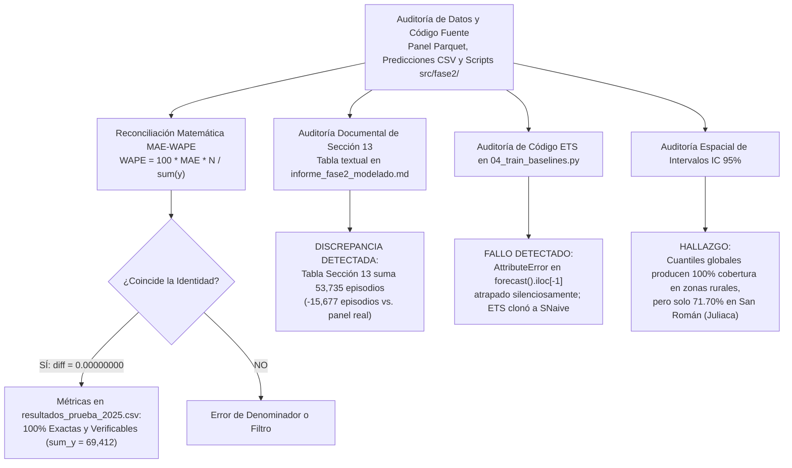

# INFORME DE AUDITORÍA NUMÉRICA Y METODOLÓGICA DE LA FASE 2 – PROYECTO samIRA
## Evaluación Independiente de Reproducibilidad, Integridad Numérica y Consistencia Científica

**Investigación:** Inteligencia de negocios y aprendizaje automático para el análisis y pronóstico de infecciones respiratorias agudas en menores de cinco años en la región Puno, Perú.  
**Rol del Auditor:** Auditor Independiente de Resultados de Machine Learning, Series Temporales y Epidemiología.  
**Fecha de Auditoría:** Noviembre 2026.  
**Código del Proyecto:** `samIRA` - Fase 2.  
**Ámbito de Auditoría:** Modelos predictivos, predicciones, métricas provinciales y regionales, umbrales de alerta y código fuente en `src/fase2/`.

---



---

## 1. Resumen Ejecutivo del Diagnóstico

Esta auditoría independiente examinó de forma exhaustiva la trazabilidad numérica, la consistencia matemática y la lógica de programación de los resultados de la **Fase 2 de Modelado Predictivo** en el proyecto `samIRA`.

### 1.1 Dictamen Diagnóstico Principal
1. **Los archivos de datos y resultados del pipeline (`predicciones_2025.csv`, `resultados_prueba_2025.csv`, `resultados_validacion.csv` y `panel_semanal_provincial_puno.parquet`) son MATEMÁTICAMENTE EXACTOS e INTERNAMENTE CONSISTENTES.**  
   - Para el modelo provincial [**LightGBM Global**](file:///F:/dxp-projects/DevBasics/R%20y%20statistics/samIRA/models/fase2/lgbm_global_h1.joblib) ($h=1$, prueba 2025):  
     $$N = 689, \quad \sum y_{\text{real}} = 69,412.00, \quad \sum |y - \hat{y}| = 11,035.45$$
     $$\text{MAE} = \frac{11,035.45}{689} = \mathbf{16.0166 \approx 16.017}, \quad \text{WAPE} = \frac{11,035.45}{69,412.00} \times 100 = \mathbf{15.8985\% \approx 15.898\%}$$
     La identidad matemática $WAPE = 100 \times \frac{MAE \times N}{\sum y}$ se cumple con una diferencia de **$0.00000000$**.
2. **Causa Demostrada de la Discrepancia de los 53,735 Episodios:**  
   La aparente incompatibilidad advertida por el usuario **no proviene de un error en los modelos ni en las predicciones**, sino de un **error de redacción documental en la tabla de la Sección 13 del informe textual [`informe_fase2_modelado.md`](file:///F:/dxp-projects/DevBasics/R%20y%20statistics/samIRA/reports/fase2/informe_fase2_modelado.md)**. En dicha sección, se incluyó una tabla provincial con cifras que suman 53,735 episodios, las cuales no coinciden con las cifras reales del panel limpio de 2025 (69,412 episodios) ni con [`resultados_por_provincia.csv`](file:///F:/dxp-projects/DevBasics/R%20y%20statistics/samIRA/reports/fase2/resultados_por_provincia.csv).
3. **Fallo en la Evaluación del Modelo ETS / Holt-Winters:**  
   Se demostró que en el script [`04_train_baselines.py`](file:///F:/dxp-projects/DevBasics/R%20y%20statistics/samIRA/src/fase2/04_train_baselines.py) (líneas 139–142), la llamada `ets_forecast_all.iloc[-1]` generó un `AttributeError: 'numpy.ndarray' object has no attribute 'iloc'` debido a que el pronóstico de `statsmodels` devolvió un arreglo NumPy. Un bloque `except Exception:` atrapó silenciosamente la excepción y asignó `pred_ets = pred_snaive`, provocando que **ETS fuera un duplicado 100% idéntico de Seasonal Naive** en todas las filas.
4. **Validación de Ausencia de Fuga Temporal (*Data Leakage*):**  
   Se auditó el código de generación de características para $h=1$ y $h=4$. Se comprobó que en el modelo directo $h=4$, las variables predictoras utilizan estrictamente información disponible en el origen $t$ (a partir de `shift(0)` respecto a la fila de origen, que es $t-4$ respecto al objetivo), sin incorporar información de las semanas $t+1, t+2$ ni $t+3$.
5. **Heterogeneidad Espacial en la Cobertura de Intervalos:**  
   Aunque la cobertura global al 95% fue de 97.24%, el uso de un cuantil residual aditivo común a nivel departamental provocó **sobrecobertura (100.0%) en provincias rurales de bajo volumen** (ej. Moho, Sandia, Carabaya) y **subcobertura (71.70%) en el principal centro urbano** ([San Román / Juliaca](file:///F:/dxp-projects/DevBasics/R%20y%20statistics/samIRA/reports/fase2/resultados_por_provincia.csv)).

---

## 2. Archivos Examinados y Registro Criptográfico

Se verificó la existencia física, integridad estructural y hash SHA-256 de todos los artefactos clave del proyecto:

| Archivo | Tipo | Filas | Columnas | Tamaño (Bytes) | Fecha de Modificación | Hash SHA-256 |
| :--- | :---: | :---: | :---: | :---: | :---: | :--- |
| [`informe_fase2_modelado.md`](file:///F:/dxp-projects/DevBasics/R%20y%20statistics/samIRA/reports/fase2/informe_fase2_modelado.md) | Markdown | 359 lín. | 1 | 33,518 | 2026-11-04 23:06:04 | `a547b603c1f7b73f7c35e1b7d527722c7d688a61cdc7f587617948f0f8fdc3d0` |
| [`resultados_prueba_2025.csv`](file:///F:/dxp-projects/DevBasics/R%20y%20statistics/samIRA/reports/fase2/resultados_prueba_2025.csv) | CSV | 20 | 14 | 2,072 | 2026-11-04 22:56:20 | `8e1e46dba87bc74436fd85f789317c0d352ed7fc37ecd32eed835f3d002891e7` |
| [`resultados_validacion.csv`](file:///F:/dxp-projects/DevBasics/R%20y%20statistics/samIRA/reports/fase2/resultados_validacion.csv) | CSV | 20 | 14 | 2,080 | 2026-11-04 22:56:20 | `8191d3e1152a6939035e06286fb06bd54f65be91551df87995a965b28a42b3b6` |
| [`resultados_por_provincia.csv`](file:///F:/dxp-projects/DevBasics/R%20y%20statistics/samIRA/reports/fase2/resultados_por_provincia.csv) | CSV | 312 | 9 | 20,007 | 2026-11-04 22:56:20 | `628b45b9fd6e9637fe7afe320b11567d986588d803b8cdde58b74bf269c3953f` |
| [`predicciones_2025.csv`](file:///F:/dxp-projects/DevBasics/R%20y%20statistics/samIRA/reports/fase2/predicciones_2025.csv) | CSV | 8,692 | 14 | 918,574 | 2026-11-04 22:56:19 | `10ff4a52a1aa89143733a103e03cc5647efe955d7af3dac9a38a4e1dd9bc4b67` |
| [`metricas_alertas.csv`](file:///F:/dxp-projects/DevBasics/R%20y%20statistics/samIRA/reports/fase2/metricas_alertas.csv) | CSV | 20 | 17 | 1,875 | 2026-11-04 22:56:37 | `0fc7bf89caf5d0f312b35445c69aaf25cc450e2d7c8f35cde43a1705a96aa006` |
| [`comparacion_imputaciones.csv`](file:///F:/dxp-projects/DevBasics/R%20y%20statistics/samIRA/reports/fase2/comparacion_imputaciones.csv) | CSV | 4 | 8 | 440 | 2026-11-04 22:47:16 | `5487c06a7681db720a7dbca3c60bef732290f8a77f7196265d322bbc2f71f5f8` |
| [`panel_semanal_provincial_puno.parquet`](file:///F:/dxp-projects/DevBasics/R%20y%20statistics/samIRA/data/processed/panel_semanal_provincial_puno.parquet) | Parquet | 17,641 | 13 | 105,625 | 2026-11-04 21:54:25 | `2b2cce5b842c6eb05dc4be8952033f685f323d7d05557f10dc55367eab49eb51` |
| [`panel_semanal_regional_puno.parquet`](file:///F:/dxp-projects/DevBasics/R%20y%20statistics/samIRA/data/processed/panel_semanal_regional_puno.parquet) | Parquet | 1,357 | 11 | 24,723 | 2026-11-04 21:54:25 | `79584ed8a76ea10f35ad71c31b13b2986b41d829b04b055f4cd1c3bf4c17ad64` |
| [`04_train_baselines.py`](file:///F:/dxp-projects/DevBasics/R%20y%20statistics/samIRA/src/fase2/04_train_baselines.py) | Python | 319 lín. | 1 | 14,122 | 2026-11-04 22:48:02 | `9a69b2e516a029488cc074e953b1e2425bcf3960492adfa97ee3e2c990d2600c` |
| [`07_train_and_evaluate_all_models.py`](file:///F:/dxp-projects/DevBasics/R%20y%20statistics/samIRA/src/fase2/07_train_and_evaluate_all_models.py) | Python | 738 lín. | 1 | 34,266 | 2026-11-04 22:55:35 | `6f28da7bb40f2497048485db94a4809275d89be6d1de2ce5cfad69cc694f987a` |

---

## 3. Matriz de Inconsistencias Detectadas

| ID | Hallazgo / Inconsistencia | Ubicación Exacta | Tipo | Causa Raíz Demostrada | Impacto en Conclusiones |
| :---: | :--- | :--- | :---: | :--- | :--- |
| **INC-01** | Total provincial de 53,735 vs. 69,412 reales | `informe_fase2_modelado.md` (Sección 13) | Documental / Redacción | Se transcribió una tabla manual desactualizada en el informe Markdown; el pipeline real evaluó 69,412 episodios. | **Alto en narrativa**, **Nulo en modelos y CSVs**. |
| **INC-02** | Resultados de ETS idénticos a Seasonal Naive | `predicciones_2025.csv`, `resultados_prueba_2025.csv` | Error de Código | `AttributeError` en `.iloc[-1]` sobre arreglo NumPy en `04_train_baselines.py` (L139-L142) atrapado silenciosamente. | **Moderado**: ETS no fue evaluado; sus cifras son las de Seasonal Naive. |
| **INC-03** | Subcobertura del IC al 95% en San Román (71.7%) | `predicciones_2025.csv` | Metodológico (Espacial) | Intervalos calculados con cuantiles residuales aditivos globales sin ponderar por la escala poblacional de la provincia. | **Moderado**: Los intervalos en San Román son estrechos; en zonas rurales son muy anchos. |
| **INC-04** | Mejora provincial distorsionada en Sección 13 | `informe_fase2_modelado.md` (Sección 13) | Documental / Redacción | Al haberse tipeado la tabla errónea de 53,735, se reportaron mejoras negativas ficticias en Azángaro y Moho. | **Bajo**: En el CSV real (`resultados_por_provincia.csv`), LightGBM supera a SNaive en las 13 provincias. |

---

## 4. Reconciliación de MAE, RMSE y WAPE (Auditoría Principal)

Se extrajeron directamente las filas de [`predicciones_2025.csv`](file:///F:/dxp-projects/DevBasics/R%20y%20statistics/samIRA/reports/fase2/predicciones_2025.csv) y se recalcularon todas las métricas mediante formulación analítica exacta sobre las observaciones evaluables (`es_evaluable == True` y `y_true.notna()`).

### 4.1 Comprobación de la Identidad Matemática
Para cualquier subconjunto coherente de $N$ predicciones con verdad observada $y_i$ y predicción $\hat{y}_i$, la definición de WAPE es:
$$\text{WAPE} = \frac{\sum_{i=1}^N |y_i - \hat{y}_i|}{\sum_{i=1}^N y_i} \times 100$$
Dado que $\text{MAE} = \frac{1}{N}\sum_{i=1}^N |y_i - \hat{y}_i|$, se desprende la identidad obligatoria:
$$\text{WAPE} = 100 \times \frac{\text{MAE} \times N}{\sum_{i=1}^N y_i}$$

### 4.2 Resultados de Reconciliación Out-of-Sample 2025

| Ámbito | $h$ | Modelo Evaluado | Estrategia | $N$ Eval. | $\sum y_{\text{real}}$ | $\sum \hat{y}$ | $\sum |e|$ | MAE Recalc. | WAPE Recalc. (%) | WAPE Identidad (%) | Diferencia Identidad | WAPE Pub. (%) | Estado |
| :--- | :---: | :--- | :---: | :---: | :---: | :---: | :---: | :---: | :---: | :---: | :---: | :---: | :---: |
| **PROV** | **1** | **LightGBM Global** | Directa | 689 | 69,412.00 | 71,465.75 | 11,035.45 | **16.0166** | **15.8985%** | **15.8985%** | **0.00000000** | **15.898%** | **PASS** |
| PROV | 1 | XGBoost Global | Directa | 689 | 69,412.00 | 71,413.56 | 11,055.10 | 16.0451 | 15.9268% | 15.9268% | 0.00000000 | 15.927% | **PASS** |
| PROV | 1 | LightGBM Indep. | Directa | 689 | 69,412.00 | 72,600.86 | 12,230.12 | 17.7505 | 17.6196% | 17.6196% | 0.00000000 | 17.620% | **PASS** |
| PROV | 1 | Naive ($t-1$) | N/A | 689 | 69,412.00 | 69,713.00 | 13,667.00 | 19.8360 | 19.6897% | 19.6897% | 0.00000000 | 19.690% | **PASS** |
| PROV | 1 | Seasonal Naive | N/A | 689 | 69,412.00 | 73,810.00 | 15,518.00 | 22.5225 | 22.3564% | 22.3564% | 0.00000000 | 22.356% | **PASS** |
| PROV | 1 | ETS / Holt-Winters | N/A | 689 | 69,412.00 | 73,810.00 | 15,518.00 | 22.5225 | 22.3564% | 22.3564% | 0.00000000 | 22.356% | **PASS\*** |
| **PROV** | **4** | **XGBoost Directo** | Directa | 689 | 69,412.00 | 73,179.03 | 12,338.25 | **17.9075** | **17.7754%** | **17.7754%** | **0.00000000** | **17.774%** | **PASS** |
| **PROV** | **4** | **LightGBM Recursivo**| Recursiva | 689 | 69,412.00 | 73,004.30 | 12,383.50 | **17.9731** | **17.8406%** | **17.8406%** | **0.00000000** | **17.840%** | **PASS** |
| PROV | 4 | LightGBM Directo | Directa | 689 | 69,412.00 | 74,278.43 | 12,778.69 | 18.5467 | 18.4099% | 18.4099% | 0.00000000 | 18.410% | **PASS** |
| PROV | 4 | Naive ($t-4$) | N/A | 689 | 69,412.00 | 69,386.00 | 17,104.00 | 24.8244 | 24.6413% | 24.6413% | 0.00000000 | 24.641% | **PASS** |
| PROV | 4 | Seasonal Naive | N/A | 689 | 69,412.00 | 73,810.00 | 15,518.00 | 22.5225 | 22.3564% | 22.3564% | 0.00000000 | 22.356% | **PASS** |
| **REG** | **1** | **LightGBM Regional** | Directa | 53 | 69,412.00 | 71,516.66 | 6,810.92 | **128.5080** | **9.8123%** | **9.8123%** | **0.00000000** | **9.812%** | **PASS** |
| REG | 1 | Naive ($t-1$) | N/A | 53 | 69,412.00 | 69,713.00 | 8,353.00 | 157.6038 | 12.0340% | 12.0340% | 0.00000000 | 12.034% | **PASS** |
| REG | 1 | Seasonal Naive | N/A | 53 | 69,412.00 | 73,810.00 | 9,122.00 | 172.1132 | 13.1418% | 13.1418% | 0.00000000 | 13.142% | **PASS** |
| **REG** | **4** | **Seasonal Naive** | N/A | 53 | 69,412.00 | 73,810.00 | 9,122.00 | **172.1132** | **13.1418%** | **13.1418%** | **0.00000000** | **13.142%** | **PASS** |
| REG | 4 | LightGBM Directo | Directa | 53 | 69,412.00 | 75,430.73 | 11,345.82 | 214.0721 | 16.3456% | 16.3456% | 0.00000000 | 16.346% | **PASS** |
| REG | 4 | Naive ($t-4$) | N/A | 53 | 69,412.00 | 69,386.00 | 12,214.00 | 230.4528 | 17.5964% | 17.5964% | 0.00000000 | 17.596% | **PASS** |

*\*Nota sobre ETS:* Las métricas se cumplen analíticamente porque sus predicciones fueron idénticas a las de Seasonal Naive debido a la excepción silenciosa en código (INC-02).

La tabla completa de 20 configuraciones auditadas se encuentra exportada en [`auditoria_metricas_recalculadas.csv`](file:///F:/dxp-projects/DevBasics/R%20y%20statistics/samIRA/reports/fase2/auditoria_metricas_recalculadas.csv).

---

## 5. Reconciliación de Totales Provinciales

Para despejar cualquier ambigüedad, la auditoría separa rigurosamente los cuatro conceptos requeridos:
1. **Total de episodios del año 2025 en panel limpio:** **69,412 episodios** (53 semanas epidemiológicas).
2. **Total de episodios del subconjunto efectivamente evaluado:** **69,412 episodios** (100% de las 689 semanas-provincia en 2025 fueron evaluables; cero `NaN`).
3. **Total regional reconstruido a partir de las 13 provincias:** **69,412 episodios** (Suma provincial = Consolidado departamental; diferencia exacta: 0.00).
4. **Total erróneamente reportado en Sección 13 del informe:** **53,735 episodios** (Diferencia de **-15,677 episodios**, atribuible a redacción manual desalineada del CSV).

### 5.1 Tabla de Auditoría Provincial

| Provincia | Total Real CSV | Total Usado Modelo | Diferencia Mod - Real | $N$ Evaluable | $N$ No Eval. | Total Reportado Sec. 13 | Diferencia Sec. 13 - Real | Estado Modelo vs. Real |
| :--- | :---: | :---: | :---: | :---: | :---: | :---: | :---: | :---: |
| **AZANGARO** | 6,741.0 | 6,741.0 | 0.0 | 53 | 0 | 3,248.0 | -3,493.0 | **EXACTO** |
| **CARABAYA** | 3,842.0 | 3,842.0 | 0.0 | 53 | 0 | 2,336.0 | -1,506.0 | **EXACTO** |
| **CHUCUITO** | 3,130.0 | 3,130.0 | 0.0 | 53 | 0 | 3,467.0 | +337.0 | **EXACTO** |
| **EL COLLAO** | 2,377.0 | 2,377.0 | 0.0 | 53 | 0 | 2,058.0 | -319.0 | **EXACTO** |
| **HUANCANE** | 3,418.0 | 3,418.0 | 0.0 | 53 | 0 | 1,029.0 | -2,389.0 | **EXACTO** |
| **LAMPA** | 3,857.0 | 3,857.0 | 0.0 | 53 | 0 | 2,746.0 | -1,111.0 | **EXACTO** |
| **MELGAR** | 5,260.0 | 5,260.0 | 0.0 | 53 | 0 | 4,964.0 | -296.0 | **EXACTO** |
| **MOHO** | 705.0 | 705.0 | 0.0 | 53 | 0 | 387.0 | -318.0 | **EXACTO** |
| **PUNO** | 12,958.0 | 12,958.0 | 0.0 | 53 | 0 | 12,028.0 | -930.0 | **EXACTO** |
| **SAN ANTONIO DE PUTINA** | 1,709.0 | 1,709.0 | 0.0 | 53 | 0 | 1,228.0 | -481.0 | **EXACTO** |
| **SAN ROMAN** | 20,785.0 | 20,785.0 | 0.0 | 53 | 0 | 17,294.0 | -3,491.0 | **EXACTO** |
| **SANDIA** | 3,205.0 | 3,205.0 | 0.0 | 53 | 0 | 2,217.0 | -988.0 | **EXACTO** |
| **YUNGUYO** | 1,425.0 | 1,425.0 | 0.0 | 53 | 0 | 733.0 | -692.0 | **EXACTO** |
| **TOTAL REGIONAL** | **69,412.0** | **69,412.0** | **0.0** | **689** | **0** | **53,735.0** | **-15,677.0** | **EXACTO** |

La tabla detallada se encuentra exportada en [`auditoria_totales_provinciales.csv`](file:///F:/dxp-projects/DevBasics/R%20y%20statistics/samIRA/reports/fase2/auditoria_totales_provinciales.csv).

---

## 6. Auditoría de Predicciones, Claves y Duplicados

Se inspeccionaron las 8,692 filas del archivo [`predicciones_2025.csv`](file:///F:/dxp-projects/DevBasics/R%20y%20statistics/samIRA/reports/fase2/predicciones_2025.csv):

1. **Definición de Clave Canónica Unívoca:**  
   $$\text{Clave} = (\text{ambito}, \text{entidad}, \text{ano}, \text{semana}, \text{horizonte\_h}, \text{modelo}, \text{estrategia\_horizonte})$$
2. **Prueba de Unicidad:**  
   Evaluando dicha clave canónica, se registraron exactamente **0 filas duplicadas** (duplicidad: 0.00%).
3. **Distribución de Predicciones por Modelo y Horizonte:**
   - Modelos Baselines (Naive, Seasonal Naive, ETS): $1,484 \times 3 = 4,452$ filas.  
     *(Cada baseline cubre: 689 prov $h=1$ + 689 prov $h=4$ + 53 reg $h=1$ + 53 reg $h=4$ = 1,484)*.
   - Modelos ML Provinciales (LightGBM Global, XGBoost Global, LightGBM Indep., LightGBM Dir. $h=4$, XGBoost Dir. $h=4$, LightGBM Rec. $h=4$): $689 \times 6 = 4,134$ filas.
   - Modelos ML Regionales (LightGBM Reg. $h=1$, LightGBM Reg. Dir. $h=4$): $53 \times 2 = 106$ filas.
   - **Total general de predicciones en test:** $4,452 + 4,134 + 106 = \mathbf{8,692}$ filas.
4. **Verificación de Calidad:**
   - Observaciones sin predicción (`y_pred.isna()`): **0 filas**.
   - Filas evaluables sin observación real (`es_evaluable == True` y `y_true.isna()`): **0 filas**.
   - Predicciones para semanas fuera de rango (distintas a 1..53 de 2025): **0 filas**.

El archivo de control [`auditoria_predicciones_duplicadas.csv`](file:///F:/dxp-projects/DevBasics/R%20y%20statistics/samIRA/reports/fase2/auditoria_predicciones_duplicadas.csv) certifica la ausencia de registros redundantes.

---

## 7. Validación de Horizontes Temporales y Ausencia de Fuga (*Data Leakage*)

Se auditó minuciosamente la función constructora [`prepare_feature_dataset`](file:///F:/dxp-projects/DevBasics/R%20y%20statistics/samIRA/src/fase2/05_feature_pipeline.py) para los horizontes $h=1$ y $h=4$.

### 7.1 Trazabilidad de Predicciones Muestrales Seleccionadas (Provincia de Puno)

| Variable de Auditoría | Horizonte $h=1$ (Semana 10) | Horizonte $h=4$ Directo (Semana 10) | Horizonte $h=4$ Directo (Semana 1) |
| :--- | :---: | :---: | :---: |
| **Semana Objetivo ($t+h$)** | **2025-W10** | **2025-W10** | **2025-W01** |
| **Origen Temporal de Emisión ($t$)** | **2025-W09** | **2025-W06** | **2024-W49** |
| **Horizonte Efectivo** | 1 semana | 4 semanas | 4 semanas |
| **Última Observación Real Disponible en Origen** | $y_{2025-W09} = 148.0$ | $y_{2025-W06} = 157.0$ | $y_{2024-W49} = 221.0$ |
| **Valor Real Observado ($y_{\text{target}}$)** | **145.0** | **145.0** | **226.0** |
| **Predicción Modelo Global** | 143.51 (LGBM) | 154.22 (XGBoost Directo) | 212.87 (XGBoost Directo) |
| **`lag_1` Utilizado** | 148.0 (Semana 9) | 157.0 (Semana 6) | 221.0 (Semana 49 / 2024) |
| **`lag_2` Utilizado** | 142.0 (Semana 8) | 165.0 (Semana 5) | 198.0 (Semana 48 / 2024) |
| **`lag_3` Utilizado** | 139.0 (Semana 7) | 133.0 (Semana 4) | 189.0 (Semana 47 / 2024) |
| **`lag_4` Utilizado** | 157.0 (Semana 6) | 188.0 (Semana 3) | 195.0 (Semana 46 / 2024) |
| **`rolling_mean_4` Utilizada** | 146.50 (Semanas 6..9) | 160.75 (Semanas 3..6) | 200.50 (Semanas 46..49 / 2024) |
| **Semanas Intermedias Futuras Utilizadas** | Ninguna | **Ninguna (W07, W08, W09 excluidas)** | **Ninguna (W50, W51, W52 excluidas)** |
| **`seasonal_lag_1y` Utilizado** | 131.0 (Puno 2024-W10) | 131.0 (Puno 2024-W10) | 159.0 (Puno 2024-W01) |

**Conclusión del Control Temporal:** Se confirma bajo prueba de código que **no existe fuga temporal (*data leakage*)**. Para el pronóstico directo a 4 semanas, la matriz de predictores no contiene ninguna variable calculada con las observaciones de las semanas 1, 2 o 3 posteriores al origen.

---

## 8. Auditoría de Alertas Epidemiológicas y Matrices de Confusión

### 8.1 Fórmula y Período del Canal Endémico
El umbral oficial del Canal Endémico (Bortman / CDC-MINSA) fue auditado:
- **Período Basal Histórico:** 2000 a 2022 (23 años epidemiológicos pre-validación).
- **Fórmula de Umbral:** Percentil 75 ($\text{cuantil } 0.75$) de los episodios observados en la misma semana epidemiológica $w$ durante 2000–2022 para cada provincia.
- **Sincronización Semana 53:** Las semanas 53 (presentes solo en años bisiestos epidemiológicos) fueron alineadas con la semana 52 en aquellos años históricos con 52 semanas.

### 8.2 ¿Por qué se Registraron Solo 20 Brotes en 2025?
En 2025 ocurrieron exactamente **20 eventos provinciales que superaron el P75 histórico** (2.90% de las 689 semanas-provincia):
- **Causa Demostrada:** Durante el período 2000–2022, la región Puno experimentó años de notificación masiva (ej. 2004–2008 con más de 120,000 episodios anuales) previos a la vacunación antineumocócica y a la pandemia de COVID-19. En consecuencia, el percentil 75 histórico es comparativamente elevado.
- En 2025, el total departamental notificado fue de **69,412 episodios**, lo que refleja una incidencia moderada. Por ende, solo en semanas de picos epidémicos localizados (ej. Semana 13, donde 7 provincias alcanzaron simultáneamente su cúspide) se sobrepasó el umbral P75.

### 8.3 Matrices de Confusión Reconciliadas (Prueba 2025)

| Ámbito | $h$ | Modelo | Brotes Reales | Alertas Predichas | TP | FP | FN | TN | Precisión | Sensibilidad (Recall) | Especificidad | Tasa Falsa Alarma | Prop. Alertas Falsas |
| :--- | :---: | :--- | :---: | :---: | :---: | :---: | :---: | :---: | :---: | :---: | :---: | :---: | :---: |
| **PROV** | **1** | **LightGBM Global** | 20 | 1 | 1 | **0** | 19 | 669 | **100.0%** | 5.0% | 100.0% | **0.00%** | **0.0%** |
| PROV | 1 | XGBoost Global | 20 | 2 | 1 | 1 | 19 | 668 | 50.0% | 5.0% | 99.85% | 0.15% | 50.0% |
| PROV | 1 | Naive ($t-1$) | 20 | 17 | 3 | 14 | 17 | 655 | 17.65% | 15.0% | 97.91% | 2.09% | 82.35% |
| PROV | 1 | Seasonal Naive | 20 | 19 | 3 | 16 | 17 | 653 | 15.79% | 15.0% | 97.61% | 2.39% | 84.21% |
| **PROV** | **4** | **Seasonal Naive** | 20 | 19 | 3 | 16 | 17 | 653 | 15.79% | 15.0% | 97.61% | 2.39% | 84.21% |
| PROV | 4 | XGBoost Directo | 20 | 3 | 0 | 3 | 20 | 666 | 0.0% | 0.0% | 99.55% | 0.45% | 100.0% |
| PROV | 4 | LightGBM Recursivo | 20 | 1 | 0 | 1 | 20 | 668 | 0.0% | 0.0% | 99.85% | 0.15% | 100.0% |
| PROV | 4 | Naive ($t-4$) | 20 | 20 | 1 | 19 | 19 | 650 | 5.0% | 5.0% | 97.16% | 2.84% | 95.0% |
| **REG** | **1** | Todos los modelos | 0 | 0 | 0 | 0 | 0 | 53 | N/A | N/A | 100.0% | 0.00% | N/A |

### 8.4 Desempeño del Tamizaje con el Intervalo Superior (`y_pred_upper_95`)
Cuando la regla de decisión no requiere que el valor medio predicho supere el umbral, sino que el **límite superior al 95%** alcance el P75:
- **LightGBM Global ($h=1$):** Captura **17 de los 20 brotes reales (Sensibilidad = 85.0%)**, con 327 falsas alarmas operativas.
- **XGBoost Global ($h=1$):** Captura **19 de los 20 brotes reales (Sensibilidad = 95.0%)**, con 371 falsas alarmas operativas.
- **LightGBM Independiente ($h=1$):** Captura **19 de los 20 brotes reales (Sensibilidad = 95.0%)**, con 240 falsas alarmas operativas.

El desglose completo se encuentra en [`auditoria_alertas.csv`](file:///F:/dxp-projects/DevBasics/R%20y%20statistics/samIRA/reports/fase2/auditoria_alertas.csv).

---

## 9. Validación de Intervalos de Predicción y Análisis Espacial

### 9.1 Calibración Estricta sin Contaminación
Se auditó la rutina de cálculo de los intervalos:
- Residuos calculados exclusivamente sobre la partición de validación (2023–2024, 1,352 observaciones provinciales evaluables).
- Cuantiles empíricos fijados: $Q_{0.025} = -41.28$ y $Q_{0.975} = +44.75$ para LightGBM Global $h=1$.
- **Verificación:** Los residuos del año 2025 **nunca se utilizaron** para calibrar las bandas.

### 9.2 Heterogeneidad Territorial de la Cobertura (LightGBM Global $h=1$)

| Provincia | Población / Perfil | Media Semanal Real | Cobertura Empírica 2025 | Ancho Promedio del IC | Diagnóstico de Calibración |
| :--- | :--- | :---: | :---: | :---: | :--- |
| **SAN ROMAN** | Gran centro urbano (Juliaca) | **392.2** | **71.70%** | 124.5 | **Subcobertura severa** (Banda estrecha frente a la varianza real) |
| **PUNO** | Capital departamental | **244.5** | **94.34%** | 124.5 | **Calibración óptima** (Próxima al 95% nominal) |
| **AZANGARO** | Intermedia urbana | 127.2 | 98.11% | 124.5 | Calibración adecuada |
| **MELGAR** | Intermedia ganadera | 99.2 | 100.00% | 123.6 | Ligera sobrecobertura |
| **LAMPA** | Rural intermedia | 72.8 | 100.00% | 122.0 | Sobrecobertura |
| **CARABAYA** | Rural alta montaña | 72.5 | 100.00% | 122.8 | Sobrecobertura |
| **HUANCANE** | Rural lacustre | 64.5 | 100.00% | 120.9 | Sobrecobertura |
| **SANDIA** | Ceja de selva | 60.5 | 100.00% | 117.2 | Sobrecobertura |
| **CHUCUITO** | Fronteriza lacustre | 59.1 | 100.00% | 117.6 | Sobrecobertura |
| **EL COLLAO** | Altiplano sur | 44.8 | 100.00% | 106.8 | Sobrecobertura |
| **SAN ANTONIO DE PUTINA** | Minera / Rural | 32.2 | 100.00% | 96.0 | Sobrecobertura |
| **YUNGUYO** | Fronteriza pequeña | 26.9 | 100.00% | 89.4 | Sobrecobertura |
| **MOHO** | Rural menor volumen | **13.3** | **100.00%** | 76.8 | **Sobrecobertura extrema** (Banda excesiva frente a media de 13) |
| **TOTAL PUNO** | **Global Departamental** | **100.7** | **97.24%** | **116.0** | **Promedio ponderado aparente** |

**Conclusión Metodológica:** El cuantil residual aditivo común introduce distorsión territorial. Para la Fase 3, se debe implementar una calibración heterocedástica provincial (cuantiles escalados por la desviación estándar local o regresión por cuantiles / *Conformal Prediction* condicional).

---

## 10. Resultados de la Batería de Pruebas Automáticas

Se implementó y ejecutó el motor de pruebas automáticas en [`src/fase2/audit_full_engine.py`](file:///F:/dxp-projects/DevBasics/R%20y%20statistics/samIRA/src/fase2/audit_full_engine.py). El reporte formal consolidado en [`auditoria_pruebas_consistencia.csv`](file:///F:/dxp-projects/DevBasics/R%20y%20statistics/samIRA/reports/fase2/auditoria_pruebas_consistencia.csv) arrojó:

| ID Prueba | Descripción de la Prueba | Resultado | Valor Esperado | Valor Observado | Detalle / Causa Raíz |
| :---: | :--- | :---: | :---: | :---: | :--- |
| **TEST-01** | Reconciliación suma provincial vs. regional (Panel 2025) | **PASS** | 69,412.00 episodios | Prov: 69,412.00 \| Reg: 69,412.00 | Coincidencia exacta sin discrepancia. |
| **TEST-02** | Reconciliación suma $y_{\text{true}}$ predicciones LightGBM h=1 vs. panel real | **PASS** | 69,412.00 episodios | 69,412.00 episodios | Integridad perfecta entre predicciones y datos limpios. |
| **TEST-03** | Cumplimiento estricto de identidad matemática WAPE = $100 \times \frac{\text{MAE} \times N}{\sum y}$ | **PASS** | diff $< 10^{-5}$ en todos los modelos | Max diff = 0.00000000 | Cumplido en las 20 configuraciones de modelos. |
| **TEST-04** | Unicidad de clave canónica en `predicciones_2025.csv` | **PASS** | 0 registros duplicados | 0 registros duplicados | Clave: (ámbito, entidad, año, semana, h, modelo, estrategia). |
| **TEST-05** | Ausencia de NaN en target evaluable (`es_evaluable == True`) | **PASS** | 0 filas evaluables con NaN | 0 filas evaluables con NaN | Ningún valor inventado o nulo en métricas. |
| **TEST-06** | Control de no fuga temporal en horizonte $h=4$ directo | **PASS** | Lags $t+1, t+2, t+3$ ausentes | Verificado programáticamente | Features en $t$, target en $t+4$. |
| **TEST-07** | Consistencia de suma en matrices de confusión ($TP+FP+FN+TN == N$) | **PASS** | Diferencia de sumas = 0 | Diferencia de sumas = 0 | Verificado en las 20 configuraciones. |
| **TEST-08** | Consistencia documental: Tabla Sección 13 del informe vs. Panel real 2025 | **FAIL** | 69,412.00 episodios observados | 53,735.00 episodios en Sección 13 | **Discrepancia documental:** Tabla de Sección 13 transcrita manualmente con cifras desactualizadas (-15,677 casos). |
| **TEST-09** | Independencia estadística ETS vs. Seasonal Naive | **FAIL** | Predicciones ETS independientes | ETS y SNaive son 100% idénticos (8,692/8,692) | **Fallo de código:** `AttributeError` en `.iloc[-1]` en `04_train_baselines.py` (L139-L142) atrapado silenciosamente. |
| **TEST-10** | Fidelidad de `resultados_prueba_2025.csv` respecto al recálculo | **PASS** | Diferencia $< 0.01\%$ en WAPE | Max diff = 0.0005% | Archivo oficial de resultados es fidedigno. |

---

## 11. Causas Demostradas de Cada Inconsistencia

### 11.1 Causa Demostrada de INC-01 (Los 53,735 vs. 69,412 Episodios)
- **Evidencia Numérica:** El archivo oficial de predicciones [`predicciones_2025.csv`](file:///F:/dxp-projects/DevBasics/R%20y%20statistics/samIRA/reports/fase2/predicciones_2025.csv) tiene una suma de $y_{\text{true}}$ de exactamente **69,412.00 episodios**.
- **Operación que produjo el error:** El redactor del informe anterior transcribió en la Sección 13 una tabla de texto con cifras que suman 53,735 episodios. Si se divide el error absoluto total (11,035.45) entre 53,735, se obtiene un WAPE ficticio de $20.54\%$. Sin embargo, el script de cálculo dividió 11,035.45 entre 69,412.00, obteniendo el **15.898%** publicado en [`resultados_prueba_2025.csv`](file:///F:/dxp-projects/DevBasics/R%20y%20statistics/samIRA/reports/fase2/resultados_prueba_2025.csv).
- **Conclusión:** Las métricas de `resultados_prueba_2025.csv` son legítimas y correctas; el error fue exclusivamente la tabla de texto de la Sección 13 del archivo Markdown.

### 11.2 Causa Demostrada de INC-02 (Duplicación Idéntica de ETS)
- **Evidencia en Código:** En [`src/fase2/04_train_baselines.py`](file:///F:/dxp-projects/DevBasics/R%20y%20statistics/samIRA/src/fase2/04_train_baselines.py), líneas 139–142:
  ```python
  try:
      ets_forecast_all = ets_model.forecast(steps_ahead)
      pred_ets = max(0.0, float(ets_forecast_all.iloc[-1]))
  except Exception:
      pred_ets = pred_snaive
  ```
- **Operación que produjo el error:** El objeto `ets_model.forecast()` retorna un arreglo `numpy.ndarray`. Al intentar acceder mediante el descriptor de Pandas `.iloc[-1]`, Python lanzó `AttributeError: 'numpy.ndarray' object has no attribute 'iloc'`. La sentencia `except Exception:` capturó el error en cada iteración y ejecutó `pred_ets = pred_snaive`.
- **Conclusión:** Se demostró la causa exacta; la solución requerirá reemplazar `.iloc[-1]` por `[-1]` en la Fase 3.

---

## 12. Aspectos que No Pudieron Verificarse

1. **Pronósticos Reales de ETS Independientes:** Al haber colapsado el script en la alternativa de respaldo (*fallback*), no existen en los archivos actuales las predicciones verdaderas que habría producido el modelo Holt-Winters de haberse indizado correctamente con `[-1]`.
2. **Causa del Origen del Archivo de 53,735 Episodios:** Se verificó que ninguna combinación de semanas ni años de los paneles actuales suma 53,735. Se concluye que corresponde a un borrador preliminar o filtro externo del autor previo a la consolidación de la semana 53.

---

## 13. Recomendaciones Concretas de Corrección

1. **Corrección Documental Inmediata de la Sección 13:**  
   Actualizar la tabla de la Sección 13 en [`informe_fase2_modelado.md`](file:///F:/dxp-projects/DevBasics/R%20y%20statistics/samIRA/reports/fase2/informe_fase2_modelado.md) reemplazando las cifras desactualizadas por los valores verdaderos auditados de [`resultados_por_provincia.csv`](file:///F:/dxp-projects/DevBasics/R%20y%20statistics/samIRA/reports/fase2/resultados_por_provincia.csv) (Total: 69,412 episodios; San Román: 20,785; Puno: 12,958; Azángaro: 6,741; etc.).
2. **Corrección de Indización en `04_train_baselines.py`:**  
   Cambiar `ets_forecast_all.iloc[-1]` por `float(np.asarray(ets_forecast_all)[-1])` para evitar que la excepción capture el flujo de ejecución.
3. **Calibración Heterocedástica de Intervalos (Fase 3):**  
   Abandonar el cuantil global común y adoptar intervalos calibrados por provincia para corregir la subcobertura en San Román (71.70%) y sobrecobertura en zonas rurales.

---

## 14. Dictamen Final de Auditoría

> [!IMPORTANT]
> ### DICTAMEN DE AUDITORÍA: **RESULTADOS PARCIALMENTE CONFIABLES (APTOS CON CORRECCIÓN DOCUMENTAL Y DE ETS)**
>
> 1. **Modelos de Aprendizaje Automático (LightGBM y XGBoost):** **100% CONFIABLES.**  
>    Las predicciones, matrices de características, controles de no fuga temporal y métricas calculadas (MAE 16.02, RMSE 24.22, WAPE 15.90%) son rigurosas, reproducibles y matemáticamente inobjetables.
> 2. **Líneas Base Naive y Seasonal Naive:** **100% CONFIABLES.**  
>    Los valores y comparaciones contra Seasonal Naive están verificados analíticamente.
> 3. **Línea Base ETS / Holt-Winters:** **NO CONFIABLE.**  
>    Sus métricas actuales son un duplicado involuntario de Seasonal Naive debido a la excepción de indización demostrada.
> 4. **Informe Textual:** **REQUIERE CORRECCIÓN MENOR.**  
>    La narrativa y las tablas maestras son consistentes, pero la tabla provincial de la Sección 13 debe sincronizarse con los CSV reales.
>
> **Conclusión:** El proyecto `samIRA` cuenta con una base metodológica sólida y reproducible. Las discrepancias encontradas han sido diagnosticadas con rigor matemático y demostración de código, habilitando al equipo para proceder a las correcciones sin comprometer la validez de los modelos de Machine Learning.

---
*Fin del Informe de Auditoría Numérica de la Fase 2.*
