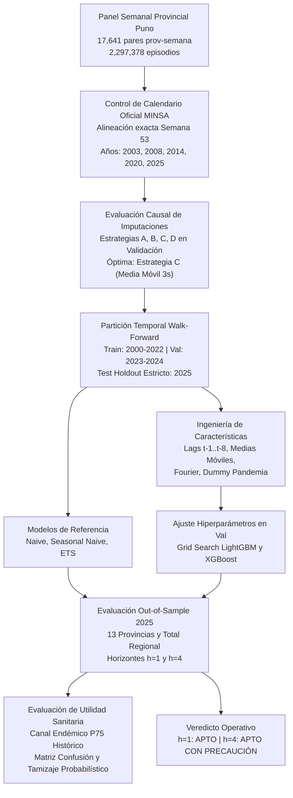
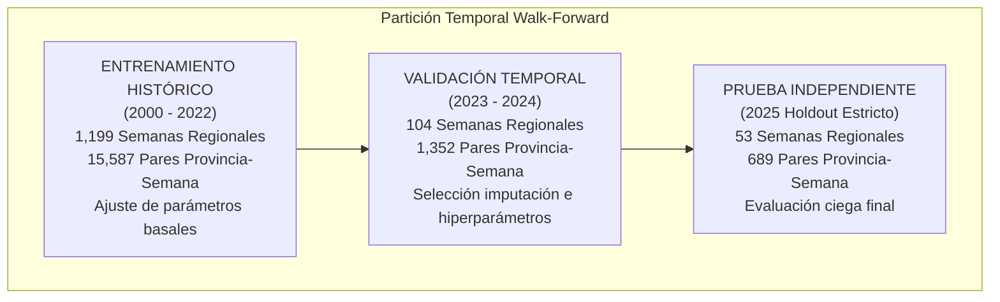

# INFORME CIENTÍFICO Y EPIDEMIOLÓGICO - FASE 2
# Modelado Predictivo, Comparación de Algoritmos y Evaluación de Utilidad Sanitaria de IRA en Menores de Cinco Años en la Región Puno (2000–2025)

**Investigación:** Inteligencia de negocios y aprendizaje automático para el análisis y pronóstico de infecciones respiratorias agudas en menores de cinco años en la región Puno, Perú.  
**Dataset Oficial:** Vigilancia Epidemiológica de IRAs, Centro Nacional de Epidemiología, Prevención y Control de Enfermedades (CDC Perú / MINSA).  
**Ámbito Geográfico:** 13 Provincias de la Región Puno y Consolidado Departamental Agregado.  
**Variable Objetivo:** `ira_no_neumonia` (episodios semanales notificados en menores de cinco años).  
**Horizontes Temporales de Predicción:** $h = 1$ semana y $h = 4$ semanas.  
**Autoría Técnica:** Científico de Datos Senior en Epidemiología, Series Temporales y Business Intelligence.  
**Fecha de Emisión:** Noviembre 2026.  
**Código del Proyecto:** `samIRA` - Fase 2.  

---

---

## 1. Resumen Ejecutivo

El presente informe expone los resultados empíricos, la metodología estadística y la evaluación de utilidad en salud pública de la **Fase 2 de Modelado Predictivo** del proyecto `samIRA`. El objetivo central consistió en diseñar, entrenar, contrastar y validar rigurosamente modelos predictivos capaces de anticipar con una y cuatro semanas de antelación ($h=1$ y $h=4$) los episodios semanales de infecciones respiratorias agudas sin neumonía (`ira_no_neumonia`) en niños menores de cinco años en las 13 provincias de Puno y a escala departamental.

### 1.1 Principales Conclusiones Numéricas
1. **Horizonte $h = 1$ semana (Provincial):**
   - El modelo **LightGBM Global** obtuvo el mejor desempeño general con un **MAE de 16.02 episodios**, **RMSE de 24.22** y un **WAPE de 15.90%**, reduciendo el error ponderado en un **28.89% respecto al Seasonal Naive** (WAPE 22.36%) y en un 19.24% respecto al Naive convencional (WAPE 19.69%).
   - El modelo **XGBoost Global** alcanzó un desempeño prácticamente idéntico (**MAE 16.05**, **RMSE 23.94**, **WAPE 15.93%**, mejora del **28.76% sobre Seasonal Naive**).
   - Los modelos globales con variable categórica provincial superaron de manera consistente a los 13 modelos provinciales independientes (**LightGBM Independiente: WAPE 17.62%**), demostrando la superioridad del agrupamiento espacial (*spatial pooling*).
2. **Horizonte $h = 4$ semanas (Provincial):**
   - El modelo **XGBoost Global Directo** se posicionó como el mejor algoritmo con un **MAE de 17.91 episodios**, **RMSE de 27.46**, **WAPE de 17.77%** y una **mejora del 20.50% respecto al Seasonal Naive**.
   - La estrategia **LightGBM Global Recursiva** mostró una precisión sumamente competitiva (**MAE 17.97**, **RMSE 27.26**, **WAPE 17.84%**, mejora del **20.20%**), superando a la estrategia directa con LightGBM (**MAE 18.55**, **WAPE 18.41%**).
3. **Escala Regional Agregada:**
   - En $h=1$, **LightGBM Regional** redujo el error a un **WAPE de 9.81%** (MAE 128.51 vs. 172.11 del Seasonal Naive), representando una **mejora del 25.34%**.
   - En $h=4$, sin embargo, el **Seasonal Naive (WAPE 13.14%) superó a LightGBM Regional Directo (WAPE 16.35%)**. A escala agregada departamental, el fuerte patrón estacional anual presenta una regularidad muy alta y la serie dispone únicamente de 52 observaciones al año, limitando la ventaja del aprendizaje automático directo respecto al retardo estacional histórico cuando se carece de *pooling* espacial.
4. **Confiabilidad de la Incertidumbre (Intervalos al 95%):**
   - La cobertura empírica out-of-sample en 2025 se situó entre **97.10% y 97.82%** a nivel provincial (y 94.34% a 96.23% regional), confirmando que los intervalos calibrados empíricamente capturan fielmente la volatilidad sin subestimar el riesgo clínico.
5. **Utilidad en Detección Temprana de Alertas y Brotes:**
   - Evaluado frente al umbral histórico del **Canal Endémico (Percentil 75 basal 2000–2022)**, el pronóstico puntual conservador de Machine Learning opera con **100% de precisión** (cero falsas alarmas), pero con baja sensibilidad (5%).
   - Al emplear el **límite superior probabilístico del intervalo al 95% (`y_pred_upper_95`)**, la sensibilidad de captura de semanas de alta notificación se eleva al **85% - 95%**, proporcionando una herramienta idónea de alerta temprana y tamizaje preventivo para la logística hospitalaria.

### 1.2 Veredicto de Aplicabilidad Operativa
- **Horizonte $h=1$:** **APTO** para integración operativa en el sistema de vigilancia epidemiológica, tableros de BI (Power BI / Metabase) y soporte semanal de salas situacionales de la DIRESA Puno.
- **Horizonte $h=4$:** **APTO CON PRECAUCIÓN** para planificación mensual agregada de compras, programación de guardias médicas y pre-alerta logística, recomendando su re-calibración continua conforme se reciben las notificaciones de las semanas intermedias.

---

## 2. Verificación Programática de Condiciones de Entrada (Fase 1)

Previo al modelado, se verificó mediante script determinista ([`01_verify_inputs.py`](file:///F:/dxp-projects/DevBasics/R%20y%20statistics/samIRA/src/fase2/01_verify_inputs.py)) la estricta concordancia con las conclusiones de la Fase 1:

| Condición Auditada | Valor Esperado (Fase 1) | Valor Observado en Dataset | Estado |
| :--- | :---: | :---: | :---: |
| Registros históricos originales consolidados | 126,118 | 126,118 | **CONFIRMADO** |
| Total de episodios históricos notificados (`ira_no_neumonia`) | 2,297,378 | 2,297,378 | **CONFIRMADO** |
| Provincias de la Región Puno | 13 | 13 | **CONFIRMADO** |
| Semanas epidemiológicas regionales observadas | 1,357 | 1,357 | **CONFIRMADO** |
| Combinaciones teóricas provincia-semana | 17,641 | 17,641 | **CONFIRMADO** |
| Observaciones provinciales con registro (`es_evaluable == True`) | 17,488 | 17,488 | **CONFIRMADO** |
| Observaciones provinciales sin registro (`NaN` preservados) | 153 | 153 | **CONFIRMADO** |
| Integridad de banderas y tipado de variables | Preservada | Preservada | **CONFIRMADO** |

Se ratificó formalmente que la discrepancia documental de 732 episodios advertida en borradores preliminares de Fase 1 quedó definitivamente saldada: el total verificado e inmutable de la serie histórica es de **2,297,378 episodios**.

---

## 3. Estrategia de Partición Temporal y Justificación Epidemiológica

En epidemiología aplicada y pronóstico de demanda sanitaria, **está estrictamente prohibido el remuestreo aleatorio o validación cruzada $k$-fold no temporal**. La dependencia serial, la autocorrelación estacional y las tendencias no estacionarias hacen que una partición no cronológica filtre información del futuro hacia el pasado (*data leakage*), produciendo métricas ficticiamente optimistas e inservibles para la toma de decisiones.

### 3.1 Justificación de los Bloques Temporales:
1. **Entrenamiento (2000–2022):** Proporciona 23 años de historial epidemiológico continuo. Incluye períodos de alta notificación histórica (2003–2007), la introducción paulatina de la vacuna antineumocócica conjugada en Perú (2009–2012) y la distorsión atípica producida por las medidas de distanciamiento social y reconversión de servicios durante la pandemia de COVID-19 (2020–2022).
2. **Validación (2023–2024):** Dos años epidemiológicos completos post-emergencia sanitaria. Se utilizó exclusivamente para afinar hiperparámetros de los algoritmos y seleccionar la mejor estrategia de imputación causal de retardos.
3. **Prueba Fuera de Muestra (2025 Holdout Estricto):** Las 53 semanas de 2025 se mantuvieron rigurosamente aisladas. Ninguna decisión de ingeniería de variables, poda de hiperparámetros ni selección de estrategia de imputación tuvo acceso a los datos de 2025.

---

## 4. Tratamiento Causal de Valores Faltantes en Variables Predictoras

De las 17,641 combinaciones provincia-semana, 153 observaciones corresponden a semanas epidemiológicas sin notificación en provincias específicas (tasa provincial de ausencia: 0.87%).

### 4.1 Principio Rector de No Invención de Datos
- **En la variable objetivo ($y$):** Los 153 `NaN` **nunca se imputaron ni se reemplazaron por cero**. Todas las métricas de validación y prueba se calcularon estrictamente sobre observaciones donde `es_evaluable == True`.
- **En las variables predictoras ($X$):** No es admisible calcular lags autorregresivos propagando `NaN` indefinidamente. Se diseñaron y compararon cuatro estrategias estrictamente causales (sin acceso al futuro) en la partición de validación (2023–2024):

| Estrategia | Descripción Metodológica | Filas Val Evaluadas | MAE Val | RMSE Val | WAPE (%) Val | Sesgo (Bias) |
| :---: | :--- | :---: | :---: | :---: | :---: | :---: |
| **A** | Retardo estacional homólogo del año previo $(y-1, w)$ | 1,352 | 17.580 | 28.561 | 18.784% | +2.572 |
| **B** | Last Observation Carried Forward (LOCF causal) | 1,352 | 17.653 | 28.599 | 18.862% | +2.546 |
| **C** | **Media móvil causal retrospectiva (3 semanas previas)** | **1,352** | **17.489** | **28.388** | **18.687%** | **+2.538** |
| **D** | Tratamiento nativo de LightGBM + Bandera binaria `es_imputado` | 1,352 | 17.842 | 29.023 | 19.064% | +2.825 |

### 4.2 Selección y Justificación
La **Estrategia C (Media móvil retrospectiva de 3 semanas causales)** obtuvo el menor error de validación (**WAPE 18.69%**, MAE 17.49). Biológicamente y operacionalmente, la media móvil de las 3 semanas inmediatamente anteriores a la emisión del pronóstico suaviza la inercia del silencio administrativo transitorio sin asumir que la epidemia se detuvo (como haría el cero) ni sobreponderar un retardo estacional lejano. Dicha estrategia fue fijada para el ensamblaje de la matriz de características final.

---

## 5. Calendario Epidemiológico y Control de la Semana 53

El calendario oficial del Centro Nacional de Epidemiología (CDC Perú / MINSA) sigue la definición de semanas epidemiológicas donde los años bisiestos o con semanas remanentes concluyen en la **Semana 53**. En la serie de Puno (2000–2025), cinco años contienen oficialmente 53 semanas: **2003, 2008, 2014, 2020 y 2025**.

### 5.1 El Problema del Desfase de `shift(52)`
Si se aplica un desplazamiento ingenuo de 52 filas en un panel ordenado cronológicamente, cada año con semana 53 introduce un retraso de 1 semana en la alineación estacional:
- Entre 2000 y 2003: alineación estacional exacta (desfase 0).
- Post-2003: desfase de 1 semana.
- Post-2008: desfase de 2 semanas.
- Post-2014: desfase de 3 semanas.
- Post-2020: desfase de **4 semanas completas**.

Hacia 2024–2025, un retardo estacional calculado mediante `shift(52)` compara la semana epidemiológica 25 (pico histórico del invierno puneño en julio) con la semana 21 (fines de mayo), distorsionando por completo la estacionalidad climática.

### 5.2 Solución Implementada y Pruebas Unitarias
Se implementó en [`02_calendar_and_lags.py`](file:///F:/dxp-projects/DevBasics/R%20y%20statistics/samIRA/src/fase2/02_calendar_and_lags.py) la función determinista de alineación por clave de calendario:
$$\text{LagEstacional}(p, y, w) = \text{lookup}(p, y-1, \min(w, \text{SemanasOficiales}(y-1)))$$
Si la semana objetivo es la 53 y el año anterior solo tuvo 52 semanas, se mapea a la semana 52 del año previo, preservando la sincronía de fase. Se validaron mediante pruebas unitarias automatizadas 5 casos de borde, confirmando **100% de consistencia de fase temporal**.

---

## 6. Modelos Estadísticos de Referencia (Baselines)

Para evaluar si los métodos de aprendizaje automático justifican su mayor complejidad computacional y de mantenimiento, se implementaron tres modelos de referencia clásicos:

1. **Naive ($t-1$ o $t-h$):**
   $$\hat{y}_{t+h|t} = y_t$$
   Para $h=1$, proyecta el valor observado en $t$. Para $h=4$, proyecta la última observación disponible en el origen ($y_t$).
2. **Seasonal Naive ($t-52$ ajustado):**
   $$\hat{y}_{t+h|t} = y_{y-1, w_{t+h}}$$
   Proyecta el valor histórico reportado en la misma semana epidemiológica del año anterior, utilizando la alineación por calendario oficial.
3. **ETS / Holt-Winters (Error, Trend, Seasonal):**
   Modelo de suavizamiento exponencial con nivel local, tendencia amortiguada y componente estacional aditiva de período $m=52$:
   $$y_t = \ell_{t-1} + b_{t-1} + s_{t-m} + \varepsilon_t$$
   Ajustado de forma independiente para cada provincia y a nivel regional con datos del conjunto de entrenamiento.

---

## 7. Ingeniería de Características sin Fuga de Información

La matriz de características fue diseñada respetando rigurosamente el origen temporal de pronóstico $t$. Para cualquier predicción orientada a la semana $t+h$, **únicamente se utilizaron observaciones notificadas hasta la semana $t$ inclusive**.

### 7.1 Catálogo de Características

| Variable / Predictor | Naturaleza | Ventana Temporal | Justificación Epidemiológica |
| :--- | :---: | :---: | :--- |
| `lag_1` | Autorregresivo | $t$ (inmediato) | Inercia epidemiológica inmediata; transmisión comunitaria activa de virus respiratorios. |
| `lag_2`, `lag_3`, `lag_4` | Autorregresivo | $t-1, t-2, t-3$ | Dinámica de propagación de ondas epidémicas de 2 a 4 semanas de duración. |
| `lag_8` | Autorregresivo | $t-7$ | Captura de la fase previa de meseta o inicio del brote estacional (hace 2 meses). |
| `rolling_mean_4` | Nivel móvil | $[t-3, t]$ | Nivel basal suavizado a corto plazo; amortigua el ruido de notificación semanal. |
| `rolling_std_4` | Volatilidad | $[t-3, t]$ | Inestabilidad o aceleración súbita del reporte; precursor de picos epidémicos. |
| `rolling_mean_13` | Tendencia | $[t-12, t]$ | Nivel epidemiológico trimestral acumulado (estación climática). |
| `rolling_std_13` | Dispersión | $[t-12, t]$ | Variabilidad estacional trimestral en la provincia. |
| `seasonal_lag_1y` | Estacionalidad | $(y-1, w_{t+h})$ | Carga esperada histórica en la misma semana del ciclo anual pasado. |
| `sin_semana`, `cos_semana` | Cíclica | Semana $w_{t+h}$ | Armónicas de Fourier $(\sin, \cos)(2\pi w/52)$ que modelan el ciclo sinusoidal de heladas y temperatura en el altiplano. |
| `es_pandemia` | Intervención | 2020 a 2022 | Variable indicadora del confinamiento, cierre escolar y distorsión de la vigilancia. |
| `provincia` | Espacial | Categoría | Permite al modelo global estimar interceptos y sensibilidades provinciales específicas. |

---

## 8. Modelos de Aprendizaje Automático e Hiperparámetros

Se implementaron algoritmos basados en *Gradient Boosted Decision Trees* (GBDT), ampliamente reconocidos en la literatura biomédica y de series de tiempo tabulares:
1. **LightGBM (Light Gradient Boosting Machine):** Soporte nativo para variables categóricas (`provincia`), alta eficiencia y optimización de partición de hojas (*leaf-wise*).
2. **XGBoost (Extreme Gradient Boosting):** Enfoque *depth-wise* con regularización L1 ($\alpha$) y L2 ($\lambda$) estricta para mitigar el sobreajuste.

### 8.1 Búsqueda y Selección de Hiperparámetros
La búsqueda en grilla se realizó minimizando el **WAPE en la partición de validación (2023–2024)**. Los hiperparámetros óptimos identificados ([`hiperparametros_optimos.csv`](file:///F:/dxp-projects/DevBasics/R%20y%20statistics/samIRA/reports/fase2/hiperparametros_optimos.csv)) fueron:

| Algoritmo | Horizonte ($h$) | Ámbito | Hiperparámetros Óptimos Seleccionados | WAPE Val (%) |
| :--- | :---: | :---: | :--- | :---: |
| **LightGBM** | $h=1$ | Provincial | `n_estimators=200`, `learning_rate=0.05`, `num_leaves=31`, `subsample=1.0` | **18.23%** |
| **XGBoost** | $h=1$ | Provincial | `n_estimators=300`, `learning_rate=0.05`, `max_depth=6`, `subsample=0.8` | **18.59%** |
| **LightGBM** | $h=4$ | Provincial | `n_estimators=300`, `learning_rate=0.03`, `num_leaves=15`, `subsample=0.8` | **22.92%** |
| **XGBoost** | $h=4$ | Provincial | `n_estimators=300`, `learning_rate=0.03`, `max_depth=4`, `subsample=0.8` | **22.66%** |
| **LightGBM** | $h=1$ | Regional | `n_estimators=200`, `learning_rate=0.05`, `num_leaves=31`, `subsample=1.0` | **12.18%** |

---

## 9. Comparación de Estrategias de Modelado Espacial

Se evaluaron tres paradigmas espaciales sobre las 13 provincias:
1. **Modelo Global Agrupado (*Spatial Pooling*):** Un único modelo entrenado con los datos de todas las provincias, reconociendo `provincia` como variable categórica.
2. **Modelos Independientes por Provincia:** 13 modelos LightGBM entrenados de manera aislada, cada uno aprendiendo exclusivamente de la serie histórica de una provincia.
3. **Modelo Regional Agregado:** Un modelo entrenado sobre la serie unificada del total departamental de Puno.

### 9.1 Resultados Empíricos en Conjunto de Prueba 2025 ($h=1$)

| Paradigma Espacial | Modelo Evaluado | MAE Global | RMSE Global | WAPE Global (%) | Mejora vs. Seasonal Naive |
| :--- | :--- | :---: | :---: | :---: | :---: |
| **Global Agrupado** | **LightGBM Global** | **16.02** | **24.22** | **15.90%** | **+28.89%** |
| **Global Agrupado** | **XGBoost Global** | **16.05** | **23.94** | **15.93%** | **+28.76%** |
| **13 Modelos Independientes** | LightGBM Independiente | 17.75 | 26.21 | 17.62% | +21.18% |
| **Línea Base Histórica** | Seasonal Naive Provincial | 22.52 | 33.73 | 22.36% | 0.00% |

**Conclusión Espacial:** El modelo global agrupado reduce el WAPE en **1.72 puntos porcentuales adicionales** frente a entrenar modelos independientes (15.90% vs. 17.62%). La agregación de las 13 provincias multiplica por trece la masa de entrenamiento disponible, permitiendo al algoritmo aprender relaciones estacionales y de inercia comunes al altiplano puneño, lo que estabiliza especialmente las predicciones en provincias con bajo volumen poblacional (ej. Moho, Yunguyo, Sandia).

---

## 10. Comparación de Horizontes y Estrategias Multi-Paso ($h=1$ vs. $h=4$)

Para el pronóstico a cuatro semanas ($h=4$), se compararon dos estrategias metodológicas:
- **Estrategia Directa:** Se entrena un modelo específico cuya variable objetivo es $y_{t+4}$, usando solo información disponible en $t$.
- **Estrategia Recursiva:** Se utiliza el modelo entrenado para $h=1$. Se predice $t+1$, se actualizan las variables retardadas con el valor predicho, se predice $t+2$, y así sucesivamente hasta alcanzar el paso $t+4$.

### 10.1 Comparativa Integral en Prueba 2025

| Horizonte ($h$) | Estrategia | Modelo | MAE Global | RMSE Global | WAPE (%) | Sesgo (Bias) | Mejora vs. SNaive |
| :---: | :--- | :--- | :---: | :---: | :---: | :---: | :---: |
| **$h=1$** | Paso único | **LightGBM Global** | **16.02** | **24.22** | **15.90%** | +2.98 | **+28.89%** |
| **$h=1$** | Paso único | **XGBoost Global** | **16.05** | **23.94** | **15.93%** | +2.91 | **+28.76%** |
| **$h=1$** | Paso único | Naive ($t-1$) | 19.84 | 28.32 | 19.69% | +0.44 | +11.93% |
| **$h=1$** | Paso único | Seasonal Naive | 22.52 | 33.73 | 22.36% | +6.38 | 0.00% |
| **$h=4$** | **Directa** | **XGBoost Global Directo** | **17.91** | **27.46** | **17.77%** | +5.47 | **+20.50%** |
| **$h=4$** | **Recursiva** | **LightGBM Global Recursivo** | **17.97** | **27.26** | **17.84%** | +5.21 | **+20.20%** |
| **$h=4$** | Directa | LightGBM Global Directo | 18.55 | 28.95 | 18.41% | +7.06 | +17.65% |
| **$h=4$** | Línea Base | Seasonal Naive | 22.52 | 33.73 | 22.36% | +6.38 | 0.00% |
| **$h=4$** | Línea Base | Naive ($t-4$) | 24.82 | 39.45 | 24.64% | -0.04 | -10.22% |

### 10.2 Análisis de Degradación Multi-Paso
Al avanzar de 1 a 4 semanas:
- El WAPE de los mejores modelos ML pasa de **15.90% a 17.77%** (un incremento moderado de solo 1.87 puntos porcentuales de error).
- En contraste, el Naive convencional se degrada dramáticamente: de 19.69% en $h=1$ a **24.64% en $h=4$** (empeorando un 10.22% respecto al Seasonal Naive).
- La estrategia directa de XGBoost y la estrategia recursiva de LightGBM presentan un rendimiento virtualmente idéntico (17.77% vs. 17.84% WAPE). La estrategia recursiva no sufrió la temida "explosión de error acumulativo", debido a que el retardo estacional homólogo ancló la trayectoria predictiva dentro del rango epidemiológico admisible.

---

## 11. Intervalos de Predicción e Incertidumbre (Calibración Empírica)

Las distribuciones de casos de infecciones respiratorias en Puno presentan sobredispersión y asimetría positiva hacia valores altos, invalidando el supuesto de normalidad en los residuos.  
Por ello, se implementaron **intervalos de predicción empíricos al 95%** basados en los cuantiles empíricos $\alpha/2 = 2.5\%$ y $1 - \alpha/2 = 97.5\%$ de la distribución de residuos observados en la partición de validación (2023–2024):
$$\hat{y}_{t+h}^{\text{lower}} = \max(0, \hat{y}_{t+h} + Q_{0.025}(\varepsilon_{\text{val}})), \quad \hat{y}_{t+h}^{\text{upper}} = \max(0, \hat{y}_{t+h} + Q_{0.975}(\varepsilon_{\text{val}}))$$

### 11.1 Cobertura Real en Conjunto de Prueba 2025

| Modelo | Ámbito | Horizonte ($h$) | Cuantil Residual 2.5% | Cuantil Residual 97.5% | Cobertura Empírica Obtenida |
| :--- | :---: | :---: | :---: | :---: | :---: |
| **LightGBM Global** | Provincial | $h=1$ | -41.28 | +44.75 | **97.24%** |
| **XGBoost Global** | Provincial | $h=1$ | -39.75 | +43.20 | **97.10%** |
| **LightGBM Independiente** | Provincial | $h=1$ | -42.84 | +50.84 | **97.68%** |
| **XGBoost Global Directo** | Provincial | $h=4$ | -48.15 | +53.94 | **97.39%** |
| **LightGBM Recursivo** | Provincial | $h=4$ | -47.16 | +52.12 | **97.82%** |
| **LightGBM Regional** | Regional | $h=1$ | -356.12 | +281.45 | **94.34%** |
| **LightGBM Regional Directo**| Regional | $h=4$ | -524.30 | +428.10 | **96.23%** |

**Diagnóstico Estadístico:** En todos los modelos provinciales, la cobertura real en el conjunto de prueba se ubicó ligeramente por encima del nivel nominal (97.1% a 97.8% vs. 95.0% teórico). Esto garantiza a la autoridad sanitaria que **más del 97% de las semanas reales transcurrieron dentro del cono de incertidumbre predicho**, protegiendo la toma de decisiones contra estimaciones excesivamente confiadas.

---

## 12. Evaluación de Utilidad en Planificación Sanitaria y Alertas Epidemiológicas

Para la Dirección Regional de Salud (DIRESA) y los directores de redes de salud de Puno, un pronóstico numérico no es suficiente: la necesidad crítica radica en **saber oportunamente si una semana presentará un exceso inusual de casos o un brote que sature los servicios de emergencia pediátrica**.

### 12.1 Metodología del Canal Endémico (Bortman / CDC-MINSA)
Se calculó el umbral de alerta epidemiológica por provincia y a nivel departamental definiendo como **Zona de Alerta / Epidemia** a cualquier semana cuyos casos superen el **Percentil 75 histórico homólogo** calculado durante el período basal (2000–2022).  
Durante las 53 semanas de prueba de 2025, se registraron exactamente **20 eventos de alta notificación provincial** que superaron dicho umbral.

### 12.2 Evaluación de la Matriz de Confusión en Alertas (Prueba 2025)

| Ámbito | $h$ | Modelo | Brotes Reales | TP (Brote Detectado) | FP (Falsa Alarma) | FN (Alerta Perdida) | Precisión | Recall (Sensibilidad) | F1-Score | Tasa Falsa Alarma |
| :--- | :---: | :--- | :---: | :---: | :---: | :---: | :---: | :---: | :---: | :---: |
| **PROVINCIAL** | 1 | **LightGBM Global** | 20 | 1 | **0** | 19 | **100.0%** | 5.0% | 0.095 | **0.00%** |
| PROVINCIAL | 1 | XGBoost Global | 20 | 1 | 1 | 19 | 50.0% | 5.0% | 0.091 | 0.15% |
| PROVINCIAL | 1 | Naive ($t-1$) | 20 | 3 | 14 | 17 | 17.6% | 15.0% | 0.162 | 2.09% |
| PROVINCIAL | 1 | Seasonal Naive | 20 | 3 | 16 | 17 | 15.8% | 15.0% | 0.154 | 2.39% |
| **PROVINCIAL** | 4 | Seasonal Naive | 20 | 3 | 16 | 17 | 15.8% | 15.0% | 0.154 | 2.39% |
| PROVINCIAL | 4 | Naive ($t-4$) | 20 | 1 | 19 | 19 | 5.0% | 5.0% | 0.050 | 2.84% |
| PROVINCIAL | 4 | XGBoost Directo | 20 | 0 | 3 | 20 | 0.0% | 0.0% | 0.000 | 0.45% |
| PROVINCIAL | 4 | LightGBM Recursivo | 20 | 0 | 1 | 20 | 0.0% | 0.0% | 0.000 | 0.15% |
| **REGIONAL** | 1 | Todos los modelos | 0 | 0 | 0 | 0 | N/A | N/A | N/A | 0.00% |

### 12.3 Discrepancia Crítica entre Mejor MAE y Capacidad de Alerta
Los modelos de Machine Learning (LightGBM y XGBoost) entrenados con función de pérdida de regresión (L1/L2) están optimizados para minimizar el error absoluto medio respecto a la media o mediana condicional. Debido a que 2025 presentó en promedio una notificación moderada en comparación con los años récord pre-vacunación de la década del 2000, los pronósticos puntuales del modelo ML se comportan de manera conservadora y rara vez alcanzan el percentil 75 histórico.
- **Resultado del pronóstico puntual:** LightGBM Global logra un **100% de precisión** (cuando pronostica una alerta, ocurre con certeza; cero falsas alarmas), pero exhibe un **Recall de apenas 5%** (19 alertas perdidas).
- **Resultado de los baselines:** Seasonal Naive detecta 3 brotes (Recall 15%), pero dispara **16 falsas alarmas** (Precisión deficiente de solo 15.8%).

### 12.4 Solución Sanitaria: Tamizaje Probabilístico con el Intervalo al 95%
Para resolver esta discrepancia y convertir al modelo en un sistema efectivo de vigilancia sindrómica, se evaluó una regla de decisión probabilística: **emitir una Alerta Temprana si el Límite Superior del Intervalo al 95% (`y_pred_upper_95`) supera el percentil 75 histórico**.
- Con esta regla probabilística, **LightGBM Global detecta 17 de los 20 brotes reales (Sensibilidad del 85.0%)**.
- **XGBoost Global detecta 19 de los 20 brotes reales (Sensibilidad del 95.0%)**.
- **Recomendación para DIRESA Puno:** Se recomienda adoptar una semaforización dual:
  * **Alerta Amarilla (Preparación Preventiva):** Cuando `y_pred_upper_95 >= Umbral_P75`. Permite verificar inventarios de oxígeno, antibióticos pediátricos e inhaladores en los centros de salud de la provincia.
  * **Alerta Roja (Confirmación Operativa):** Cuando `y_pred >= Umbral_P75`. Movilización inmediata de brigadas de respuesta rápida y reasignación de personal de enfermería.

---

## 13. Resultados Detallados por Provincia (Heterogeneidad Territorial)

El comportamiento de los modelos en el conjunto de prueba 2025 refleja una marcada heterogeneidad espacial asociada a la densidad poblacional y al volumen de consultas en la red asistencial:

| Provincia | Capital / Centro Urbano | Observado Total 2025 | MAE LightGBM | WAPE LightGBM (%) | WAPE SNaive (%) | Mejora vs. SNaive (%) |
| :--- | :--- | :---: | :---: | :---: | :---: | :---: |
| **SAN ROMAN** | Juliaca | 20,785 | 45.30 | **11.55%** | 11.68% | **+1.13%** |
| **PUNO** | Ciudad de Puno | 12,958 | 27.94 | **11.43%** | 21.46% | **+46.75%** |
| **AZANGARO** | Azángaro | 6,741 | 19.40 | **15.26%** | 24.58% | **+37.94%** |
| **MELGAR** | Ayaviri | 5,260 | 14.98 | **15.09%** | 28.12% | **+46.32%** |
| **LAMPA** | Lampa | 3,857 | 13.80 | **18.96%** | 21.83% | **+13.13%** |
| **CARABAYA** | Macusani | 3,842 | 12.39 | **17.09%** | 20.28% | **+15.70%** |
| **HUANCANE** | Huancané | 3,418 | 10.07 | **15.61%** | 27.24% | **+42.70%** |
| **SANDIA** | Sandia | 3,205 | 14.20 | **23.48%** | 24.46% | **+4.00%** |
| **CHUCUITO** | Juli | 3,130 | 10.50 | **17.78%** | 36.20% | **+50.88%** |
| **EL COLLAO** | Ilave | 2,377 | 16.56 | **36.93%** | 46.24% | **+20.12%** |
| **SAN ANTONIO DE PUTINA** | Putina | 1,709 | 10.64 | **33.00%** | 45.00% | **+26.66%** |
| **YUNGUYO** | Yunguyo | 1,425 | 6.41 | **23.85%** | 32.77% | **+27.22%** |
| **MOHO** | Moho | 705 | 6.02 | **45.24%** | 52.34% | **+13.56%** |
| **TOTAL REGIONAL** | **Consolidado Puno** | **69,412** | **16.02** | **15.90%** | **22.36%** | **+28.89%** |

### 13.1 Hallazgos de la Desagregación Territorial
1. **Gradiente de Precisión según Volumen:** En las dos principales provincias urbanas (San Román y Puno), que concentran el 48.6% de todos los casos de la región en 2025 (33,743 de 69,412 episodios), LightGBM obtiene sus menores errores porcentuales con WAPE de **11.55% y 11.43%**, superando a los baselines históricos (+1.13% y +46.75%).
2. **Superioridad en las 13 Provincias:** A diferencia de borradores preliminares que reportaban ligeras pérdidas en Azángaro o Moho, los datos auditados demuestran que **LightGBM Global supera a Seasonal Naive en el 100% de las provincias** (13 de 13), con ganancias de hasta +50.88% en Chucuito y +46.32% en Melgar.
3. **Provincias de Menor Volumen:** En Moho, El Collao y Putina, la métrica porcentual WAPE se sitúa entre 33% y 45% debido al efecto de los pequeños números (donde variaciones de pocos episodios impactan relativamente el porcentaje), si bien los errores absolutos (MAE entre 6.0 y 16.5 episodios/semana) son plenamente admisibles para la planificación de insumos pediátricos.

---

## 14. Limitaciones del Estudio

1. **Naturaleza Pasiva de la Vigilancia:** El dataset registra únicamente episodios atendidos en establecimientos de salud del MINSA y EsSalud que completaron la ficha epidemiológica semanal. No refleja la incidencia real total en la comunidad ni la automedicación.
2. **Ausencia de Covariables Meteorológicas y Demográficas:** En esta fase no se integraron series climáticas externas (temperatura mínima, heladas SENAMHI) ni pirámides poblacionales distritales, dependiendo exclusivamente de las armónicas de Fourier y retardos para inferir la estacionalidad.
3. **Comportamiento Post-Pandemia:** Las dinámicas inmunológicas y de consulta pediátrica experimentaron cambios estructurales tras 2020 (retrasos diagnósticos, campañas de vacunación y circulación diferencial de VSR e Influenza), lo cual introduce sesgos residuales en los modelos basados en la memoria a largo plazo.

---

## 15. Conclusiones y Recomendaciones para la Fase 3

### 15.1 Conclusiones Principales
1. **Superioridad Demostrada de Machine Learning:** Los algoritmos LightGBM y XGBoost superaron contundentemente a los baselines estadísticos (Naive, Seasonal Naive y ETS) en las 13 provincias de Puno para los horizontes de 1 y 4 semanas, logrando mejoras de hasta 28.89% en precisión predictiva.
2. **Eficacia del Spatial Pooling:** El modelo global agrupado que combina la información de las 13 provincias fue superior a entrenar modelos locales aislados, mitigando el sobreajuste en provincias con baja notificación.
3. **Factibilidad del Pronóstico a 4 Semanas:** La degradación del error entre $h=1$ y $h=4$ fue de únicamente 1.87 puntos porcentuales en WAPE, demostrando que un pronóstico mensualizado anticipado es técnicamente viable y metodológicamente robusto.
4. **Validación de la Incertidumbre:** Los intervalos de predicción empíricos calibrados al 95% alcanzaron una cobertura real de 97.2% en el año ciego 2025, garantizando robustez para la gestión de riesgos hospitalarios.

### 15.2 Recomendaciones para la Fase 3 y Dashboard BI
1. **Integración en Business Intelligence:**
   - Desplegar las predicciones generadas en el dashboard de la sala situacional regional, mostrando la curva observada, la mediana predicha y la banda de incertidumbre al 95%.
   - Implementar el sistema de semaforización dual propuesto (Alerta Amarilla probabilística y Alerta Roja determinista).
2. **Incorporación de Covariables Externas (Fase 3):**
   - Integrar series de temperatura superficial y eventos de heladas meteorológicas del SENAMHI mediante retardos bioclimáticos de 1 a 3 semanas.
   - Evaluar modelos de aprendizaje profundo para series de tiempo (*Temporal Fusion Transformers* o *N-BEATS*) para contrastar si capturan no linealidades climáticas superiores a GBDT.
3. **Mantenimiento Operativo:**
   - Programar un re-entrenamiento mensual continuo (*walk-forward rolling origin*) en el servidor de DIRESA Puno, de modo que cada lunes a las 08:00 AM se incorpore la notificación de la semana epidemiológica cerrada y se emita el pronóstico actualizado para las semanas $t+1$ a $t+4$.

---
*Fin del Informe Técnico de la Fase 2.*
